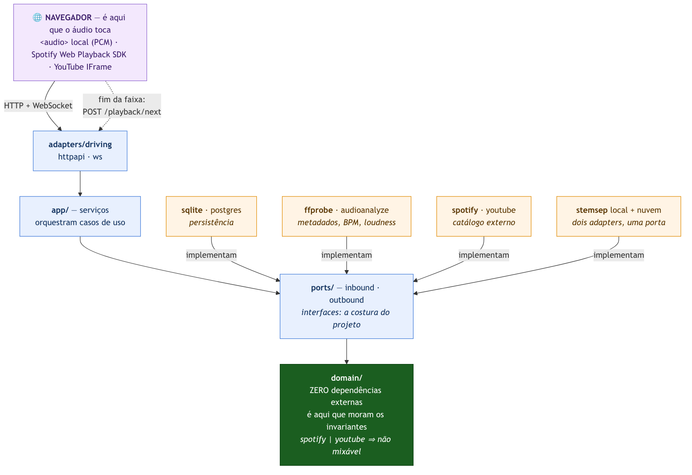
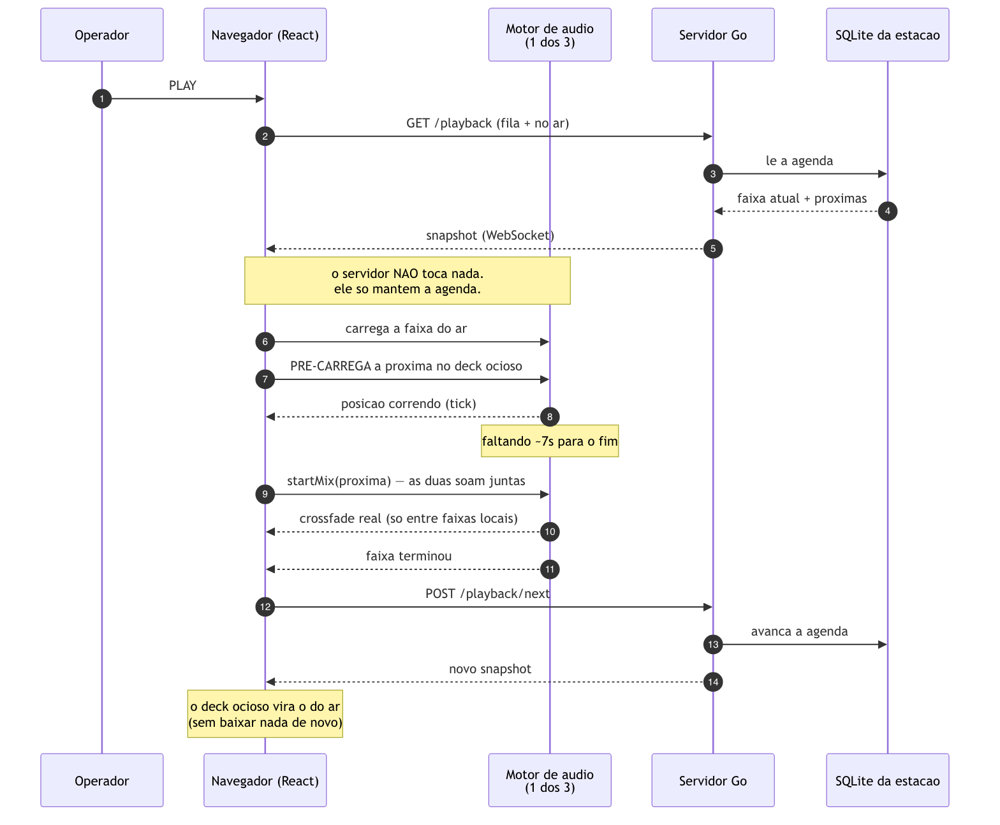
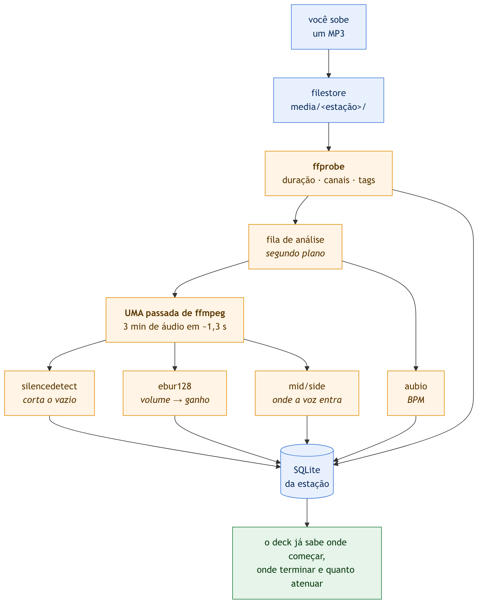
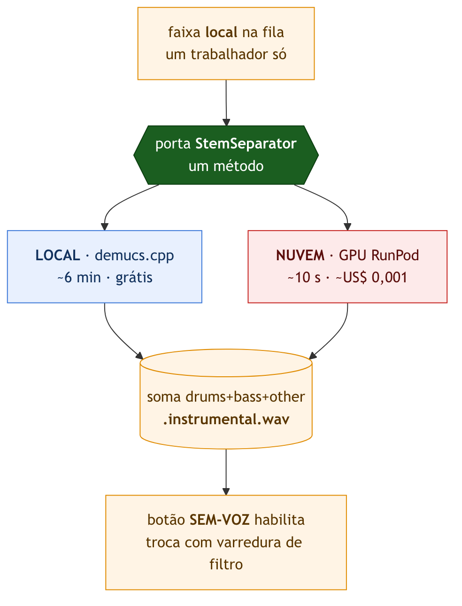
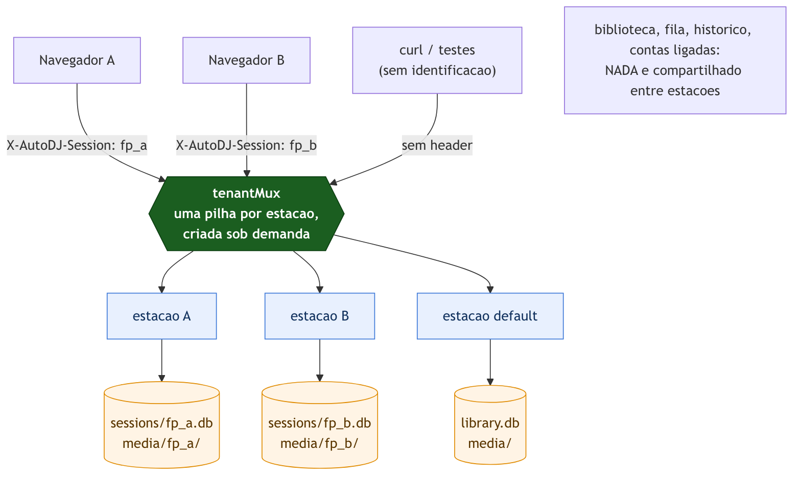

# AutoDJ

**Suas músicas tocando sozinhas, com mixagem de DJ.**

Um tocador que faz a fila andar sem ninguém olhando e mixa a virada entre uma
faixa e outra como um DJ faria. Toca **arquivos seus**, **Spotify** e **YouTube**
na mesma fila, dentro do navegador.

> Não é automação de rádio. Existe um **modo Rádio opcional** (grade de
> programação, vinhetas, relógios, RDS) para quem quiser, mas o padrão do app é
> o modo **Tocador** — o seu acervo tocando sozinho. Transmissão por servidor
> (Liquidsoap/Icecast) foi descontinuada.

Go hexagonal (backend) + Next.js (interface). Licença **MIT** (veja [LICENSE](LICENSE)).
Instância do autor: <https://autodj.andrebassi.com.br>

> **Documentação e interface são em português.** O código — funções, variáveis, tipos,
> classes CSS — é em inglês. Se for contribuir, veja [CONTRIBUTING.md](CONTRIBUTING.md).

**Índice**

1. [O que é](#o-que-é) — os avisos honestos, o essencial em 1 minuto, os três motores
2. [Usar](#usar) — subir, tocar, SEM-VOZ, Spotify, YouTube, seus dados
3. [Como funciona por dentro](#como-funciona-por-dentro) — a pilha e cinco diagramas
4. [Contribuir e referência](#contribuir-e-referência) — testes, deploy, variáveis, roadmap

---

# O que é

### Antes de usar, três avisos honestos

1. **Você traz suas próprias credenciais.** Nada de chave embutida: Spotify e YouTube
   só ligam com id/segredo seus, e a separação de vocal na nuvem gasta dinheiro da SUA
   conta do RunPod, sem teto automático. Rodar sem credencial nenhuma funciona — só as
   suas músicas locais.
2. **A busca do YouTube sem login usa a API interna (InnerTube), não a oficial.** Isso
   contraria os Termos de Serviço do YouTube. Está no projeto porque a API oficial custa
   ~100 unidades de cota por busca (≈100 buscas/dia) e exige conta. **Use por sua conta e
   risco** — ou configure a Data API oficial com sua chave e não dependa desse caminho.
   Importar colando link e tocar não passam por ele.
3. **Não há garantia** (é o que a MIT diz em maiúsculas). Isto toca música ao vivo; se
   você depende disso profissionalmente, teste antes.

### O essencial em 1 minuto

- **O áudio toca no seu navegador**, não no servidor. O servidor é o cérebro:
  guarda a biblioteca, decide a próxima faixa, mantém o now-playing.
  Fechou a aba, parou o som.
- **Três motores de áudio**, escolhidos automaticamente pela origem da faixa:
  `<audio>` (arquivos seus), Spotify Web Playback SDK, YouTube IFrame Player.
  Você não escolhe nada — a faixa entra e o deck chaveia sozinho.
- **Cada navegador é uma estação independente.** Biblioteca, fila, grade,
  cartwall e arquivos são separados. Ninguém enxerga nem apaga o material do outro.
- **Nada é instalado.** Abre a URL e usa.

### Os três motores, e por que isso muda tudo

Spotify e YouTube são DRM: o navegador toca, mas **não entrega o PCM**. Sem PCM
não há crossfade real, beatmatch nem waveform. Arquivo local entrega PCM e
permite tudo. Isso bifurca o produto inteiro — não é um botão de UI:

| Origem | PCM | crossfade | beatmatch | waveform | mixável | ECAD |
|---------|-----|-----------|-----------|----------|---------|------|
| local   | sim | sim       | sim       | sim      | sim     | sim  |
| spotify | NÃO | só fade   | NÃO       | NÃO      | NÃO (ToS) | NÃO |
| youtube | NÃO | só fade   | NÃO       | NÃO      | NÃO     | NÃO |
| line_in | sim | sim       | não       | não      | sim     | parcial |
| tts     | sim | sim       | não       | não      | sim     | n/a |

As invariantes `spotify ⇒ mixable=false` e `youtube ⇒ mixable=false` valem em
**duas camadas**: domínio (`Track.Validate` re-deriva os flags) e banco
(CHECK `spotify_never_mixable` / `youtube_never_mixable`).

**Na prática, o que você vê:** entre duas faixas locais, mixagem de verdade.
Com Spotify ou YouTube envolvido, fade de volume nos dois lados ao mesmo tempo
(as duas tocam juntas na virada) — sem beatmatch. O deck troca de motor sozinho
e mantém o mesmo tamanho na tela.

---

# Usar

### Subir na sua máquina (Nix — NUNCA Docker)

> Regra do projeto: recurso **local** sobe via **Nix**. Docker só para deploy
> remoto (Fly.io).

```bash
nix develop            # shell com go, node, ffmpeg
task serve             # server + web/out juntos (:8099)  ← o caminho curto
```

Outros modos:

```bash
task up                # Postgres via services-flake (opcional)
task dev               # API Go (:8095) — repo em memória se não houver env
task web:dev           # Next.js (:3000)
```

Sem Nix, o servidor Go sobe sozinho com repositório em memória:

```bash
GOWORK=off PORT=8095 go run ./cmd/server
```

Abra sempre `http://localhost:<porta>` — **nunca** `127.0.0.1`. O redirect de
OAuth e a identidade da estação diferem entre os dois hostnames, e o YouTube não
incorpora clipe monetizado a partir de origem que seja um IP literal.

Para encher a biblioteca rápido:

```bash
task lib:scan FOLDER=/caminho/para/mp3s   # varre uma pasta
task playback:load                        # carrega faixas na fila
```

### Da biblioteca até tocar

1. **Adicionar Mídia** — sobe seus arquivos (até **256 MB** cada; `mp3`, `flac`,
   `wav`, `ogg`, `m4a`, `aac`, `opus`, `aiff`), ou `task lib:scan` para varrer
   uma pasta.
2. **Aba Spotify / YouTube** — conecta a conta, busca, importa pra biblioteca.
3. Arraste pra fila (ou use o menu da faixa) e dê **PLAY**.
4. A partir daí anda sozinho: no fim de cada faixa o deck avisa o servidor
   (`POST /playback/next`), o próximo carrega no outro deck e a virada acontece.

### SEM-VOZ — tocar a música sem o vocal

Botão **`🎼 SEM-VOZ`** no transporte. Ligado, a faixa local toca a **versão sem
voz** no lugar do arquivo original; o deck mostra o selo `SEM-VOZ` e a lista de
músicas marca quais já estão prontas.

**Não é um filtro em tempo real — é um arquivo preparado antes.** A separação usa o
modelo **Demucs**, que precisa processar a música inteira: em torno de 6 minutos na
CPU de um Mac, ou ~10 segundos numa GPU alugada. Por isso o botão só liga em faixa
já preparada; sem preparo, ele vira **`✨ PROCESSAR SEM-VOZ (IA)`** e o clique
enfileira o trabalho.

Quando você troca, a música não corta: o grave vai saindo num filtro varrendo, a
voz se despede, a versão sem voz entra por baixo e o grave volta — cerca de 6
segundos, como uma virada de DJ.

**Por que isso funciona e o "karaokê" clássico não:** subtrair um canal do outro
apaga o que está no centro da imagem estéreo, onde a voz costuma ficar. Medimos numa
música real: aquele método tira **2 dB** de voz (praticamente nada), enquanto o
modelo tira **32 dB**. Por isso o método antigo foi aposentado.

**Onde a separação roda** — dois caminhos, mesma função:

| | como ligar | velocidade | custo |
|---|---|---|---|
| **Na sua máquina** | `scripts/build-demucs.sh` (compila o `demucs.cpp`, baixa 80 MB de pesos) | ~6 min por música de 4 min | zero |
| **Numa GPU alugada** | `AUTODJ_RUNPOD_API_KEY` | ~10 s por música | ~US$ 0,001 por faixa |

Sem nenhum dos dois a função **some da tela** — o servidor responde 404 e a UI
esconde o botão, em vez de oferecer algo que só pode falhar. Com os dois, o local
tem prioridade (é grátis); `AUTODJ_STEMSEP=cloud` força a nuvem.

**Lote:** `task stems:cloud` prepara tudo que falta, mostrando a estimativa de custo
antes de confirmar.

### GPU alugada, em detalhe (RunPod)

O AutoDJ sobe um pod GPU, manda o áudio, recebe a versão sem voz e **derruba o pod**.
Você paga por segundo — o acervo inteiro de 83 faixas sai por menos de **US$ 0,10**,
uma vez. (A alternativa que testamos, um servidor dedicado capaz de fazer isso,
custava **US$ 124 por mês**.)

Três decisões que valem entender, porque explicam o custo:

**O pod é um serviço, não uma tarefa por música.** Ele sobe uma vez, carrega o
modelo e atende várias faixas. Subir e instalar o Demucs leva ~3 minutos **pagos**;
num pod por faixa, cada música pagaria isso de novo — mais caro que a separação em
si.

**Ele fica ligado 2 minutos após a última faixa.** É o que faz a segunda música de
um lote custar 10 segundos em vez de 3 minutos. O preço é GPU parada nesse intervalo
(~US$ 0,009). Processar em sequência é bem mais barato que espaçado.

**O AutoDJ vigia e mata o pod.** A auto-terminação da nuvem não é confiável — em
teste, o pod terminou o trabalho e foi **reiniciado**, refazendo tudo. Pior: a API
responde "ok" mesmo quando não termina. Então quem lançou confere, insiste e só
sossega quando a API diz que o pod não existe mais.

⚠️ **Com a chave configurada, o servidor gasta dinheiro sozinho** quando alguém
clica em processar. Não há teto automático de gasto — o freio é o desligamento por
ociosidade. Em produção isso é uma decisão consciente.

### Spotify

Buscar e importar funciona com conta grátis. **Tocar no deck exige Spotify
Premium** — exigência do Web Playback SDK, não nossa. O painel mostra o estado
da conta ("● Conectado · Premium" ou "· sem Premium"). Sem as credenciais no
servidor, a aba não aparece (rotas dão 404).

### YouTube

Toca vídeo que permita incorporação. Vídeo bloqueado pra embed ou por região é
pulado.

A aba tem **duas sub-abas** e **login do Google é opcional**:

- **Colar links — sem conta nenhuma.** Cole os endereços num campo só, separados
  por `;` (vírgula, quebra de linha ou espaço também servem), até **50 por vez**;
  vão todos pra fila na ordem colada. Aceita `watch?v=`, `youtu.be/`, `/shorts/`,
  `/embed/` e o id cru.
- **Buscar — dois motores, um clique pra trocar.** Um chaveador em cima dos
  resultados escolhe quem faz a busca:
  - **⚡ Sem login** (padrão): consulta o YouTube direto, **sem conta e sem gastar
    cota**. Resolve a maioria dos casos.
  - **🔐 Minha conta**: a busca oficial do Google, de sempre. Pede a conta
    conectada e consome a cota (~100 buscas/dia), em troca do filtro de
    incorporação do próprio YouTube.

  Nada foi removido — os dois convivem, e trocar de motor refaz a busca sozinho.
  Por que o motor da conta ainda pede login? Freio de cota: cada busca dele custa
  ~100 unidades das ~10.000/dia (≈100 buscas), enquanto resolver links colados
  custa **1 unidade por lote**. O login segura a torneira cara; as baratas ficam
  abertas.

Entrou menos que o colado (ou que o buscado)? Vídeo que não permite incorporação
é descartado — a tela diz quantos. No motor **⚡ Sem login** isso só aparece na
importação, porque a filtragem prévia do Google só existe no motor da conta.

### Seus dados, e como fazer backup

Áudio fica **em arquivo no disco**, não dentro do banco. O banco guarda só os
metadados (título, artista, duração, BPM, marcadores, categoria) e o caminho.

```
~/.autodj/
├── library.db                 ← banco da estação "default"
├── sessions/
│   └── <id-da-estação>.db     ← um banco por estação
└── media/
    ├── <id-da-estação>/       ← seus uploads (desde a 0.2.16)
    │   ├── intro.mp3
    │   └── vinheta.wav
    └── musica-antiga.mp3      ← acervo anterior à 0.2.16, ainda funciona
```

**Backup:** copie `~/.autodj/` inteiro (banco + mídia). Em produção (Fly.io) essa
árvore fica no volume `autodj_data`, montado em `/root/.autodj` — sobrevive a
deploy e restart.

**Qual estação é a minha?** A identidade é o navegador, não uma conta
(o [diagrama 5](#5-por-que-cada-navegador-é-uma-estação) explica o mecanismo):

| Situação | Resultado |
|---|---|
| Mesmo navegador, mesma máquina | mesma estação, tudo no lugar |
| Outro navegador, ou outra máquina | **outra estação**, começa vazia |
| Aba anônima | outra estação (o `localStorage` não persiste) |
| Limpou dados do site | perde o id → cai numa estação nova, vazia |

⚠️ **Não existe login que carregue sua estação entre dispositivos.** Trocou de
máquina, é uma estação nova.

**Spotify e YouTube não ocupam disco.** Faixa dessas fontes é **referência**, não
arquivo: guardamos o URI e a capa. Nada é baixado. Se você perder o acesso à
conta, essas faixas param de tocar — só o material local é realmente seu.

---

# Como funciona por dentro

## A pilha, e por que cada peça está aí

| Camada | Tecnologia | Por que essa e não outra |
|---|---|---|
| Interface | **Next.js 15 + React 19** (export estático) | O playout mora aqui; export estático significa que o servidor Go serve a UI sem processo Node em produção |
| Áudio | **Web Audio + `<audio>` + SDKs de terceiros** | O navegador já resolve decode, buffer e Range/seek. Reimplementar isso no servidor seria refazer o que o Chrome faz melhor |
| Servidor | **Go 1.26, arquitetura hexagonal** | Um binário só, sem runtime; o domínio isolado é o que permitiu trocar a separação de vocal de CPU local para GPU alugada sem tocar em domínio, fila ou interface |
| Persistência | **SQLite** (`modernc.org/sqlite`, Go puro) | Sem daemon, um arquivo por estação. Postgres existe como adapter e só entra se um dia houver multiusuário de verdade |
| Áudio (análise) | **ffmpeg / ffprobe / aubio** | Ferramentas maduras, chamadas por shell-out. Reescrever análise de áudio em Go seria projeto próprio |
| Separação de voz | **Demucs v4** — `demucs.cpp` local ou PyTorch em GPU | Dois adapters, uma porta. É o exemplo mais concreto do retorno da arquitetura |
| Ambiente local | **Nix** (`flake.nix`) | Mesmo toolchain em qualquer máquina, sem daemon e sem imagem pesada |
| Deploy | **Docker + Fly.io** | Docker só para empacotar o remoto — nunca para desenvolvimento local |

Cinco perguntas, cinco diagramas. Se você só for ler uma parte deste README, leia
esta.

## 1. Onde cada coisa mora

O servidor **não toca áudio**. Ele mantém a agenda (o que está no ar, o que vem
depois) e responde a quem pergunta. Quem produz som é o navegador.



Repare na direção das setas: **tudo aponta para dentro**. `adapters → ports →
domain`, e o domínio não importa nada externo — nem banco, nem HTTP, nem SDK. As
setas de fora (`sqlite`, `ffprobe`, `spotify`, `stemsep`) chegam nas *portas*, que
são interfaces declaradas pelo domínio.

Isso não é purismo: é o que permitiu, num sábado, plugar uma GPU alugada como
segunda implementação de `StemSeparator` sem alterar **uma linha** de domínio, de
fila ou de interface. A porta tem um método só.

```
domain/{shared,library,playback,spotify,youtube}   modelo puro, zero deps
ports/{inbound,outbound}                           interfaces
app/                                               serviços
adapters/driven/{library,ffprobe,filestore,memory,sqlite,postgres,spotify,youtube,stemsep,stubengine}
adapters/driving/{httpapi,ws}
cmd/{server,migrate}
web/                                               Next.js (static export)
migrations/                                        schema Postgres
flake.nix / Taskfile.yaml                          stack local (Nix)
Dockerfile / fly.toml / deploy/                    remoto (Fly.io)
docs/                                              AIOX SDD (prd, architecture, stories)
```

## 2. Quem manda a música tocar



O ponto que costuma surpreender: **o navegador é quem dirige a fila**. O servidor
não tem relógio de música — ele só sabe qual é a ordem. Quando a faixa acaba (ou o
deck decide que acabou), o navegador chama `POST /playback/next` e o servidor
avança a agenda.

Duas consequências práticas:

- **A próxima faixa já está carregada** antes de entrar no ar. Os dois decks fazem
  ping-pong: enquanto A toca, B baixa. A virada não espera rede.
- **A mixagem acontece antes do fim**, com as duas faixas soando juntas — e a fila
  do servidor **não é adiantada**. A faixa que entra toca "por fora" e é adotada
  pelo motor quando o servidor finalmente a promove.

## 3. O que acontece quando você sobe um arquivo



O caminho completo do clique em **Adicionar Mídia**:

1. O arquivo sobe inteiro (`POST /api/v1/library/upload`, multipart, até 256 MB).
2. É gravado em `media/<sua-estação>/<nome>`. O nome é sanitizado (sem `../`, sem
   barras) e **arquivo de mesmo nome sobrescreve o anterior** dentro da sua estação.
3. O `ffprobe` lê duração, canais, artista, álbum e capa embutida.
4. A faixa entra na biblioteca com id = `sha1` do caminho, e **já aparece na lista**.
5. A análise roda em segundo plano.

Deu erro em qualquer passo depois do 2, o arquivo é apagado — não fica lixo.

O detalhe que vale copiar é o passo 5: **uma passada só de ffmpeg** produz três
sinais diferentes (onde cortar o vazio, quanto atenuar, onde a voz entra), porque
`asplit=3` alimenta três filtros no mesmo decode. Três medições, um decode: 3
minutos de áudio em ~1,3 s.

O que sai disso vira **marcador** na faixa, não coluna nova — e marcador o operador
pode arrastar. A marca automática e a marca feita à mão dirigem o deck do mesmo
jeito, com uma fonte de verdade só.

## 4. Como a voz sai da música



Não é filtro ao vivo: é **arquivo preparado antes**. A versão anterior tentou fazer
ao vivo, por cancelamento de centro, e foi aposentada por medição em música real —
**2,0 dB** de redução de voz contra **31,9 dB** do modelo. Dois decibéis não é
"tirar a voz", é não fazer nada audível.

O instrumental é a **soma** de bateria + baixo + outros. Subtrair o vocal do
original seria mais óbvio e está errado: devolveria, com fase invertida, o resíduo
que o modelo *não* separou — o defeito sai do lugar errado e vira artefato.

## 5. Por que cada navegador é uma estação



Não há tela de login. A identidade é a **impressão digital do navegador**
(FingerprintJS, guardada no `localStorage`), enviada em toda chamada — header
`X-AutoDJ-Session` no REST, `?sid=` no WebSocket. O servidor usa esse id para achar
**o seu** banco e **a sua** pasta de mídia; quem chega sem identificação (curl,
testes) cai numa estação `default`.

Duas estações podem subir `intro.mp3` no mesmo minuto sem se atrapalhar: cada uma
grava na própria pasta, os ids diferem e **apagar a faixa de uma nunca toca no
arquivo da outra**. Arquivos soltos na raiz do `media/` (acervo anterior à 0.2.16)
continuam tocando e continuam removíveis — nada foi movido nem renomeado na
atualização.

É decisão de produto para uso caseiro, não descuido — e está registrada como tal
em [SECURITY.md](SECURITY.md). O backend de autenticação existe inteiro e é a
alavanca para fechar o acesso quando for preciso.

> Os diagramas são gerados dos fontes em [`docs/diagramas/*.mmd`](docs/diagramas)
> (Mermaid). Editou um? `mmdc -i arquivo.mmd -o arquivo.png -b white -s 2`.

---

# Contribuir e referência

## Testes

```bash
task test          # go test ./... -cover
task cover         # gate: domain 100%, adapters/app >=90% (CI bloqueia)
task smoke:media   # sobe o servidor e prova o isolamento de mídia por estação
```

`smoke:media` faz o teste de verdade: sobe o servidor com `HOME` descartável,
envia o mesmo `intro.mp3` por duas sessões e verifica que os arquivos não se
sobrescrevem, que os ids diferem, que cada estação enxerga só a sua faixa e que
apagar de uma não mexe na outra.

`postgres` e `cmd/*` são integration-tier (fora do gate unitário).

As regras que um PR precisa respeitar estão em [CONTRIBUTING.md](CONTRIBUTING.md).

## Deploy (Fly.io)

Uma máquina roda a API Go + o web estático (`Dockerfile`, `fly.toml`,
`deploy/entrypoint.sh`). Docker é usado **só aqui**. SQLite e mídia persistem no
volume `autodj_data` em `/root/.autodj`. O container roda como usuário sem
privilégio (`app`, uid 10001), não como root.

```bash
task deploy    # gate de changelog + fly deploy --build-arg APP_VERSION=v<git-tag>
```

Toda versão **precisa** de entrada em `web/app/lib/changelog.ts` batendo com a
tag git mais recente — `scripts/changelog-check.sh` aborta o build sem isso.

Fluxo de release: commit em `develop` → doc + changelog + `git tag vX.Y.Z` →
merge em `main` → `task deploy` → volta pra `develop`. `main` só recebe o que
sobe pra produção.

### A versão no titlebar

`scripts/app-version.sh` é o ponto único que resolve o número exibido:

| Estado do repositório | Versão exibida |
|---|---|
| HEAD exatamente na tag, árvore limpa | `v0.2.16` — release |
| commit depois da tag | `v0.2.17-dev.c23d2a1` |
| alteração não commitada | `v0.2.17-dev.c23d2a1.dirty` |

Se o número tem **`-dev`**, aquele bundle não é o de produção. Isso vale
inclusive para o deploy: subir fora da tag rotula a imagem como `-dev`, então o
titlebar de produção nunca se apresenta como um release que não é.

## Variáveis de ambiente (servidor)

### Armazenamento

| Var | Efeito |
|-----|--------|
| `DATABASE_URL` | usa Postgres; sem ela → SQLite por estação |
| `AUTODJ_DB_PATH` | `memory` → repo efêmero por estação (dev/teste) |
| `AUTODJ_SESSIONS_DIR` | pasta dos bancos por estação (default `~/.autodj/sessions`) |
| `AUTODJ_MEDIA_DIR` | raiz da mídia (default `~/.autodj/media`); uploads vão pra `<raiz>/<estação>/` |
| `AUTODJ_LIB_ROOT` | pasta varrida no boot (opcional) |
| `AUTODJ_PEAKS_DIR` | cache de waveform |

### Integrações (sem as vars, as rotas dão 404 e a aba some)

| Var | Efeito |
|-----|--------|
| `AUTODJ_SPOTIFY_CLIENT_ID` | Client ID PKCE do Spotify |
| `AUTODJ_SPOTIFY_REDIRECT` | callback (default `http://127.0.0.1:<porta>/api/v1/spotify/callback`) |
| `AUTODJ_YOUTUBE_API_KEY` | YouTube Data API v3. **Sozinha já liga a aba**: colar links, importar, tocar **e a busca no motor ⚡ Sem login** funcionam. Sem ela, YouTube inteiro some (404) |
| `AUTODJ_YOUTUBE_CLIENT_ID` + `AUTODJ_YOUTUBE_CLIENT_SECRET` | OAuth Google — só habilitam conectar conta (e, com ela, o motor de busca **🔐 Minha conta**). Sem os dois, `connect`/`callback` dão **503** e o resto segue funcionando |
| `AUTODJ_YOUTUBE_REDIRECT` | callback (default `http://127.0.0.1:<porta>/api/v1/youtube/callback`) |
| `AUTODJ_RUNPOD_API_KEY` | separação de vocal numa GPU alugada. **Sem ela o recurso some** (rotas 404, botão escondido) — a menos que o binário local esteja instalado |
| `AUTODJ_STEMSEP` | `cloud` força a GPU mesmo com o binário local instalado (o padrão prefere o local, que é grátis) |
| `AUTODJ_RUNPOD_GPUS` | lista de GPUs a tentar, em ordem (default: da mais barata à mais cara). Capacidade de nuvem some e volta — por isso é lista, não uma só |
| `AUTODJ_RUNPOD_MIN_BALANCE` | saldo mínimo em USD para lançar pod (default 1.00) |
| `AUTODJ_DEMUCS_BIN` / `AUTODJ_DEMUCS_MODEL` | binário e pesos da separação **local** (default `~/.autodj/bin/demucs` e `~/.autodj/models/htdemucs.bin`) |
| `AUTODJ_ELEVENLABS_API_KEY` | TTS ElevenLabs |
| `AUTODJ_PIPER_MODEL` | TTS local (Piper), alternativa offline |

### Servidor

| Var | Efeito |
|-----|--------|
| `PORT` | porta HTTP (default 8095) |
| `WEB_DIR` | serve o export estático (`web/out`) |
| `AUTODJ_ADMIN_PASSWORD` / `AUTODJ_JWT_SECRET` / `AUTODJ_JWT_TTL` | autenticação |
| `AUTODJ_AUTOPILOT` | `0` desliga o preenchimento automático da fila |
| `AUTODJ_LINEIN` / `AUTODJ_RDS_FILE` | entrada de linha e arquivo RDS |

Segredo **nunca** vai pro repositório — em produção use `fly secrets set`,
localmente exporte a partir de um gerenciador de senhas.

## Roadmap

Épico 1 protótipo → 2 library rica → 3 marcadores+mixagem → 4 scheduler →
5 DJ deck → 6 Spotify/YouTube+AI DJ → 7 playout pro+RBAC → 8 relatórios/social →
9 desktop/multi-estação. Detalhes em `docs/prd.md`; decisões e change log em
`docs/architecture.md`; limitações conhecidas em `docs/known-issues.md`.
