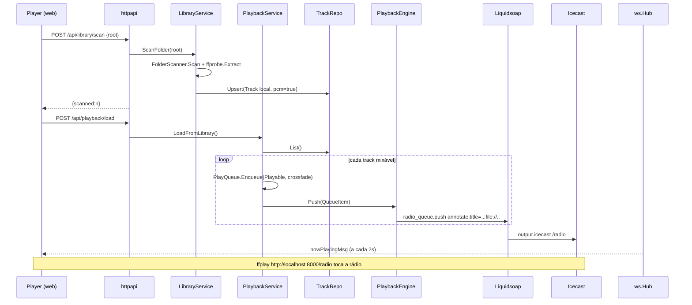
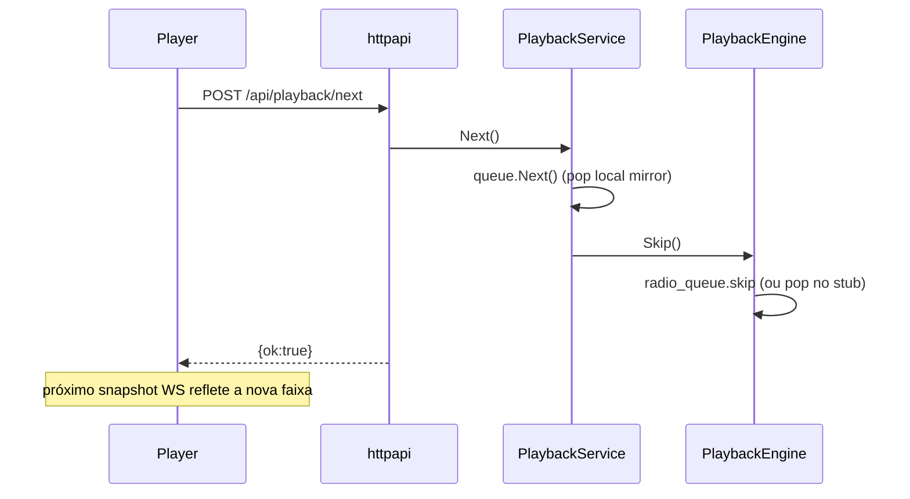

# AutoDJ — Fullstack Architecture

## Introduction

> **⚠️ DESCONTINUADO (2026-07-25): broadcast por servidor (Liquidsoap + Icecast) foi
> removido do produto.** Não transmitimos mais no servidor. O **playout roda no
> browser** (2 motores: Spotify Web Playback SDK / `<audio>` local); o servidor só
> orquestra fila/now-playing via `stubengine`. O adapter `driven/liquidsoap`, o
> `cmd/engine`, o `deploy/icecast.xml` e os serviços Nix de Icecast/Liquidsoap foram
> apagados. As menções a Liquidsoap/Icecast/`.liq`/`output.icecast`/mount `/radio`
> abaixo são **registro histórico** do desenho original do Épico 1 — não refletem o
> estado atual. O invariante `spotify ⇒ mixable=false` continua no domínio + banco
> (2 camadas), mas a antiga 3ª camada (recusa no bus Liquidsoap) não existe mais.

Este documento descreve a arquitetura fullstack do AutoDJ ("radio-as-software"): backend Go hexagonal, playout no browser (Spotify SDK / áudio local) e frontend Next.js. Ele é a fonte única de decisões técnicas; as Dev Notes de cada story carregam o contexto suficiente para implementar sem reler este arquivo.

**Starter template**: nenhum starter externo. A estrutura é **inspirada em `labs/polytrader`** (Go hexagonal + `web/` Next.js + Taskfile + `fly.toml` + AIOX SDD), adaptada ao domínio de rádio (dois motores de áudio, Liquidsoap/Icecast).

### Change Log

| Date | Version | Description | Author |
|------|---------|-------------|--------|
| 2026-07-28 | 0.2.39 | **Duas regressões no NÚCLEO do playout, causadas pela troca de fonte do SEM-VOZ — a segunda é a mais sutil da sessão.** **(a) Troca deixava o playout pela metade** (`PLY-1`): a varredura leva ~6 s; interrompida no meio — tipicamente pela FAIXA ACABAR — o `finishSwap()` não rodava e os papéis não fechavam: o elemento tido como "ao vivo" ficava em volume 0 enquanto o outro tocava. Deck anunciando no ar, transporte em RETOMAR, relógio congelado, e a mixagem sem tentar (o coordenador tem gate em `playing`). **(b) `pause` AGENDADO passava pelo guarda** (`PLY-2`): `a.pause()` não emite o evento na hora — o browser o AGENDA —, então liberar `swappingRef` de forma síncrona em `finishSwap` deixava o evento chegar depois e marcar a estação como parada. Como `playing` só muda por evento, e quem assume já estava tocando (logo não emite `play`), **nada** trazia o estado de volta. Efeito prático: **com o SEM-VOZ ligado a mixagem não acontecia em faixa nenhuma** — sem o modo, nenhuma faixa passa pela troca; com ele, todas passam. **Fixes**: a troca não começa perto do fim; interrupção REVERTE em vez de completar; `startMix` recusa enquanto há troca em curso (os dois disputavam o MESMO elemento ocioso); `finishSwap` **AFIRMA** `playing` a partir de quem assumiu e solta o guarda só no próximo ciclo. **Medido no cenário exato** (SEM-VOZ ligado, faixa a −9 s do fim): antes **107/111 amostras em RETOMAR e ZERO em mixagem**; depois **0 em RETOMAR e 15 amostras com os dois decks em `mixing-out`/`mixing-in`**. **Lição transversal** (em `known-issues.md`): guarda booleano contra evento de mídia é frágil — o evento chega DEPOIS; ou o guarda cai no próximo ciclo, ou o estado é afirmado em vez de aguardado, de preferência os dois. Junto: etiqueta SEM-VOZ da grade redesenhada (sem borda, sem emoji, na mesma linha do título, que passa a truncar) | @architect |
| 2026-07-28 | 0.2.38 | **Faixa preparada exibida como "processando"** (`PLY-3`). O `GET /library/instrumentals` passou a devolver também `ready` na 0.2.37 — a FILA precisa disso, por ser montada do `Playable`, que não pode carregar estado que termina minutos depois —, mas os consumidores anteriores (`PlayerScreen`, `OpMediaList`) tratavam QUALQUER valor no mapa como trabalho em andamento: faixa pronta com "⏳ PROCESSANDO", botão desabilitado e barra girando para sempre. Mesma classe do bug dos **dois DTOs**: ampliar o significado de um contrato sem varrer quem consome. Só apareceu ao OLHAR A TELA — os testes não cobrem a junção servidor↔UI | @architect |
| 2026-07-28 | 0.2.37 | **Separação de vocal em GPU alugada por segundo (RunPod)** — segundo adapter da MESMA porta `outbound.StemSeparator`; domínio, `StemService`, fila, rotas e UI **não mudam**. **Medido**: faixa de 45 s pronta em **78 s** incluindo subir o pod e instalar o Demucs; no spike isolado **~10 s de GPU para 3 min de áudio** (0,06× o tempo real, contra 1,9× num M1 Pro). Acervo de 83 faixas por **< US$ 0,10, uma vez**, contra US$ 124/MÊS da VM revertida na 0.2.36. **⚠️ O POD É SERVIÇO, NÃO JOB**: o AutoDJ manda os bytes e recebe os bytes na mesma requisição, o que mantém a porta arquivo-entra/arquivo-sai, **dispensa rota nova e token**, e carrega o modelo UMA vez por lote (num job por faixa, cada uma pagaria os ~3 min de subida — mais caro que a separação). **⚠️ WATCHDOG NO AUTODJ porque a auto-terminação NÃO é confiável**: no spike o pod terminou o trabalho e o RunPod REINICIOU o container, que refez tudo; e não dá para detectar de dentro, porque `podTerminate` responde `null` **mesmo em sucesso** — a confirmação é por CONSULTA. Validado em produção: pod ocioso 8m43s desligado e morte confirmada. **⚠️ Lista de fallback de GPU é REQUISITO**: três modelos seguidos deram `SUPPLY_CONSTRAINT` no spike, e no primeiro lote real a A5000 caiu e a A4000 entrou sozinha. Preço vem da API, nunca da tabela do site (lá é Serverless, US$ 0,69/h; pod on-demand sai por US$ 0,16–0,27/h) — e **"NVIDIA L4" não existe** no secure cloud. Outras armadilhas registradas: `mkdir -p /workspace` (com `volumeInGb: 0` o diretório não existe e o RunPod reinicia em loop) e a **API de logs inexistente** (`rest.runpod.io/v1/pods/{id}/logs` responde erro de spec — o `Logs()` do `finetuning-platform` provavelmente está quebrado). Ver [story 10.6](stories/10.6.separacao-na-nuvem.md) | @architect |
| 2026-07-28 | 0.2.36 | **Separação por IA REVERTIDA de produção — funcionou, e mesmo assim saiu, pela CONTA.** A 0.2.35 compilou o `demucs.cpp` na imagem, escalou a VM e chegou a rodar uma separação em prod. O que derrubou foi o preço: o mínimo viável é `performance-4x`/8 GB (medido: 5,87 GB de pico com 2 threads, **6,98 GB com 4**, e **5,91 GB para 150 s** — a memória NÃO cresce com a duração, é por segmento, mas cresce com as threads), e isso leva a fatura de **US$ 5,70 + US$ 1,50 de volume para ~US$ 124 + US$ 1,50** — **17×** — para rodar **8–15 min por faixa** contra ~6 min na máquina do operador. Pagar 17× para ser mais lento não se sustenta. **⚠️ E NÃO BASTA ENCOLHER A VM DEIXANDO O BINÁRIO NA IMAGEM** — é a parte que quase passou batida: com o `demucs` presente, `StemSeparator.Available()` responde true, as rotas sobem, a UI oferece a ação, e o primeiro clique estoura a memória matando a **máquina** (não só o recurso) e tirando a estação do ar. O estágio de build e o `[[vm]]` voltam juntos ou não voltam; ficaram **comentados, não apagados**, com o passo a passo no próprio `Dockerfile`. **Alternativas registradas, nenhuma implementada**: (1) preparar na máquina do operador e enviar o instrumental como faixa comum — custo zero, funciona hoje; (2) escalar sob demanda, já que o Fly cobra por segundo (~US$ 0,17/h; um lote de 20 faixas sai por menos de US$ 1), ao custo de reiniciar a máquina a cada troca; (3) o mesmo `demucs.cpp` **em WASM no browser** (o [freemusicdemixer](https://github.com/sevagh/free-music-demixer) faz exatamente isso) — servidor não gasta nada e vale para qualquer visitante, ao custo de ~81 MB de modelo e execução mais lenta que nativa; (4) API paga por uso (~US$ 0,04–0,11/min), sem infra, com o áudio saindo para terceiros. **Lição de processo**: a autorização para escalar foi pedida e dada com a medição de MEMÓRIA na mesa, mas sem a da FATURA — que só veio depois, a pedido do operador. Número de custo é parte da decisão, não do relatório | @architect |
| 2026-07-28 | 0.2.35 | **Separação por IA passou a existir em PRODUÇÃO, e a VM foi escalada por causa dela — revertendo a regra "prod não tem, de propósito".** Decisão explícita do operador, tomada com medições: pico de RAM **5,87 GB** (30 s de áudio, 2 threads), **6,98 GB** (30 s, 4 threads) e **5,91 GB** (150 s, 2 threads) — ou seja, **a memória NÃO cresce com a duração** (é por segmento) mas **cresce com o número de threads**. Daí `shared-cpu-1x`/1 GB → **`performance` 4 vCPU / 8 GB**, com **`AUTODJ_DEMUCS_THREADS=2`** (novo env): quatro threads deixariam menos de 1 GB para sistema, servidor e SQLite, e um OOM aqui não degrada o recurso — mata a máquina e tira a estação do ar. Tempo medido 1,9× o real num M1 Pro com 2 threads; em núcleo de nuvem, espere 8–15 min por música. **O custo mensal sobe muito** (de compartilhada com 1 GB para dedicada com 8 GB); a alternativa de custo zero — preparar na máquina do operador e enviar o instrumental como faixa comum — ficou registrada como continuando válida. A imagem ganhou um **estágio de build** que compila o `demucs.cpp` (não há binário oficial para linux/amd64) e baixa os pesos ggml, espelhando o `scripts/build-demucs.sh`; runtime recebe `AUTODJ_DEMUCS_BIN`/`AUTODJ_DEMUCS_MODEL`, e os instrumentais caem em `~/.autodj/instrumentals`, isto é, no volume — sobrevivem a deploy. **Duas correções junto: (a) a UI não oferece mais a ação onde ela não existe** — o store passou a saber se a rota respondeu 404 e o `onPrepareStem` some, porque um botão que só pode terminar em "não está instalado" é pior que um botão ausente (a mensagem também deixou de mandar o operador rodar um script e passou a falar do recurso); **(b) auto-reload em versão nova**, com toast FIXO de 5 s antes — o que **REVERTE** a regra "nunca recarregar sozinho" (0.2.20). O que torna a reversão aceitável é a retomada da 0.2.26: a posição é salva continuamente, então o reload volta tocando de onde parou. O corte de alguns segundos existe e foi aceito. Toast fixo (ttl 0) porque um aviso que some antes do evento que anuncia é pior que aviso nenhum. Validado: `task cover` verde + `tsc --noEmit` + `task web:build`, e medições de memória/tempo com `/usr/bin/time -l` | @architect |
| 2026-07-28 | 0.2.34 | **Botão de três estados, fila com o mesmo vocabulário da grade, e três bugs de estado compartilhado.** **(a) O botão SEM-VOZ deixou de ser um beco sem saída**: faixa sem preparo vira `✨ PROCESSAR SEM-VOZ (IA)` (o clique enfileira) e, processando, mostra a barra NO PRÓPRIO BOTÃO. Antes o operador via a função existir e a única saída era um menu de contexto em outra tela. **(b) `useStemWork` virou STORE ÚNICO DE MÓDULO** (`useSyncExternalStore`) — era `useState` por chamador, e o clique em PROCESSAR no transporte acendia a barra lá enquanto a grade seguia sem saber: a instância dela já tinha encerrado o ciclo (mapa vazio encerra o poll) e ninguém a acordava. Um mapa, um timer, N assinantes, com notificação só quando o conteúdo MUDA (a resposta é idêntica a cada 4 s; re-render à toa pisca a grade). **(c) O `pause` da troca de fonte não é pausa da ESTAÇÃO**: o elemento que sai é pausado depois da rampa e, naquele instante, ainda é o "ao vivo" — o evento marcava a estação como parada e o transporte trocava PAUSAR por RETOMAR no meio de uma música que seguia tocando pelo outro elemento. `swappingRef` (ref, não estado: a sequência é assíncrona) engole o evento só nessa janela, e é solto em TODOS os caminhos de saída — preso, engoliria uma pausa real depois. **(d) A FILA passou a mostrar BPM e SEM-VOZ**, o que forçou duas decisões: **BPM entrou no `Playable`** (é ESTÁTICO — medido uma vez, não muda, então o retrato do enfileiramento continua verdade) e **`GET /library/instrumentals` passou a devolver também as PRONTAS**, revertendo o argumento da 0.2.33 ("`ready` já vai no `trackDTO`") — verdade para a grade, falso para a fila, que vem do `Playable` e não pode carregar estado que termina minutos depois. As prontas saem do REPO, não da memória (que se perde no restart; o arquivo é a verdade). **(e) `PrepareAll`**: ligar o preparo automático vale para o acervo inteiro, e **só na transição desligado→ligado** — salvar o ⚙ de novo com a opção marcada varreria o acervo a cada clique (sem trabalho repetido, porque `Prepare` é idempotente, mas com varredura à toa). **(f) Confirmação de aperto de 3 s** em todo botão do transporte: `:active` só dura enquanto o dedo está no botão, e num playout o efeito da ação nem sempre é visível na hora. Anel expandindo (não fundo cheio — fundo cheio marca LIGADO, e misturar as linguagens confundiria os estados), `pointer-events: none` inviolável. **`.tbtn-pressed:disabled { opacity: 1 }`** porque PRÓXIMA/RETROCEDER ficam `busy` logo após o clique, exatamente durante o efeito, e o `:disabled` genérico o apagava no momento em que ele mais importa. E a **respiração verde ficou exclusiva do `.tbtn-voice`**: o PAUSAR também usa `.active` (para "pausado"), então a regra genérica acendia dois botões animados ao ligar o SEM-VOZ. Validado: `task cover` verde + `tsc --noEmit` + `task web:build` | @architect |
| 2026-07-28 | 0.2.33 | **Preparo automático de SEM-VOZ, a grade que mostra o estado, e o BPM que nunca funcionou.** **(a) BPM zerado em silêncio desde sempre** — medido: 83 faixas do operador, ZERO com BPM, com o aubio instalado e sem erro. `aubio tempo` devolve **"110.31 bpm"** (um número) enquanto `bpmFromBeats` esperava **timestamps de batida**; com uma linha só não fecha dois deltas e devolve 0. Novo `parseBPM` (faixa de sanidade 20–300 — o aubio devolve 0 em trecho sem batida, e "BPM 0" gravado pareceria medido) + **plano B no `aubiotrack`**, porque os ambientes divergem: Homebrew instala `aubio`, o `aubio-tools` do Debian (imagem de deploy) traz `aubiotrack` sem garantia do unificado. **Dockerfile passou a instalar `aubio-tools`** (~2 MB) — sem ele prod ficaria sem BPM no acervo inteiro. Backfill remediu 83/83. **(b) Preparo AUTOMÁTICO** (`mixing.Settings.AutoInstrumental`, ⚙ Configurações, **desligado por padrão**): faixa local nova entra na fila da separação sozinha. Entra pelo `enqueueAnalysis` via porta própria **`StemQueue`** (só `Prepare`) + `MixSettingsRepo` — mesma gramática do `AnalysisEnqueuer`/`CatalogWatcher`: quem importa faixa não tem de saber de fila, estado ou erro da separação. **Best-effort: falha nunca derruba o import** (fila cheia vira log; a faixa entrou e toca — trocar o essencial pelo acessório seria pior). Desligado por padrão porque são ~1,4× o tempo real por faixa num trabalhador só: 80 músicas = ~5 h de CPU, e ligar isso tem de ser decisão consciente. Em prod não faz nada (sem `demucs`, a porta nem é ligada). **(c) `GET /library/instrumentals`** — o que está em andamento AGORA, para a grade inteira: UMA requisição em vez de uma por linha. Só `queued`/`running` (o `ready` já viaja no `trackDTO`), e **mapa vazio é o sinal de parada** do poll do cliente (`useStemWork`, 4 s) — sem trabalho, zero requisição. Dentro do MESMO gate de disponibilidade: sem a ferramenta a rota não existe (404) e a UI não desenha barra, em vez de responder `{}` fingindo um recurso ausente. **(d) UI**: pílula verde **`🎼 SEM-VOZ`** nas faixas preparadas (nasceu emoji de 11px e o operador não achou na tela — informação que ninguém encontra é informação que não existe), **barra indeterminada abaixo do nome** enquanto separa (indeterminada de propósito: o modelo imprime `(N%)` POR THREAD em segmentos distintos, o que não vira total confiável, e barra que finge saber a porcentagem mente quando trava), **fila ≠ rodando** com desenhos distintos (o worker é UM só; sem isso três enfileiradas pareceriam três separações simultâneas), e coluna **BPM** que some inteira quando nenhuma faixa tem o dado. **(e) Vocabulário**: todo texto de UI passou de "INSTRUMENTAL" para **"SEM-VOZ"**, incluindo o botão do transporte (agora tamanho cheio, com **equalizador animado + halo respirando** quando ligado — cor sozinha obriga a comparar com o vizinho pra saber se está aceso; movimento o olho pega de longe, e barras dançando dizem "está saindo som assim agora"). ⚠️ Identificadores, classes CSS, a coluna `instrumental_path` e o valor de contrato `?stem=instrumental` **NÃO** foram renomeados — é a regra 24 (código em inglês, texto em pt-BR) e são valores de acordo com o servidor. **LOOP oculto** (`SHOW_LOOP = false`) a pedido do operador, com a lógica intacta. Validado: `task cover` verde + `tsc --noEmit` + `task web:build` + backfill de BPM 83/83 no acervo real | @architect |
| 2026-07-28 | 0.2.32b | **A TRANSIÇÃO do modo VOZ, e três bugs que só apareceram com o acervo tendo instrumentais.** (a) **`stemSrcRef = null` virava troca.** `null` significa "não sei o que está carregado", mas o efeito comparava `null !== false` e "trocava" o original PELO original — `src =` novo no elemento no ar, ou seja, **reload no meio da música**, disparado assim que a consulta do preparo respondia. Invisível enquanto nenhuma faixa tinha instrumental (`hasStem` nunca virava true); com o acervo preparado, virou corte seco a cada faixa. Fix: quem carrega anota qual fonte entrou, nos TRÊS caminhos (carga fresca, handoff da pré-carga, adoção da mixagem), e `null` nunca dispara troca. (b) **O botão não habilitava quando a separação terminava** — uma consulta por faixa, e a separação leva minutos, então ela termina com a faixa já no ar e a resposta ficava congelada em `queued`. Agora repergunta a cada 10 s **enquanto** há trabalho; `ready`/`failed` encerram. (c) **`.tbtn.active` não existia no CSS**: a classe era aplicada desde sempre e não pintava nada — LOOP e VOZ nunca deram retorno de "ligado". Ganharam verde claro + `inset` (afundado; a sombra externa dos outros faz o oposto). **⚠️ O ESTALO DA TROCA ERA DA PRÓPRIA RAMPA, não do arquivo trocando** — a descoberta que destravou o resto: `rampEl` usava passo fixo de 50 ms, ótimo num fade de 3–7 s (60–140 passos) e desastroso numa rampa de 140 ms, onde dá **3 passos** (1,0 → 0,67 → 0,33 → 0, degraus de ~3,5 dB); salto de ganho é descontinuidade, e descontinuidade É clique (zipper noise). Eu tinha posto um fade para esconder o estalo e o fade virou o estalo. Passo agora é **adaptativo** (~30 passos em rampas ≤600 ms, piso de 8 ms) e a curva é **cosseno**, não reta (reta tem quina nas pontas, e quina estala). **A transição em si, afinada de ouvido pelo operador em cinco rodadas** (fade 130 → 320 ms → eco → whoosh sintetizado → varredura de filtro; e a varredura de 420 → 750 → 1500 → 3000 ms por lado): a fonte nova entra no elemento OCIOSO já tocando e já na posição (mecanismo do crossfade local↔local da 0.2.26, que é o que elimina o buraco de 80–300 ms em que o `src =` no elemento no ar deixa de produzir áudio), sob uma **varredura de passa-alta 20 Hz → 4 kHz → 20 Hz** (3 s por lado) com **crossfade de 6 s** por baixo — a mesma duração do gesto, senão o ouvido lê dois eventos em vez de um. Mascaramento espectral: no topo o sinal perdeu quase toda a energia, então é onde a descontinuidade é menos audível. **A sobreposição só é segura POR CAUSA do filtro** — cruzar em banda cheia somaria duas cópias da mesma base com ms de defasagem (comb filtering); em 4 kHz o conteúdo correlacionado não está lá. Detalhes que o filtro impôs: rampa de frequência **exponencial** (altura se percebe em oitavas; linear gastaria quase todo o tempo acima de 1 kHz), **Q 0,7** (o default 1 faz pico na frequência de corte, e pico varrendo vira assobio), repouso em **20 Hz** e não 0 (`exponentialRamp` não aceita zero, e 20 Hz é transparente na prática). **⚠️ WEB AUDIO VOLTOU AO PLAYOUT, corrigindo o que a entrada anterior afirmou** ("não é mais usado em lugar nenhum"): filtrar exige nó de filtro e `<audio>` só expõe ganho. Travas: contexto nasce do **clique** (nunca no carregamento), `attach` **só roteia com o contexto já `running`** (suspenso + roteado = estação muda), o contexto é pedido no INÍCIO da troca porque `resume()` é assíncrono (senão a primeira troca da sessão sairia sem efeito), sem contexto utilizável cai no **fade sequencial**, e o cleanup devolve o filtro ao repouso (elemento esquecido no topo entregaria a próxima faixa sem grave). Alternativas descartadas no caminho, cada uma por um motivo medido: **crossfade simétrico em banda cheia** (comb filtering), **eco com realimentação** (lia como reverb, e roteava o áudio da faixa no ar), **whoosh sintetizado** (som estranho colado por cima — o operador quis que o efeito agisse SOBRE a música), e **sync de amostra por Web Audio** (resolveria de vez, mas exige decodificar os dois arquivos em memória, ~85 MB por versão numa música de 4 min). Validado: `task cover` verde + `tsc --noEmit` + `task web:build`, e afinação por ouvido do operador no browser real | @architect |
| 2026-07-28 | 0.2.32 | **Cancelamento de centro APOSENTADO — o botão VOZ passa a ter um caminho só: o instrumental separado por IA.** A 0.2.29 justificou o DSP com uma tabela medida num **mix sintético** (senoides, vocal perfeitamente centrado) — um caso construído a partir da própria hipótese, que provava que o filtro fazia o que a fórmula dizia, nunca que aquilo removia voz de uma música. **Medido agora em música real**, com o próprio Demucs como régua ("quanta voz sobra em cada saída"), num trecho de 40s de *Ace Of Base — All That She Wants*: original **−17,3 dB**, cancelamento de centro **−19,3 dB** (redução de **2,0 dB**), instrumental da IA **−49,2 dB** (redução de **31,9 dB**). Dois decibéis não é "tirar a voz"; e manter os dois caminhos atrás do mesmo botão significava que o operador não tinha como saber qual estava atuando — o selo `INSTRUMENTAL` mentia metade das vezes. **REMOVIDO**: `web/app/lib/vocalCut.ts` e todo o grafo de Web Audio do `useLocalPlayout`; `Analysis.StereoSideDB`, `Track.StereoSideDB`, `MinStereoSideDB`, `Track.VocalRemovable()`; `sideEnergyDB`/`stereoFloorDB` do analisador (e o gate por nº de canais do `cli.go` passou a servir só ao detector de vocal); a coluna `stereo_side_db` do SQLite e do Postgres (migração 019 apagada — nunca foi lançada; a 020 do instrumental foi renumerada para **019**); `Playable.VocalRemovable` e o `vocal_removable` dos **dois** DTOs; e o campo correspondente do `types.ts`. **A régua ficou UMA**: `Track.HasInstrumental()`, lida ao vivo do endpoint (nunca do `Playable`, que é retrato do enfileiramento). `PlayoutDeck.vocalRemovable` virou `instrumentalReady`. **Consequência de arquitetura**: **Web Audio deixou de ser usado no playout** — a exceção que a 0.2.29 abriu (opt-in, nascida de clique, nunca no carregamento) morreu com o grafo, e volta a valer sem asterisco a regra da 0.2.28 (ganho no `<audio>.volume`, porque o `AudioContext` nasce `suspended`). **Lição registrada**: um teste construído a partir da hipótese confirma a hipótese; medida de qualidade de áudio precisa de material real — o mesmo padrão que já tinha aparecido nos testes do autopilot. Validado: `task cover` verde (domain 100%, adapters/app ≥90%) + `go vet ./...` + `task web:build` | @architect |
| 2026-07-28 | 0.2.31 | **Separação de vocal por IA — o instrumental PREPARADO, que é a única resposta para faixa MONO.** O modo VOZ (0.2.29) é instantâneo mas exige imagem estéreo; sem centro não há o que subtrair, e o botão se desabilita. A IA fecha esse buraco porque separa por CONTEÚDO. **Motor: [`demucs.cpp`](https://github.com/sevagh/demucs.cpp) (MIT, C++17 + Eigen header-only, sem PyTorch), pesos `htdemucs` 4-source em ggml (80 MB).** ⚠️ **SHELL-OUT, não cgo, e a razão não é preguiça**: cgo funcionaria (é C++ puro), mas passaria a exigir toolchain C++ para compilar o servidor Go **inclusive na imagem de deploy, onde o recurso NEM RODA** — prod é `shared-cpu-1x` com 1 GB. Shell-out mantém o binário Go puro e o recurso opt-in: `scripts/build-demucs.sh` instala em `~/.autodj/{bin,models}`, e SEM ele `StemSeparator.Available()` é false, **as rotas nem são registradas** e a UI esconde o item — mesma degradação graciosa do analisador sem `aubio` e do Spotify sem client id. (Armadilha do script: o `CMakeLists` do upstream declara compat com CMake <3.5, removido no CMake 4.x → `-DCMAKE_POLICY_VERSION_MINIMUM=3.5`.) **CUSTO MEDIDO, e é ele que define o desenho inteiro: 45s de áudio em 64,8s de parede** num M1 Pro com 6 threads (~1,4× tempo real; ~6 min para uma música de 4) — o upstream reporta 4m09s para 4 min num Ryzen 5950X com 4 threads, mesma ordem. Logo: **pré-render por faixa, jamais caminho de playout**, com **um trabalhador só** e **teto de 6 threads** (o modelo já paraleliza por dentro; dois trabalhos em paralelo não terminariam antes, só disputariam CPU com o playout, que roda ao mesmo tempo). **O instrumental é a SOMA `drums+bass+other`, não a subtração do vocal**: subtrair reintroduziria, com fase invertida, o resíduo que o modelo NÃO separou — o defeito sai do lugar errado e vira artefato audível; e `normalize=0` no `amix` é obrigatório, senão o ffmpeg divide pelo nº de entradas e o instrumental sai ~10 dB abaixo ("sumiu tudo" ≠ "sumiu a voz"). **Domínio**: `Track.InstrumentalPath` + `HasInstrumental()` + `Separable()` — régua DIFERENTE de `VocalRemovable()` de propósito (o modelo não liga para imagem estéreo nem para limiar; só importa se o arquivo existe). **Persistência**: coluna `instrumental_path` (`ensureInstrumentalColumn` + `migrations/020_instrumental.sql`) — perder esse caminho num Upsert custaria MINUTOS de CPU por gravação. **Servir**: `?stem=instrumental` na rota de áudio que JÁ EXISTE, não uma rota nova — o `<audio>` do deck já negocia Range/seek com ela, o Service Worker já a cacheia e o buffer anti-queda já a conhece; sem o preparo o servidor devolve o original em silêncio, nunca 404 no meio da música. **⚠️ O ESTADO NÃO PODE VIR DO `Playable` — pego pelo teste ponta a ponta**: com o arquivo pronto, `instrumental_ready` chegava `false`, porque o Playable é um retrato do instante do ENFILEIRAMENTO e a separação termina minutos depois; o retrato diria "não" para sempre. O campo foi **removido** do Playable (mentira latente) e vive em dois lugares frescos: `trackDTO` (a lista) e `GET /library/tracks/{id}/instrumental` (o playout). **Frontend**: `useInstrumental` (poll que só existe ENQUANTO há trabalho — intervalo permanente custaria requisições para sempre para observar algo que muda uma vez na vida da faixa), item no `OpContextMenu` cujo RÓTULO É O ESTADO (a operação leva minutos: o operador precisa saber se já pediu), e no `useLocalPlayout` a troca de fonte com posição preservada + **o grafo de Web Audio DESLIGADO** quando o instrumental está no ar (cancelar centro por cima processaria duas vezes) + **o buffer anti-queda ignorado** nesse caso (o Blob guardado é sempre do original, e preferi-lo tocaria a versão COM voz). **O botão VOZ passa a habilitar por DOIS caminhos** — cancelamento de centro OU instrumental pronto —, e **o selo INSTRUMENTAL deixou de olhar `np.vocal_removable`**: em mono ele é false, e o selo ficaria mudo exatamente onde a IA funciona; quem decide é o `PlayerScreen`, que manda o sinal já filtrado. Refactor de tabela junto: as 7 migrações repetidas do SQLite viraram um laço — a escada de blocos `if err != nil { db.Close(); return }` idênticos derrubava a cobertura (89,9%) por linhas que nenhum teste alcança; foi para **92,5%**. **⚠️ LIMITE HONESTO: a QUALIDADE não foi medida com música real.** O encanamento está provado ponta a ponta (pedido → separação → arquivo → deck tocando faixa mono sem vocal, com o selo); o RESULTADO não: os arquivos de teste são senoides puras e o Demucs foi treinado em música — ele não reconhece um seno de 1400 Hz como voz, e as quatro bandas caíram uniformemente ~3 dB, que é mudança de nível e não separação. O sintético serviu para o modo VOZ (DSP puro, indiferente ao conteúdo) e NÃO serve para um modelo treinado. Registrado em `docs/pendencias.md` como pendência real. Validado: `task cover` verde (domain 100%, `app` 91,5%, `sqlite` 92,5%; `stemsep` entrou como integration-tier junto com `audioanalyze`/`tts` — o trabalho dele é invocar processo externo) + `go build ./...` + `tsc --noEmit` + `task web:build` | @architect |
| 2026-07-28 | — | **CORREÇÃO DE REGISTRO: a justificativa para recusar separação por IA (v0.2.29) estava errada em dois fatos.** Ficou documentado que `demucs-web`/`onnxruntime-web` **exigem** Cross-Origin Isolation (COOP/COEP) e que ligar `COEP: require-corp` quebraria o iframe do YouTube e o Web Playback SDK do Spotify, e que o modelo teria ~172 MB. Pesquisado na fonte primária: **só o WASM MULTI-THREAD precisa de `crossOriginIsolated`** — single-thread roda sem header nenhum e o backend **WebGPU não tem requisito de cross-origin isolation documentado** ([ONNX Runtime Web — env flags and session options](https://onnxruntime.ai/docs/tutorials/web/env-flags-and-session-options.html)); além disso o isolamento é **por documento**, não por origem, então uma página isolada à parte nunca afetaria o player. O peso real do `htdemucs` em ggml é **81 MB** (6-source: 53 MB), não 172. E "não existe implementação Go" era verdade **irrelevante**: [`demucs.cpp`](https://github.com/sevagh/demucs.cpp) é C++17 com Eigen header-only, **MIT**, sem PyTorch — cgo chama direto (existe também [`yalue/onnxruntime_go`](https://github.com/yalue/onnxruntime_go)); é o mesmo motor que o [freemusicdemixer](https://github.com/sevagh/free-music-demixer) compila para WASM e roda no browser. **O impedimento real é VELOCIDADE, não header**: benchmark do próprio autor (4 min de música, Ryzen 5950X de 16 núcleos) dá **10m23s** single-thread e **4m9s** com 4 threads — ~2,5× mais lento que tempo real num desktop parrudo, e prod é `shared-cpu-1x` com 1 GB. **Consequência de desenho, que é o que importa:** separação por IA **não pode ser um botão ao vivo** como o modo VOZ; é **pré-render por faixa**, feito uma vez e guardado, com outra promessa ao operador ("prepare esta música" ≠ "tire a voz agora"). É também o **único** caminho que resolve o caso **mono** — modelo separa por conteúdo e não depende de imagem estéreo, que é exatamente o que o cancelamento de centro não tem como fazer. Qualidade de referência: HTDemucs ≈ 9,0 dB de SDR no vocal, Mel-Band RoFormer um pouco acima, MDX-Net ≈ 8,5 dB e mais rápido; tempo real de verdade segue sendo pesquisa ([RT-STT](https://arxiv.org/abs/2511.13146): 383K parâmetros e 23 ms de latência, mas 5,56 dB e **sem pesos públicos**). Nada implementado nesta entrada — é correção de registro + desenho da evolução | @architect |
| 2026-07-28 | 0.2.29 | **Modo VOZ: um botão no transporte e a faixa local toca sem o vocal — por CANCELAMENTO DE CENTRO, não por IA.** Pedido do operador: "ligar algo e a música sair sem vocal", com o liga/desliga num lugar bom da interface (escolhido por ele: botão `🚫🎤 VOZ` ao lado do LOOP, mais um selo `INSTRUMENTAL` no deck pra nunca ficar ambíguo o que está no ar). **IA foi avaliada e recusada por dois motivos concretos deste app**: (a) no browser, `demucs-web`/`onnxruntime-web` exigem **Cross-Origin Isolation** (COOP/COEP) pra usar `SharedArrayBuffer` — ligar `COEP: require-corp` quebraria o **iframe do YouTube e o Web Playback SDK do Spotify**, dois dos três motores, além de ~172 MB de modelo num bundle de 234 kB e separação em segmentos, não em tempo real; (b) no servidor, Demucs/UVR roda em Python+torch, **não existe implementação Go pronta** (seria STFT + inferência do zero) e prod é `shared-cpu-1x` com **1 GB**, onde o modelo não cabe com folga. O que sobra é o que o `stereotools=mlev` do ffmpeg faz: a voz de estúdio é mixada no CENTRO e some ao subtrair os canais. **A receita foi MEDIDA, não palpitada** (ffmpeg 8.0, mix sintético de verdade conhecida — baixo 80Hz centro, guitarras 500/700Hz laterais, "vocal" 1400Hz centro, prato 9kHz centro; RMS por banda em dB): o `L−R` ingênuo mata o vocal (−30,2 → −57,0) **mas mata o baixo junto** (−31,6 → −64,4) **e os pratos** (−41,0 → −74,4) — é o "karaokê chocho" clássico. A receita `side + lowpass(mid,200Hz) + highpass(mid,9kHz)` devolve os extremos do centro: vocal cai pra **−54,5** (−24,3 dB, inaudível sob a mistura) enquanto baixo fica em **−31,7** e prato em **−44,1**. Nível geral cai 3,7 dB ⇒ makeup **1,5** (≈ +3,5 dB), de propósito abaixo da compensação exata pra material com muito `side` não estourar o teto. **`Q = 0.707` nos dois filtros**: o default do `BiquadFilterNode` é `Q = 1`, que ressoa no corte e coloriria a devolução do centro — a tabela foi medida com resposta plana. **Saber POR FAIXA se dá**, senão o operador liga, a música vira um casco oco e ele reporta como bug: a informação já estava sendo calculada — `detectVocalStart` (0.2.28) já monta `mid`/`side` por janela de 200 ms —, faltava guardar um número. `Analysis.StereoSideDB` = **mediana de `side − mid`** nas mesmas janelas; `Track.StereoSideDB` (coluna `stereo_side_db`, `ensureStereoSideColumn` + `migrations/019_stereo_side.sql`, mesmo padrão do `loudness_lufs` da 0.2.28); `Track.VocalRemovable()` com a régua **no domínio**, não na UI. **Por que RELATIVO ao `mid`**: o `side` absoluto anda com o nível do master — faixa gravada baixa pareceria mono, faixa alta pareceria estéreo; o dado responderia sobre o VOLUME em vez da IMAGEM. **Limiar `MinStereoSideDB = −30 dB`, também medido** (estreitando a imagem do mesmo mix em passos): mono `−inf`, largura 0,10 → **−31,3** (ainda oco), 0,25 → **−23,3** (já dá pra cancelar), original → **−11,2**; −30 cai na folga entre os dois regimes. **⚠️ A armadilha do MONO de 1 canal, achada medindo**: nesse arquivo o `c1` do `pan` do ffmpeg resolve como silêncio, então `mid` e `side` saem **numericamente iguais** e a conta daria **0 dB** — o valor de imagem MÁXIMA. Sem o gate por nº de canais (`ffprobe`), o modo apareceria **habilitado exatamente na faixa onde produz o casco oco**; e mono grava o **piso** (−60), não 0, porque 0 é "não medido" e o `Backfill` re-analisaria a faixa em todo boot, para sempre. Pelo mesmo motivo `VocalRemovable()` exige medição (`StereoSideDB != 0`): "não sei" tem de responder NÃO, senão todo acervo ainda não analisado apareceria como removível. `Backfill` passa a re-enfileirar quem tem `StereoSideDB == 0` — senão o recurso estrearia só pra faixa nova. **Custo de análise: zero invocação nova de `ffmpeg`** — é uma mediana sobre buckets que já existiam. **`Playable` carrega o BOOLEANO** (`vocal_removable`), não o dB cru: mandar o número convidaria a UI a reimplementar o limiar e a divergir dele em silêncio; serializado nos **DOIS** DTOs (`ws` e `httpapi` — classe de bug recorrente registrada no CLAUDE.md). **⚠️ Web Audio AQUI, depois de a 0.2.28 tê-lo RECUSADO no ganho — e não é contradição**: o que muda é o que fica refém do `AudioContext`. O ganho vale pra toda faixa, sempre, e rotear todo o playout arriscaria o autoplay em toda sessão, inclusive no boot (por isso ficou no `<audio>.volume`); o modo VOZ é **opt-in e nasce de um clique**, que é o próprio gesto que o browser exige, e **não é persistido** (F5 volta desligado, igual ao LOOP) — então **nunca há roteamento no carregamento da página**, o cenário perigoso deixa de existir por construção. O padrão já existia no código (`useDeckPair.ts:28` cria o contexto no primeiro gesto; `useDeck.ts:91` monta uma cadeia de biquads). Novo `web/app/lib/vocalCut.ts` (puro, sem React, como `lib/gain.ts`) monta o grafo com **nós nativos — sem AudioWorklet, sem FFT, sem WASM**: `splitter(2)` → `side = 0,5·L − 0,5·R` e `mid = 0,5·L + 0,5·R` → `lowpass(200)`/`highpass(9k)` → `makeup` → `cutGain`, em paralelo a um `bypassGain`. **Liga/desliga é rampa curta entre os dois ganhos (120 ms), nunca reconexão** — reconectar nó no meio da música dá clique; e `createMediaElementSource` é **irreversível e só pode ser chamado uma vez por elemento** (`WeakMap` guarda a cadeia). **Os DOIS elementos** do ping-pong são atados: o modo vale pra faixa seguinte, e a pré-carga precisa entrar no ar já instrumental. `el.volume` age **antes** do grafo, então normalização, fades e a mixagem local↔local da 0.2.28 seguem funcionando sem saber que o grafo existe. Sem CORS a considerar (fontes mesma-origem e `blob:`; elemento cross-origin sem CORS sairia **mudo** ao ser roteado). **UI**: botão entre LOOP e RETROCEDER com os dois motivos de desabilitação distintos no `title` ("não há faixa local no ar" ≠ "esta faixa é mono"); o modo **não se desarma sozinho** quando entra uma faixa que não permite (vale pra próxima local), mas o botão **continua clicável** enquanto ligado — aceso e desabilitado prenderia o operador no modo; o selo `INSTRUMENTAL` (`.deck-instrumental`, gramática do `CUE`/`MIX`) aparece **só quando o corte está de fato atuando**, porque anunciar um corte que não acontece é mentira na tela. Escopo intocado: **só faixa local (PCM)** — Spotify e YouTube tocam out-of-band e o invariante `spotify\|youtube ⇒ !mixable` segue como está. Validado: `task cover` verde (domain 100%, adapters/app ≥90%) + `go build ./...` + `tsc --noEmit` + `task web:build` | @architect |
| 2026-07-28 | 0.2.28 | **Trim de silêncio, ganho constante e entrada do vocal — os três em UMA passada de `ffmpeg`.** Pedido do operador: começar a música onde tem áudio, tocar tudo no mesmo volume e saber onde a voz entra (com LOOP na base pra encaixar locução). **O ponto de partida era pior que zero: metade disso já estava DECLARADA e não fazia nada** — `mixing.Settings` tinha `TrimMusicas`/`TrimVinhetas`/`Normalize`/`NormalizeVol` desde a Story 3.3, com tela e persistência, e **nenhuma linha de código os lia**; `library.Analysis.LoudnessLUFS` existia como campo e nunca era calculado (nem gravado — `Track` não tinha o campo); o marcador `intro` estava documentado como *"where vocals kick in"* e ninguém o preenchia. Pior: o analisador (`audioanalyze.CLI`) shellava `aubio`/`keyfinder-cli`/`audiowaveform`, **nenhum dos três presente na imagem de produção**, então em prod ele era o `Noop` — nada era analisado. **A saída foi usar o `ffmpeg`, que já está nos dois ambientes**, e medir os três sinais num único decode: `silencedetect` (cues), `ebur128` (loudness) e `mid/side` por 200ms (vocal), com `asplit=3`. **Vocal por mid−side**: voz de estúdio é mixada no CENTRO, instrumento é panorâmico — `mid` (L+R) reforça o central, `side` (L−R) o cancela, e `mid − side` mede "quão centralizado"; `bandpass` em ~1,4kHz tira bumbo/baixo (também centrais) da conta. Medido com sinal sintético: instrumento hard-left dá **0 dB** de diferença, tom centralizado por cima dá **+15 dB**. **Mono não tem side ⇒ não marca vocal** (canais vêm do `ffprobe`); trim e loudness seguem normais. Regra do operador respeitada no algoritmo: **na dúvida não marca** — só com subida sustentada por ≥1,5s acima da linha de base do intro (MEDIANA, não média: um estouro no começo deslocaria a média e esconderia a voz), depois do `cueIn`, nunca antes de 1s. **Dois detalhes de `ffmpeg` que só apareceram medindo**: (a) `framelog=quiet` é obrigatório no `ebur128` — sem ele são ~1800 linhas por faixa de 3min e o resumo se perde; o parser lê SÓ a linha do resumo, porque as de quadro carregam o mesmo `I: … LUFS` e dariam o valor do primeiro 100ms; (b) o `ametadata=print:file=-` escreve na **saída padrão** enquanto os outros dois logam na de **erro** — dois canais, dois parsers, sem desembaraçar texto. E `measure_perchannel=RMS_level` corta o `astats` de ~30 métricas por janela para uma (senão são ~60 mil linhas). Custo medido: **3 min de áudio em ~1,3s**. **Domínio**: `Analysis` ganha `CueInMs`/`CueOutMs`/`VocalMs`; `Track` ganha `LoudnessLUFS` (agora gravado — o campo do `Analysis` era descartado); `Marker` ganha `Auto` e `Track.ApplyAutoMarkers` substitui só o que é automático, **preservando o que o operador colocou à mão** (reusa `SetMarkers`, sem duplicar as regras de singleton/ordem/range). Cue fora do intervalo, ou `end` antes de `start`, é descartado sozinho — artefato de arredondamento entre duas sondas do mesmo arquivo não pode derrubar BPM e loudness da rodada. `mixing.Settings` ganha `DetectVocal` e `NormalizeVol` **passa a ter significado**: `alvo = -24 + (vol/100)·12`, escolhido pra que o default histórico **89 caia em ≈ −13,3 LUFS** (padrão de streaming) — **nenhum dado migrou**. **Cues viajam como MARCADORES, não colunas**: `markers` já é JSON (zero migração), já tem rota e editor, e assim a marca que o operador arrasta dirige o deck exatamente como a do analisador — uma fonte de verdade, não duas. Só `loudness_lufs` virou coluna (`ensureLoudnessColumn` no SQLite + `018_loudness.sql`), porque sem ela o `Upsert` perderia a medida e o backfill re-analisaria a mesma faixa em todo boot. `Backfill` passa a re-enfileirar quem tem `LoudnessLUFS == 0`, não só `!Analyzed()` — senão o recurso estrearia só pra faixa nova. **As dicas chegam ao browser no `Playable`** (`cue_in_ms`/`cue_out_ms`/`vocal_ms`/`loudness_lufs`/`category`), preenchidas no único ponto de construção (`toPlayable`) e serializadas nos **DOIS** DTOs (`ws` e `httpapi` — o `ws/dto.go` ganhou um `toPlayableDTO` único, porque montar o struct campo a campo em três lugares é como o `artist` sumiu do deck na 0.1.20). Vão no `Playable` e não num fetch novo porque **o snapshot já é espelhado em localStorage**: as dicas funcionam offline de graça. **Ganho SEM Web Audio, e a razão é dura**: o `AudioContext` nasce `suspended` e exige gesto — com o histórico de autoplay barrado deste app (0.2.26/0.2.27), rotear o `<audio>` por um `GainNode` arrisca deixar a estação **muda até alguém clicar**. Então o ganho entra no `<audio>.volume`, nos 7 pontos onde o literal `1` significava "ganho pleno", exatamente como o motor do Spotify já faz com `SPOT_TARGET = 0.8`. **Limite honesto e documentado**: `volume` não passa de 1, então sobra ~+1,9 dB de reforço — atenuar é ilimitado, amplificar não. Lógica pura em `web/app/lib/gain.ts` (o `web/` não tem test runner). **Deck publica `endMs`** (fim efetivo) além de `durMs` (duração real, que é o que a tela mostra), e o coordenador de mixagem passa a usá-lo — com a duração crua o crossfade começaria DEPOIS do fim já cortado. A entrante da mixagem também começa no cue DELA e sobe até o ganho DELA. **UI**: bloco "Áudio das faixas locais" no ⚙ Configurações (o modal de Mixagem é gated no modo Rádio e o padrão é Tocador — os interruptores eram inalcançáveis), mostrando o LUFS resultante ao lado do número; **LOOP saiu do "em breve"** e ficou amarrado ao FALAR (mas clicável sozinho, porque FALAR só existe no modo Rádio); novo `DeckMarks.tsx` desenha zonas de corte hachuradas, tick 🎤 no vocal, faixa do loop (pulsando quando armado, com opt-out em `prefers-reduced-motion`) e selo de ganho — as marcas são IRMÃS da barra, num `.deck-viz` novo, porque a `.deck-prog` tem `overflow: hidden` e cortaria o tick. Fonte não-PCM não recebe marca nem ganho: `spotify|youtube ⇒ !mixable` intocado. Validado: `go test ./...` (1295 testes) + gate de cobertura verde (domain 100%, adapters/app ≥90%, `playout.go` 100% com fixtures de saída REAL do ffmpeg) + `tsc --noEmit` + `task web:build` | @architect |
| 2026-07-27 | 0.2.17 | **Busca do YouTube SEM LOGIN e SEM COTA: segundo motor (InnerTube) atrás da mesma porta, chaveável na UI — nada removido.** Pedido do usuário: "use a lib em go mas não remova o que já existe, tudo continua, só faça algo pra chavear que seja elegante, animado e responsivo". Contexto: a 0.2.17 já tinha soltado o import por links, mas a BUSCA seguia presa ao OAuth — gate que só existia como **escudo da cota** (`search.list` ≈ 100 unidades das ~10k/dia). A saída não é remover o gate (isso queimaria a cota compartilhada em ~100 teclas), é **não usar a Data API pra buscar**: o InnerTube é o mesmo protocolo que o site do YouTube consome, sem key e sem conta, custo **zero** de cota. **Lib escolhida: `github.com/raitonoberu/ytsearch` v0.2.0** — MIT, zero deps externas, resultados **tipados** (as alternativas MIT `nezbut/innertube-go` e `wslyyy/youtube-go` devolvem `map[string]interface{}`; `ppalone/ytsearch` não publica licença redistribuível no pkg.go.dev → descartada). **Backend**: `domain/youtube` ganha `Backend` (`BackendFree`/`BackendAPI`) + `NormalizeBackend` (vazio/desconhecido → `free`, então cliente velho não quebra); `app.YouTubeService.Search` passa a receber o backend e, no caminho `free`, **pula o gate de conta** (o `api` continua exigindo `ErrNoAccount`), com `WithFreeCatalog` no wiring e `Status.FreeSearch = s.free != nil`; novo adapter `adapters/driven/youtube/innertube.go` implementa a porta **já existente** `outbound.YouTubeCatalog` — `Search()` pela lib, `Videos()`/`PlaylistItems()` **delegando ao adapter da Data API** (é de lá que vêm duração exata e o flag `embeddable`, e custa 1 unidade por lote), com **fallback pro adapter Data API se o parse falhar** (degrada, não quebra). Três armadilhas da lib, tratadas no adapter e registradas porque a assinatura não avisa: `Next()` **não recebe `context.Context`** → cancelamento/timeout entram pelo campo `HTTPClient`; `VideoItem.Duration` vem em **segundos** (×1000 pro `DurationMs`); construtores default `Language:"en"`/`Region:"US"` → forçados pra `pt`/`BR`. `httpapi/youtube.go` lê `?backend=` e repassa. **Preço do grátis, documentado na UI**: sem o pré-filtro `embeddable` do Google, um resultado pode ser descartado só no import. **Frontend**: novo `YouTubeBackendSwitch.tsx` (`role="radiogroup"`, pílula deslizante `.ytbk-glide` por `transform: translateX(idx*100%)` na mesma gramática visual do `.opsub2`, ícone escala 1.16 no ativo) + família `.ytbk` no `globals.css` **só com tokens semânticos** (dark herda de graça), responsividade por **container query** (`container-type: inline-size`, esconde o hint abaixo de 300px) e não por media query — o painel é uma coluna, não a tela —, mais o opt-out obrigatório de `prefers-reduced-motion`. `YouTubePanel` guarda o estado, deriva o backend **efetivo** (`status.freeSearch ? escolha : "api"`, então servidor sem o motor grátis nem mostra o switcher), põe `searchBackend` nas deps do efeito de busca (trocar de motor **refaz a consulta** sozinho) e mostra o hero de conexão **só** no motor `api` desconectado. Validado: `GOWORK=off go build ./...` + `task cover` (gate verde, `domain/youtube` 100.0%, `innertube.go` 97.5% em 18 testes) + `task web:build` verdes | @architect |
| 2026-07-27 | 0.2.17 | **Login do Google deixa de ser obrigatório na aba YouTube: nova sub-aba "Colar links" importa lote de URLs sem conta nenhuma.** Pedido do usuário sobre o print da aba: "a integração não pode ser obrigatória... uma sub-aba com um campo multi line enorme que eu possa colar endereços de vídeo do youtube separados por `;` e faz a importação pra fila/deck". Até aqui o `YouTubePanel` tinha um **early-return duro** em `!status.connected` → o painel inteiro era o card "Conectar ao YouTube" (decisão original da 0.2.0, "espelho fiel do Spotify"), e nada — nem o import por URL, que sempre foi barato — acontecia antes do OAuth. **Isso era gate no lugar errado**: quem custa cota é a BUSCA (`search.list` ≈ **100 unidades** das ~10k/dia ≈ 100 buscas), não a resolução de ids (`videos.list` = **1 unidade por lote de até 50**, 100× mais barato). Como prod é público e multi-tenant por fingerprint, o login permanece **como escudo de cota da busca**, e o caminho barato passa a rodar livre. **Backend** (hexagonal, camada por camada): `domain/youtube/youtube.go` ganha `MaxImportLinks = 50`, `ParseLinks(raw) []string` (separa por `;`, vírgula, quebra de linha, tab e espaço; dedupe **preservando a ordem colada**; cap 50) e `VideoID(entry)` (aceita `watch?v=`, `youtu.be/<id>`, `/shorts/<id>`, `/embed/<id>` e id cru de 11 chars), mais o sentinela `ErrNoLinks`; `app/youtube_service.go` ganha `ImportLinks(ctx, text)` → `videos.list` em lote → `importItems` (mesmo mapeamento `CatalogItem → Track(source=youtube)` do import por busca, então o invariante `youtube ⇒ !mixable` e o descarte de não-incorporável valem igual); `ports/inbound` publica o método; `httpapi/router.go` monta **`POST /api/v1/youtube/import-links`** (`{text}` → `[]trackDTO`) **fora** do bloco de OAuth. **Gating deixa de ser tudo-ou-nada**: `cmd/serverkit/serverkit.go` passa a ter `ytOAuthOn := ytClientID != "" && ytSecret != ""` — a **API key sozinha** já sobe a aba (status + import-links + playout), e sem client id/secret as rotas `connect`/`callback` respondem **503** (`ErrOAuthUnavailable`, novo mapeamento em `writeYouTubeErr`), nunca 404/500. Sem a API key, YouTube segue 404 inteiro (degradação graciosa preservada). **Frontend**: `YouTubePanel.tsx` perde o early-return de conexão e ganha segmented control de duas sub-abas (`Sub = "buscar" | "colar"`, classes `opsub2` já existentes); o hero "Conectar com Google" migra p/ **dentro** da sub-aba "Buscar"; a sub-aba inicial segue o estado da conta enquanto o operador não escolher (`subPick === null` → desconectado abre em "Colar links"); chip desconectado vira `○ Sem conta (opcional)` (`.spot-chip-off`, tracejado/apagado — não é erro); o único early-return restante é o guia de setup (`loaded && !configured`). Novo `YouTubeLinksImport.tsx` (textarea `min-height:190px`, `resize:vertical`, monoespaçada porque o conteúdo é URL) + `lib/ytLinks.ts` — **espelho client-side do parser Go, usado só p/ a contagem viva "N link(s) detectado(s)"** (a verdade é o domínio; mexeu num, mexa no outro). O import anexa ao FIM da fila (`pos=-1`) preservando a ordem colada, com opção "Tocar o primeiro agora"; e **pode entrar MENOS que o colado** — vídeo não-incorporável é descartado pelo catálogo e a sub-aba reporta o descarte explicitamente. Fiação: `page.tsx` `enqueueYouTubeLinksSafe` → `RightPanel` → `OperacionalScreen` → `YouTubePanel`; **não** passa por `PlayerScreen` (esse ramo desemboca no `ProgramList`, que só precisa do drop de uma faixa arrastada). Validado: `GOWORK=off go build ./...` + `task cover` (gate verde, `domain/youtube` 100.0%) + `task web:build` verdes | @architect |
| 2026-07-27 | 0.2.17 | **Versão exibida passa a distinguir release de trabalho não lançado (`-dev.<sha>`).** `NEXT_PUBLIC_APP_VERSION` vinha de `git describe --tags --abbrev=0` (via `changelog-check.sh`), ou seja: **a última tag, independentemente do que o HEAD contém**. Duas consequências ruins, ambas observadas na prática. (a) Build local feito depois de um release mostrava exatamente o mesmo número da produção — impossível saber, olhando o titlebar, se o bundle era o que está no ar ou trabalho por cima dele. (b) Pior: um `web/out` obsoleto de build anterior seguia exibindo a versão ANTIGA (`v0.2.15` enquanto prod já servia `v0.2.16`), sem sinal nenhum de staleness — o número menor sugeria "atrás de prod" quando na verdade era artefato velho de um checkout à frente. Fix: novo `scripts/app-version.sh`, ponto ÚNICO de resolução da versão exibida, consumido por `web-build.sh` e pela task `deploy`. Regra: HEAD **exatamente** na tag (`git describe --exact-match --match "v[0-9]*"`) **e** árvore limpa (`git status --porcelain` vazio) → `v<tag>`, build de release; qualquer outra coisa → `v<próxima patch>-dev.<sha curto>`, mais sufixo `.dirty` quando há alteração não commitada. O gate de changelog não mudou de semântica: `app-version.sh` chama `changelog-check.sh` internamente, então continua obrigatório que a tag mais recente tenha entrada em `changelog.ts` — a mudança é só no RÓTULO. Fallbacks preservados: sem `.git` (tarball//container de build) ou sem tag alguma, devolve a versão da tag como antes. Efeito colateral desejado no deploy: subir prod fora da tag agora rotula a imagem como `-dev.<sha>`, então o titlebar de produção nunca afirma ser um release que não é. Validado em repo descartável nos três estados (na tag limpo → `v0.2.16`; na tag sujo → `v0.2.17-dev.<sha>.dirty`; commit após a tag → `v0.2.17-dev.<sha>`) | @architect |
| 2026-07-27 | 0.2.16 | **Isolamento do diretório de mídia POR ESTAÇÃO — `~/.autodj/media/<tenant>/`.** O multi-tenant só existia na metade do estado: o banco já era por fingerprint (`~/.autodj/sessions/<fp>.db`, com o tenant default no legado `~/.autodj/library.db`), mas o `MediaStore` era **único e global** (`filestore.New(AUTODJ_MEDIA_DIR)` com o mesmo `Base` para todo mundo). Como o `Save` sanitiza o nome pro basename e colisão **sobrescreve in place**, e o id do track é `idFor(path) = sha1(path)`, duas estações que enviassem `intro.mp3` (a) sobrescreviam o áudio uma da outra e (b) caíam no **mesmo id** — biblioteca isolada no metadado, compartilhada no arquivo. Além disso `Remove` só guardava contra sair do `Base`, então apagar faixa numa estação removia o arquivo que outra ainda referenciava. Fix, sem tocar em domínio/API/UI: `filestore.Store` passa a ter **duas fronteiras** — `Base` (diretório de ESCRITA, `<root>/<tenant>`) e `Root` (raiz do media, fronteira do delete) — mais o construtor `NewFor(base, tenant)`; o tenant é sanitizado no próprio adapter (`[^a-z0-9]`, defensivo — vira componente de path) mesmo já chegando sanitizado do `sanitizeSession`. `buildTenant` ganha o parâmetro `tenantID` (passado por `tenantMux.resolve`) e mapeia `defaultTenant → ""`, o que devolve o layout legado (Base = Root): **o tenant default segue gravando na raiz**. `Remove` aceita duas coisas e só elas: o que está sob o próprio `Base`, e **filho direto da raiz** (acervo pré-isolamento, que as linhas antigas referenciam por path absoluto — sem essa exceção, apagar faixa velha deixaria órfão eterno); subdiretório de OUTRO tenant e qualquer path fora da raiz seguem ignorados. **Zero migração**: nada é movido ou renomeado, os `Path` absolutos já gravados continuam resolvendo, e nenhum `sha1(path)` muda — logo nenhuma referência (fila, play_log, cartwall, grade) precisa ser reescrita; só uploads NOVOS vão pro subdiretório. Em prod o `media/` sequer existia ainda (0 arquivo local enviado), então o custo real foi nulo. Escolha de desenho registrada: **áudio continua no filesystem, não vira BLOB no SQLite** — 4 dos 5 consumidores de `Track.Path` são processos externos que exigem caminho (`ffprobe` metadados, `ffmpeg` capa embutida, analyzer BPM/refrão/waveform, engine de playout) e o quinto é `http.ServeFile`, que dá Range/seek/`Accept-Ranges`/modtime de graça pro `<audio>` do deck; o driver é `modernc.org/sqlite` (Go puro), que não expõe I/O incremental de blob via `database/sql` — um `SELECT` materializaria a faixa inteira em RAM, numa VM de 1 GB shared. BLOB em SQLite só ganha do filesystem abaixo de ~100 KB; MP3/FLAC ficam 30–500× acima. Validado: `go test ./...` verde, cobertura `filestore` 91.3% | @architect |
| 2026-07-27 | 0.2.15 | **Bug fix: virada YouTube→YouTube entrava no deck e ficava parada em 00:00 (só voltava a tocar com PLAY/RETOMAR ou refresh).** Sintoma reportado: faixa do YouTube acaba no Deck A, a próxima (também YouTube) aparece carregada no Deck B, progresso zerado, transporte lendo `RETOMAR`. Causa: **leitura de `liveIdx` obsoleta dentro do mesmo flush de effects do handoff**, em `web/app/hooks/useYouTubePlayout.ts`. No handoff o effect 1 troca os papéis DENTRO do próprio effect — atualiza `liveIdxRef.current` de forma síncrona, chama `setLiveIdx(nidx)` e dispara `other.goLive()`. O `setLiveIdx` só reflete no render SEGUINTE, então o valor derivado `cued` continua apontando para o mapeamento antigo durante o resto daquele flush. O effect 1b (pré-carga/cue da próxima) tem `npUri` nas deps, que acabou de mudar → roda no MESMO flush, logo depois — e resolvia a instância ociosa a partir do `cued` velho, mirando justamente o player que tinha recebido `goLive()` um instante antes. Os dois ramos do effect matavam o áudio recém-iniciado: com próxima na fila, `cue()` (mute + `cueVideoById` da OUTRA faixa); com fila vazia, `standby()` (pause + mute). Como `wantPlay` continuava `true` e o player ficava apenas pausado, qualquer PLAY/RETOMAR ou refresh recuperava o som — daí o sintoma "só não começa sozinho". Fix cirúrgico: o effect 1b passa a resolver a instância ociosa por `playersRef.current[liveIdxRef.current === 0 ? 1 : 0]` (a **ref**, sempre síncrona), nunca pelo `cued` derivado do render; `liveIdx` e os status/callbacks das duas instâncias seguem nas deps para o effect reexecutar depois que o swap commita. Escopo: só YouTube→YouTube. A mixagem cross-motor (Spotify↔YouTube) já era imune por causa do guard `if (mixUri) return;` (v0.2.12), e a virada de faixas locais não passa por esse hook. Zero mudança no servidor, no domínio e no contrato de API. Validado: `task web:build` verde | @architect |
| 2026-07-27 | 0.2.14 | **Enxugamento de UI (pedido do usuário sobre o print da aba YouTube): selo “não-mixável” fora de tudo, e funções ainda não liberadas visíveis porém desabilitadas.** (1) **Selo removido em todos os provedores** — `SpotifyResults.tsx` e `YouTubeResults.tsx` deixam de renderizar `<span class="spot-badge drm">não-mixável</span>` em cada linha, e a regra `.spot-badge`/`.spot-badge.drm` sai do `globals.css` (ficaria órfã). O `TrackDetailModal` também deixa de exibir a linha **Mixável**. Motivo: mixabilidade é consequência determinística da plataforma (`spotify`/`youtube` ⇒ `mixable=false`, invariante do domínio inalterado) — repetir isso em toda linha de resultado era ruído, nunca informação. Os textos de rodapé e o toast de importação dos dois painéis perderam a menção redundante (“(não-mixável)”, “entra na biblioteca como não-mixável”) mas seguem explicando que a importação traz **só metadados** e que BPM/refrão/waveform ficam pros arquivos locais. Mensagens de ERRO que citam não-mixável (`useDeck`, `useCartwall` — “faixa não-mixável (Spotify/DRM) não carrega no deck”) **permanecem**: ali a informação explica uma falha concreta. (2) **`🎙 Locutor com IA`** já vinha com `disabled` mas sem estilo de desabilitado — parecia clicável; novo `.opscreen-mix:disabled` (opacity 0.42 + grayscale + `not-allowed` + hover neutralizado) e `title="Locutor com IA — em breve"`. (3) **Chip `⚡ Instantâneas`** passa a ficar sempre desabilitado (visível, esmaecido pelo `.opcat.off` que já existia). Como o `OpCategoryBar` só aceitava um `disabledTitle` único p/ todos os chips, ganhou `disabledTitles?: Partial<Record<OpCategoryKey,string>>` (motivo POR chip, com fallback no `disabledTitle`): `instantaneas` → “Instantâneas — em breve”, `musicas` → “Adicione uma música local para habilitar”. `disabledKeys` deixa de ser condicional (`hasLocal ? undefined : {musicas}`) e passa a sempre conter `instantaneas`. Zero mudança no servidor, no domínio e no caminho de áudio. Validado: `task web:build` verde | @architect |
| 2026-07-27 | 0.2.13 | **A TELA REFLETE A MIXAGEM: os dois decks mostram o cross-motor em curso (feedback "o áudio mixou mas a tela não").** A v0.2.12 entregou a sobreposição no ÁUDIO, mas a UI ficava mentindo durante a janela: o deck da faixa ENTRANTE aparecia congelado em `00:00`, barra de progresso vazia e selo `CUE`, apesar de ela já estar tocando. Causa: na janela o servidor ainda reporta o `now_playing` como a faixa que SAI (a fila só avança no fim natural — invariante da v0.2.12), e nenhum dos dois hooks de playout consegue reportar a posição da entrante (`useYouTubePlayout` força `livePos = 0` quando `!npIsYouTube`; `useSpotifyPlayout` gateia `live`/`posMs` em `npIsSpotify`). Fix, sem tocar no servidor nem no áudio: `useCrossEngineMix` passa a expor o estado da janela — `CrossMixState { active, uri, elapsedMs, ms }`, com `elapsedMs` derivado de wall-clock (`Date.now() - startedAt`, o `startedAt` gravado no instante do `startMix` — único relógio disponível já que a entrante toca "por fora" do now-playing) e um ticker de 250 ms (`UI_TICK_MS`) que só existe enquanto a janela vive (`win !== null`), zerado pelos mesmos resets de `npUri`/`wantPlay`. Fiação da prop `mix` por toda a coluna do player: `page.tsx` → `PlayerScreen` → `ProgramList` → `DeckPair` → `Deck`. Em `DeckPair` a janela só é aceita se `mix.uri === queue[1]?.playable.uri` — casa contra o `Playable` (a `uri` **não** existe no `DeckInfo` do `nowNext`, que só carrega o que a tela desenha), a mesma fonte que o hook usou p/ abrir a janela; mexer na fila no meio derruba o modo MIX na hora e a tela volta ao normal. Resultado visual: o deck entrante roda decorrido/restante reais (`elapsed = mixPos`, `remaining = -(dur-mixPos)`, `frac = mixPos/dur`) em vez de zerado, e os DOIS decks trocam o selo por `MIX ▲` (subindo/entrando) e `MIX ▼` (descendo/saindo) no lugar do `CUE`, com contorno âmbar (`.deck.mixing`) nos dois e barra de progresso âmbar na entrante (`.deck.mixing-in .deck-prog-fill`); selo pulsa (`@keyframes deck-mix-pulse`) com opt-out em `prefers-reduced-motion`. Fim da janela = o now-playing alcança a entrante e tudo volta ao estado normal (ela vira a do ar, a seguinte reaparece como `CUE`). Zero mudança no servidor e zero mudança no caminho de áudio. Validado: `task web:build` verde | @architect |
| 2026-07-27 | 0.2.12 | **MIXAGEM CROSS-MOTOR: crossfade REAL (sobreposto) no fim de cada faixa quando os decks têm provedores diferentes (Spotify ↔ YouTube).** Antes o fade na virada era **sequencial** — a que saía descia, a fila avançava, e só então a entrante subia (dois fades encostados, buraco audível no meio, "fade não funciona entre Spotify e YouTube"). Fix: novo hook coordenador `web/app/hooks/useCrossEngineMix.ts`, montado em `page.tsx` depois do seletor de motor. Quando falta `≤ fadeMs()` p/ o fim da faixa no ar E `queue[1].playable.source` é do OUTRO motor (`isCross`, local nunca entra no par) E as URIs diferem, ele chama `incoming.startMix(nextUri)` (entrante entra **subindo de 0**) e, só se esse retornar `true`, `outgoing.fadeOut()` — os dois motores soam **ao mesmo tempo** durante a janela. Se o motor entrante não conseguir partir (device/iframe não pronto), o que está no ar **não** é abaixado (melhor sem mixagem que com silêncio) e o guard `mixedFor` é liberado. **A FILA NÃO É ADIANTADA** — diferença central p/ a tentativa revertida da v0.2.6, que antecipava `POST /playback/next` e fazia todo o resto (deck, takeover, histórico) ver a troca antes da hora: aqui o servidor segue avançando só no fim natural; a entrante toca "por fora" e os hooks a **adotam** quando o now-playing alcança. **Adoção/abort nos dois hooks de playout** (`useSpotifyPlayout`, `useYouTubePlayout`): ref `preStarted` guarda a URI iniciada por fora; o effect de play, ao ver `np.uri === preStarted`, apenas assume (`lastPlayed`, sem re-tocar); um effect de abort dispara quando o now-playing vira uma URI **diferente** da pré-iniciada (a fila mudou no meio da janela) e para o motor que estava tocando por fora. No YouTube o `startMix` **reaproveita a pré-carga da v0.2.11**: se a instância engatilhada já tem a URI, faz `standby()` na ociosa + `goLive()` na engatilhada com `setVolume(0)` **antes** (`liveIdxRef` atualizado antes do `setLiveIdx` p/ o ramp mirar a instância nova); senão cai no `play(uri)` degradado. Novo ref `mixUri` congela o effect de pré-carga durante a janela (senão o preload roubaria a instância que está tocando) e torna o memo `roles` **mix-aware**: com `mixUri` setado e `npIsYouTube` ainda false, `r[liveIdx] = "cue"` — sem isso os dois papéis dariam `null` e o iframe que está tocando seria **parqueado (deck preto, regressão da v0.2.9)**; a âncora `[data-yt-cue-slot]` já existe nesse instante (`DeckPair.nextRole.ytCued`), e a invariante de nunca reparentar o iframe segue valendo (só muda o retângulo do overlay via CSS). **Bug lateral corrigido na mesma versão:** os dois hooks rampavam com `FADE_MS = 3000` hardcoded, ignorando a duração escolhida em ⚙ (3s/5s/7s) — agora `fadeIn`/`fadeOut`/`startMix` leem `fadeMs()` na hora. Gates do coordenador: `fadeMs()>0`, `dur > ms + 3000` (faixa curta demais não mixa), `remaining ≤ ms`, `remaining ≥ 600` (tarde demais), 1 mixagem por faixa (`mixedFor`, resetado por `npUri`), e `wantPlay && playing`. Spotify→Spotify é impossível de sobrepor (uma conta = um playback ativo) e qualquer transição com `local` segue em corte seco. Zero mudança no servidor. Validado: `GOWORK=off go build ./... && go test ./...` + `task web:build` verdes | @architect |
| 2026-07-27 | 0.2.11 | **PRÉ-CARGA no deck ocioso: a próxima faixa carrega o ÁUDIO enquanto a atual ainda toca (virada sem silêncio).** Antes o deck ocioso era só metadado (capa/título/duração da `queue[1]`); o áudio só começava a carregar quando a faixa entrava no ar — YouTube `loadVideoById` + 1–3 s de buffer, Spotify transfer+play ~1 s → **buraco de silêncio a cada transição**. Fix: cada motor com pré-carga vira **ping-pong de duas instâncias** (a que está no ar e a engatilhada), com o papel decidido por `liveIdx` dentro do hook de playout — o deck ocioso da UI passa a hospedar a instância engatilhada. **(1) YouTube — dois `YT.Player`, dois hosts:** `page.tsx` ganha `ytHostBRef` (ambos parqueados 0×0, nunca reparentados — invariante v0.2.4 vale p/ OS DOIS); `useYouTubePlayer(hostRef, isLive)` vira dual-capable e expõe `cue()`/`goLive()`/`standby()`; `useYouTubePlayout(hostARef, hostBRef, …)` mantém duas instâncias e devolve `roles: [YouTubeHostRole, YouTubeHostRole]` (`"live" | "cue" | null`). `cue(uri)` = `mute()` + `cueVideoById` + **warm-play mudo** (300 ms `playVideo` → 2600 ms `pauseVideo` + `seekTo(0,true)`): `cueVideoById` sozinho, pela doc oficial, só baixa thumbnail/metadado — **o download real do mídia exige tocar**, e tocar só é permitido sem gesto se estiver **mudo** (a política de autoplay olha o flag de mute, **não** `setVolume(0)` — daí `mute()`/`unMute()` novos no tipo `YouTubePlayer` em `lib/youtubeIframe.ts`). `goLive()` = cancela os timers de warm + `seekTo(0,true)` + `unMute()` + `playVideo()`, com **self-heal** em 1.8 s caindo p/ `loadVideoById` se não chegou a PLAYING. Timers de warm são canceláveis para que uma virada antecipada nunca pause o áudio no ar; o listener de gesto fica **gated na instância ao vivo**. Se o player engatilhado não estiver com a URI esperada, o handoff cai no caminho antigo (`play(npUri)`) — sem regressão. **(2) Locais — dois `<audio>` com `preload="auto"`:** `useLocalPlayout` mantém `elemsRef[2]` + `liveIdx`; um effect novo aponta o elemento ocioso p/ `queue[1]` (`src` + `load()`, `volume=0`) e o branch de handoff no effect de load troca os papéis sem novo request, semeando `realDur` a partir de `idle.duration` (o `loadedmetadata` do elemento pré-carregado dispara **antes** de os listeners migrarem, senão a barra ficaria sem duração). O effect de eventos reassina a cada troca de `liveIdx`. **(3) Spotify segue igual — limitação de plataforma:** o Web Playback SDK **não tem API de pré-carga** (nada de cue/preload; a faixa só existe no device ao ser transferida). **(4) Overlay por papel:** `useYouTubeOverlay(hostRef, role)` troca o bool por `YouTubeHostRole` e escolhe a âncora — `"live"` → `[data-yt-slot]`, `"cue"` → `[data-yt-cue-slot]`, `null` → parqueado. `Deck.tsx` ganha `ytCued` (novo âncora `data-yt-cue-slot`, mesmo box 60×60) e `DeckPair.tsx` seta `ytCued: hasNext && next.source === "youtube"` no papel da próxima. Em ambos os motores, `liveIdxRef.current` é atualizado **antes** do `setLiveIdx` p/ que qualquer `fadeIn()`/`rampVolume` logo após a virada mire a instância nova. Validado: `GOWORK=off go build ./... && go vet ./... && go test ./...` + `tsc --noEmit` + `task web:build` verdes | @architect |
| 2026-07-27 | 0.2.10 | **CAUSA-RAIZ REAL do "clipe do YouTube some ao arrastar pro deck": a origem da página ser um IP (`127.0.0.1`).** O YouTube **recusa incorporar vídeo monetizado** (VEVO/gravadora/canal oficial) quando o host da origem é um **IP literal** — o player devolve `onError 150` + `getVideoData().errorCode === "auth"` e trava em UNSTARTED, mesmo com `status.embeddable === true` na Data API. O app então faz exatamente o que deve (`embed:150` → effect 3a → `POST /playback/next`) e a faixa **desaparece do deck**. **Prova A/B controlada** (mesmo vídeo `JGwWNGJdvx8`, mesmo `host: youtube-nocookie`, mesmos playerVars, mesmo Chrome, mesmo servidor, mesmo instante): `http://127.0.0.1:8099` → state -1, `errorCode "auth"`, `onError 150`; `http://localhost:8099` → state 3, `errorCode null`, sem erro; `https://example.com` → state 3, sem erro. Não é o `youtube-nocookie` (cookieful **também** falha em IP), não é o esquema `http:` (localhost também é http), não é o vídeo. É o **host ser IP**. Vídeo livre (Big Buck Bunny) toca até em IP — daí o bug parecer aleatório ("só alguns somem"). **Prod nunca foi afetado** (domínio real); é defeito exclusivo do ambiente de dev. Isso **corrige o diagnóstico anterior** (que atribuía o sumiço a vídeos VEVO genuinamente não-incorporáveis) e também o registro de que o Chrome automatizado "não decodifica YouTube": ele decodifica (Big Buck Bunny chega a PLAYING dentro do app); o que não roda nele é **clipe monetizado**, que fica em BUFFERING eterno sem erro — logo erro/bloqueio de embed **é** reproduzível na automação (foi assim que a origem IP foi isolada), só a reprodução de áudio VEVO exige o browser real. **Fix (sem mudar a lógica de skip, que está correta):** (a) novo `web/app/lib/ytOrigin.ts` — `isBareIpOrigin()` (IPv4 literal ou `[IPv6]`), `localhostEquivalentURL()`, `currentOrigin()`; (b) novo `web/app/components/YouTubeOriginWarning.tsx` — banner `spot-warn spot-err` no topo do `YouTubePanel` (estados conectado E desconectado) explicando o bloqueio e linkando a URL equivalente em `localhost`; renderiza `null` fora de origem IP; (c) `useYouTubePlayer.ts` `onError` emite `console.warn` com a dica quando código morto ocorre em origem IP (a semântica v0.2.9 — `embed:` só p/ {100,101,150} — fica intacta); (d) `scripts/serve-local.sh` e `scripts/serve-youtube-local.sh` anunciam `http://localhost:$PORT` e passam `AUTODJ_{SPOTIFY,YOUTUBE}_RETURN` **absolutos p/ localhost** — os `*_REDIRECT` de OAuth continuam em `127.0.0.1` porque o **Spotify exige o loopback IP literal** e é o registrado nos dois consoles; só o retorno pós-callback muda, senão o login terminaria de volta na origem IP (o state-smuggling `<sid>~<state>` é agnóstico de origem, então a troca não quebra o fluxo). **Regra nova (`CLAUDE.md`): em dev, abrir sempre `http://localhost:<porta>` — nunca `127.0.0.1`.** | @dev |
| 2026-07-26 | 0.2.9 | **YouTube volta a tocar na transição Spotify→YouTube — desfaz a tripla regressão da v0.2.8.** Sintoma: partida cross-engine automática (Spotify→YouTube, sem novo gesto do usuário) deixava o deck **preto** e o vídeo não tocava; YouTube-first (▶ clicado) tocava normal, local e prod. Causa-raiz — 3 regressões que aterrissaram juntas na v0.2.8 (commit 9783086): (1) `useYouTubePlayer.ts` `onError` passou a setar `embed:${code}` p/ TODOS os códigos (na v0.2.4 era cosmético `erro no player (${code})`, não-`embed:`); (2) novo campo `errored` no `YouTubeDeck` = `npIsYouTube && error.startsWith("embed:")`; (3) `page.tsx` escondia o overlay quando `errored` — `useYouTubeOverlay(ytHostRef, isYouTube && !errored)`. Esconder o overlay **parqueia o iframe fora do `[data-yt-slot]` → deck preto**; e como a partida cross-engine é sem gesto fresco, o vídeo demora mais a chegar a PLAYING e o `playedRef` fica false por mais tempo → um `onError` transitório (código 2/5) dispara antes do detector de bloqueio (poll com janela de graça 3s) travar → `embed:` → `errored=true` → overlay some → preto, e o effect 3a (`POST /playback/next`) ainda PULA a faixa. YouTube-first tem gesto imediato → PLAYING em 1-2s → detector trava primeiro. Fix (restaura a semântica validada da v0.2.4): (a) `onError` só marca `embed:${code}` p/ códigos **permanentemente mortos** — `dead = code===100 || code===101 || code===150` (removido/privado, incorporação desabilitada pelo dono) — que NUNCA tocam nem YouTube-first, logo jamais são falso positivo cross-engine; códigos ambíguos/transitórios 2 e 5 viram erro cosmético `yt:${code}` (não pula, não esconde); (b) removido o campo `errored` do `YouTubeDeck` (tipo + assignment no `useMemo` do deck em `useYouTubePlayout.ts`); (c) `page.tsx` volta a `useYouTubeOverlay(ytHostRef, youtDeck.isYouTube)` — **o overlay NUNCA é escondido**. Um 2/5 genuinamente terminal continua coberto pelo fallback por duração (effect 3b, `durMs+1500`) → a fila escoa sem travar. Regra: só `embed:` (→ pula na hora, effect 3a) p/ {100,101,150}; nunca esconder o overlay do YouTube (esconder = parquear = preto). Validado: `GOWORK=off go build ./...` + `task web:build` verdes; playout Spotify→YouTube a validar no browser real do usuário (Chrome automatizado não decodifica YouTube). @architect |
| 2026-07-26 | 0.2.8 | **Humanização de erros YouTube/Spotify + cota da busca vira 429 (não 500).** Antes o painel mostrava cru e inútil (`⚠️ youtubeSearch: 500`). Causa-raiz: cota diária da YouTube Data API v3 esgotada devolvia **upstream 429** mas o backend mapeava p/ **HTTP 500** genérico. Fix backend em 3 camadas (hexagonal): (1) `domain/youtube` novo sentinela `ErrQuotaExceeded`; (2) `adapters/driven/youtube/catalog.go` — `get()` detecta cota (`isQuotaStatus`: 429, ou 403 c/ corpo `quotaExceeded/rateLimitExceeded/dailyLimitExceeded`) e **embrulha** (`%w`) o status upstream em `ErrQuotaExceeded` p/ `errors.Is` cruzar a fronteira; (3) `adapters/driving/httpapi/youtube.go` `writeYouTubeErr` — `errors.Is(err, ErrQuotaExceeded)` → **HTTP 429** com corpo `{error}` claro. Frontend: novo `web/app/lib/errors.ts` (humanizer central) — `humanizeResponse(res,provider)`/`humanizeThrown(e,fallback)` leem status+corpo e devolvem frase pt-BR; `api.ts` passa todo `throw` por `throwHuman(op,res,provider)` (preserva `.status` p/ o `useSocial` que ramifica em 404/409/422); hooks `useYouTube`/`useSpotify` trocam mensagens cruas por `humanizeThrown`. Cota esgotada agora diz claro: ~100 buscas/dia, reseta de madrugada (meia-noite Pacífico), e sugere **IMPORTAR colando a URL** (import/playout não gastam cota — só a busca). **LIMITAÇÃO CONHECIDA documentada** (ver seção "Limitações conhecidas" abaixo + `CLAUDE.md`): busca exige a **API key** (não o login OAuth — eixos independentes), teto grátis 10k unidades/dia ÷ 100 por `search.list` ≈ 100 buscas/dia; aumentar via (a) importar por URL/ID (`videos.list` = 1 unidade, 100× mais barato), (b) múltiplos projetos Google Cloud + round-robin de keys (não implementado hoje — `AUTODJ_YOUTUBE_API_KEY` é uma só), (c) formulário oficial de audit do Google (lento/burocrático). Testes: `catalog_test.go` (`TestCatalogQuota429TaggedErrQuotaExceeded`, `TestCatalogQuota403WithQuotaReasonTagged`, `TestCatalog403WithoutQuotaReasonStaysPlain`). Validado: `go build ./...` + `go test ./...` (youtube 301 pass) + `task web:build` verdes | @architect |
| 2026-07-26 | 0.2.8 | **Artwork YouTube: fallback derivado do id do vídeo (capa nunca 404).** Faixas YouTube importadas antes (ou arrastadas por URI crua) podiam ter `artwork_url` vazio no banco → o endpoint `GET /library/tracks/{id}/artwork` caía no 404/placeholder ♪. Fix em 2 camadas, provider-agnóstico: (1) `app/library_service.go` `Artwork()` — a guarda de curto-circuito `ArtworkURL=="" && Path==""` agora inclui `YouTubeURI==""`, senão a track YouTube (sem Path) morria com `ErrNoArtwork` antes de chegar no handler; (2) `adapters/driving/httpapi/router.go` `artwork()` — quando não há `ArtworkURL` guardado, deriva a miniatura pública `https://i.ytimg.com/vi/<videoID>/mqdefault.jpg` (sem API key, espelha o Spotify sempre mandar capa de álbum) via novo helper `youtubeVideoID` que aceita os dois formatos de URI (`youtube:video:<id>` e id cru; playlist/desconhecido → 404). Imports futuros nunca mais aparecem sem capa. Testes: `httpapi` (`TestYouTubeVideoID`, `TestArtworkYouTubeFallback`, `TestArtworkURLWins`) + `app` (`TestArtworkYouTubeNoStoredURL`, `TestArtworkNoSource`). Validado local: endpoint 302→ytimg com `artwork_url` vazio nos dois formatos; `go test ./...` verde. **Modo demo REMOVIDO (mesma versão):** todo tenant (default OU fingerprint real) sobe **VAZIO** — sem `AUTODJ_DEMO`, sem seed de catálogo/clocks/grid/events, sem tenant `default` pré-populado. `buildTenant(ctx, dbPath)` perde o param `seedDemo`; `resolve` chama direto; `serverkit.go` remove o bloco `if demo {…}` (seed de `DemoTracks`+`schedule.Default*`) e usa `WithDemo(false)`. Motivo: o `default` semeado gerava confusão (browser caindo no `default` via bug de fingerprint via a biblioteca demo em vez da estação isolada). O `~/.autodj/library.db` legado foi apagado (recriado vazio se um request cair no `default`). Seeds (`DemoTracks`, `schedule.Default*`) seguem no domínio, testados, mas nenhum wiring os chama | @dev |
| 2026-07-26 | 0.2.7 | **Fix `oauth state mismatch` no connect de YouTube/Spotify: pending de OAuth passou de slot único para mapa keyed by state.** Causa-raiz: `YouTubeService`/`SpotifyService` guardavam o fluxo OAuth em voo num único `pending *PendingAuth`. Um 2º `Begin()` na mesma estação (retry, duplo-clique ou aba de login antiga aberta) SOBRESCREVIA o slot; completar a PRIMEIRA autorização então falhava `p.State != state` → `ErrStateMismatch` (`youtube: oauth state mismatch`). Reproduzido via curl: dois POST `/youtube/connect` (S1,S2) + callback `?state=<sid>~S1` → o erro exato. **Fix (`app/youtube_service.go` + `app/spotify_service.go`):** `pending` virou `map[string]*PendingAuth` keyed by state. `Begin`→`rememberPendingLocked(state[,verifier])` (poda entradas expiradas, cap `maxPendingAuth=16` com reset anti-runaway, insere). `Complete`: `len==0`→`ErrNoAccount`, `pending[state]==nil`→`ErrStateMismatch`, achado-mas-expirado→`delete`+`ErrAuthExpired`, sucesso→`clearPending()` (limpa tudo). Semântica de erro preservada. **(2) Segundo bug, o que o usuário viu de fato:** `sessionFromState` (`cmd/serverkit/tenants.go`) tinha guard `if sid == defaultTenant { return "", "", false }` — quando o browser NÃO tinha FingerprintJS resolvido, `sessionId()` do frontend devolvia `"default"`, o envelope virava `default~<state>` e o guard REJEITAVA a peel → `Complete()` recebia `default~<state>` colado em vez de `<state>` → `oauth state mismatch` em YouTube **e** Spotify. Fix: guard removido — o envelope é SEMPRE peelado quando há `~` (i>0); `sanitizeSession` já colapsa sid vazio/inválido pra `default`, então o sid retornado sempre roteia. Teste novo `TestSessionFromState` cobre `default~<state>`. Provado via curl (Begin sem header → callback `state=default~S1` → `token endpoint status 400`, i.e. state aceito, só falha no exchange real). state-smuggling `<sid>~<state>` intacto p/ sids reais. Testes: `svc.pending["st8"]`/`len(svc.pending)` + regressão nova `Complete_toleratesSecondBegin` (dois Begins, completa o 1º state → nil) nos dois serviços; fake OAuth ganhou `stateQueue` p/ Begins distintos. `go test ./...` (GOWORK=off) verde | @architect |
| 2026-07-26 | 0.2.7 | **Fix "acabou o Spotify e parou tudo" na transição cross-engine (fim natural lido errado como takeover).** Sintoma do usuário: faixa A no Spotify + faixa B no YouTube; ao A terminar sozinha, o player LIMPOU os dois decks e PAROU tudo — sem áudio e sem o crossfade de 7s configurado. **Causa-raiz:** o Web Playback SDK dispara `player_state_changed(null)` quando o device do SDK deixa de ser o ativo. Isso acontece em DOIS casos indistinguíveis pelo evento: (a) **takeover real** (outro aparelho da conta assumiu o playback) e (b) **fim natural** (a faixa acabou e o device ficou idle — o SDK às vezes emite o null com `prevState` ainda "tocando", ANTES do paused-em-0). O branch null tratava QUALQUER null-enquanto-tocando como takeover → `takeoverNonce++` → `useSpotifyPlayout` → `onExternalTakeover` → `page` `setWant(false)` → o effect `!wantPlay` do `useYouTubePlayout` fazia `ytStop()` na faixa B entrante → tudo parava, sem transição. **Fix (`web/app/hooks/useSpotifyPlayer.ts`):** novo `lastProgressRef {pos,dur,at,playing}` atualizado no branch não-null a cada state; no branch null computa `nearEnd = dur>0 && dur-(pos+elapsed) < 4000` (elapsed = wall-clock desde o último progresso, só se estava tocando). `takeoverNonce++` **só** quando `wasPlaying && !nearEnd` (takeover real, meio da faixa); `wasPlaying && nearEnd` (fim natural, <4s p/ acabar) apenas marca `playing:false` SEM bumpar takeover → a fila avança sozinha p/ o próximo motor e o crossfade preemptivo (3b-cross, 0.2.6) roda normal. Trade-off aceito: takeover genuíno nos últimos 4s de uma faixa fica suprimido (raro). **Guarda robusta adicional em `page.tsx onSpotifyTakeover` (independe de timing):** o heurístico `nearEnd` sozinho não bastava — com fade=7s o crossfade preemptivo (3b-cross) AVANÇA a fila ~7s ANTES do fim natural (now_playing já vira YouTube e toca); o null ATRASADO do Spotify chega depois e, matando wantPlay, cortava o YouTube já no ar → parada total (2º sintoma do usuário). A guarda ignora o takeover quando `snap.now_playing.source !== "spotify"` (já cruzamos de motor — Spotify só idlando) OU `snap.queue[1].playable.source !== "spotify"` (prestes a cruzar). Só é takeover real com Spotify no ar E próxima também Spotify (ou fila vazia). Geral (independe de fade on/off e da ordem dos eventos do SDK). `go test ./...` (GOWORK=off) + `task web:build` verdes | @architect |
| 2026-07-26 | 0.2.5 | **Fade SÓ na troca de motor Spotify↔YouTube + duração configurável (5s/7s) + selo de origem elegante (logo+wordmark) no deck e em tudo.** (1) **Fade cross-engine SOMENTE** (pedido do usuário — `web/app/lib/transition.ts` novo): o fade-in/out das transições só dispara quando o motor MUDA entre Spotify e YouTube (spotify→youtube ou youtube→spotify). Mesmo motor (spotify→spotify, youtube→youtube) e QUALQUER transição envolvendo local = corte seco, nunca fade. Tracker module-level: `markEngine(source)` grava o motor no ar; `crossFadeInFor(source)` (a entrada cruzou Spotify↔YouTube; 1ª faixa da sessão = false); `crossFadeOutBetween(from,to)`; `isSpotifyYouTubeCross(a,b)` só true p/ `{a,b}={spotify,youtube}` — local nunca entra no par. **Ordem no play de cada hook**: `void fadeIn()` ANTES de `markEngine(...)` (fadeIn lê `crossFadeInFor` síncrono com o `lastEngine` ANTIGO antes do 1º await); ramo resume (pos>1500) só `markEngine`. **fadeOut gated em `page.tsx`**: `onNext`/`onPrev` só chamam `fadeOutRef.current()` se `crossFadeOutBetween(atual, próxima)` (próxima via `snapRef`/`prevItem`). (2) **Duração configurável**: `fade.ts` migrou de bool p/ **ms** (localStorage `autodj.fade.v1`): `0`=desligado, `3000`/`5000`/`7000`. Combo no `LayoutEditor` com 4 opções fixas (3s/5s/7s/Desligado) — **sem campo aberto pra digitar** (pedido do usuário). Compat legado: `"1"`→3000, `"0"`→0, ausente→3000. Getters `fadeMs()`/`fadeEnabled()=fadeMs()>0`, setter `setFadeMs`, hook `useFadeMs`; hooks rampam por `fadeMs()`. (3) **Selo de origem elegante em TUDO** (`SourceBadge.tsx`): logo SVG inline da marca + wordmark, no lugar do emoji+texto. Deck ao vivo mostra o motor (Spotify/YouTube) via `SourceBadge` no `deck-meta-txt` (`source` plumbado `nowNext`→`DeckInfo`→`RoleProps`→`Deck`); fila (`QueueRow`), Tocadas (`HistoryRow`) e detalhes da faixa (`TrackDetailModal`) trocaram o emoji pelo mesmo selo. Variante `local` adicionada p/ uniformizar; `PublicSitePanel` mantém seu selo próprio (semântica "sem mix" do site público). CSS `.src-badge` (pill, gap logo+txt, cores por marca). Verificado: `tsc --noEmit` + `task web:build` verdes | @architect |
| 2026-07-26 | 0.2.4 | **Causa-raiz PROVADA do vídeo YouTube não tocar: reparent do iframe recarrega o player.** O `Deck.tsx` movia o host do player (`appendChild` → slot de capa do deck ao vivo) a cada troca A/B. Pela spec HTML, **mover um `<iframe>` na árvore (remover+reinserir) RECARREGA o iframe** — o document interno reinicializa e o handshake postMessage do `YT.Player` morre a cada swap → o vídeo nunca chega a PLAYING. Comprovado empiricamente no browser real: reparent dispara 2º evento `load` (`reloadedOnReparent:true`); player nunca-movido tocava. Ou seja, o "fix de viewport" do 0.2.3 tinha causa-raiz **errada** — o palco 320×320 ficou apenas como margem de segurança de viewport, não é a cura. **Fix (`useYouTubeOverlay.ts` novo + `page.tsx`, `Deck/DeckPair/ProgramList/PlayerScreen` limpos do reparent):** o host **nunca é reparentado** — fica fixo/parqueado em `page.tsx` (escondido) e, quando faixa YouTube está no ar, é sobreposto **visualmente** ao `[data-yt-slot]` do deck ao vivo via `position:fixed` + `getBoundingClientRect` num loop `requestAnimationFrame`. Reposicionar por CSS **não recarrega** o iframe → o player sobrevive ao ping-pong A/B e toca (validado no browser: estados `[-1,3,1]`, `finalState:1` PLAYING). Regra nova no `CLAUDE.md`: NUNCA reparentar o iframe do YouTube — só reposicionar por CSS/overlay. Verificado: `tsc --noEmit` + `task web:build` verdes | @architect |
| 2026-07-26 | 0.2.3 | **Fix definitivo: vídeo do YouTube volta a tocar (viewport mínimo do player).** Causa-raiz do vídeo não tocar em browser real (travava 00:00 / overlay "Ocorreu um erro. Tente novamente mais tarde"): a doc oficial do IFrame Player API exige **viewport ≥200×200px** — players menores são **recusados** pelo YouTube. O host do player é movido pro slot de capa **60×60** do deck (e parqueado é 0×0), então o iframe a `width/height:"100%"` renderizava sempre abaixo do mínimo e nunca tocava (os fixes 0.2.1 nocookie+referrerpolicy e 0.2.2 origin/enablejsapi+janela-de-graça eram necessários mas insuficientes — o bloqueador real era o tamanho). Fix em `useYouTubePlayer.ts` (boot): o iframe renderiza num **palco fixo 320×320** (viewport interno que o player mede) dentro do host, encolhido só **visualmente** via `transform:scale(hostClientWidth/320)` pro tamanho corrente do host, com `ResizeObserver` reescalando quando o Deck move o host pro slot 60×60. `transform` não altera o box interno do iframe → o YouTube vê 320×320 (válido) e toca; a tela continua 60×60. Regra nova documentada no `CLAUDE.md`: nunca renderizar o player YouTube em elemento <200px (renderizar grande + escalar por transform). Verificado: `task web:build` verde | @architect |
| 2026-07-26 | 0.2.0 | **Integração YouTube (espelho fiel do Spotify) — nova fonte lado a lado.** Épico 6, stories 6.5–6.7. (1) **Domínio**: `shared.SourceYouTube = "youtube"` + linha na matriz `Capabilities` idêntica ao Spotify (`Mixable:false`); novo invariante **`youtube ⇒ !mixable`** enforçado em 2 camadas — domínio (`Track.Validate`, novo `ErrYouTubeNeedsURI`: `SourceYouTube ⇒ YouTubeURI != ""`) e banco (CHECK `youtube_never_mixable`). Novo contexto `domain/youtube` (`Account{...,Premium}`, `CatalogItem{Kind: video|playlist}`, `PendingAuth`) espelhando `domain/spotify`. (2) **OAuth = Google auth-code COM client secret** (não PKCE público): adapter `driven/youtube/oauth.go` (`accounts.google.com/o/oauth2/v2/auth` + `oauth2.googleapis.com/token`, `channels.list?mine=true` p/ ChannelTitle + best-effort Premium). (3) **Busca = YouTube Data API v3 com API KEY própria** (não o token OAuth): `driven/youtube/catalog.go` (`search.list` type=video,playlist + `playlistItems.list` + `videos.list` p/ durações ISO-8601 `PT#M#S`→ms; thumbnail → `ArtworkURL`). (4) **Playout no deck = IFrame Player API** (grátis, sem premium — playout NUNCA gated em Premium, que fica best-effort só p/ paridade do chip). Divergência estrutural única do espelho Spotify: o IFrame exige elemento DOM visível — UM host `<div>` persistente nunca-desmontado parqueado em `page.tsx` é **movido via `appendChild`** (não React Portal, não recria → iframe não recarrega no ping-pong A/B) pro slot de capa 60×60 do deck ao vivo (`data-yt-slot`), **mesmo box, só chaveia o motor**. `useYouTubePlayer`/`useYouTubePlayout` espelham os hooks Spotify; terceiro branch no seletor de `page.tsx` (`spotDeck.isSpotify ? spot : youtDeck.isYouTube ? yout : local`); `useLocalPlayout` tightened (catch-all exclui `youtube`). (5) **Persistência**: coluna `youtube_uri` + CHECK + tabela `youtube_account` (SQLite rebuild idempotente da `tracks` no open + Postgres `017_youtube.sql`); repos memory/sqlite/postgres + `.YouTubeAccount()`. (6) **DI gated**: YouTube só sobe com as 3 vars `AUTODJ_YOUTUBE_{CLIENT_ID,CLIENT_SECRET,API_KEY}` (senão rotas 404, degradação graciosa igual Spotify). (7) **Frontend** (componentes): `YouTube{Panel,Results,ResultMenu,Setup}`, aba na `OperacionalScreen` gated atrás de "Conectar ao YouTube" (login Google obrigatório — espelho fiel, nada de busca/play antes de conectar), drag `text/autodj-youtube-uri`, source label 🔴 YouTube em fila/histórico. State-smuggling `<sid>~<state>` do OAuth reusado sem mudança. Cobertura: `domain/youtube` 100%, `adapters/driven/youtube` 95.8%. Verificado: `go test ./...` + `task cover` + `task web:build` verdes | @architect |
| 2026-07-24 | 0.1.0 | Arquitetura inicial; Épico 1 (walking skeleton) implementado | @architect |
| 2026-07-24 | 0.1.1 | Sync com implementação: REST versionada `/api/v1`, endpoints `/playback/enqueue` + `/ui/*` (contrato de mock via API), shell RadioPro (decks/transport/operacional), convenção de fila e transport diferido p/ Épico 4 | @architect |
| 2026-07-24 | 0.1.2 | Persistência local = **SQLite por usuário logado** (`modernc.org/sqlite`, 1 arquivo/user, sem daemon); Postgres passa a remoto/multiusuário só **quando escalar**. Adapter `sqlite` marcado como planejado (specs à frente do código) | @architect |
| 2026-07-25 | 0.1.3 | Ops de fila do operador: endpoints `/playback/{dequeue,move,clear}`; `PlayQueue.RemoveAt/MoveAt`; UI reordena só a cauda visível (`slice(2)`), decks A/B intocáveis; engine `MoveAt` (stub real, Liquidsoap no-op — mirror é fonte de verdade). Invariante `spotify ⇒ !mixable` preservado (reorder não reavalia transição) | @architect |
| 2026-07-25 | 0.1.4 | Playout no browser p/ os DOIS motores: novo `useLocalPlayout` (`<audio>` via `/library/tracks/{id}/audio`) avança a fila local A→B (`/playback/next`) no fim, com fallback por duração — antes só o Spotify avançava e a faixa local travava. `LoadFromLibrary` idempotente (PLAY 2× não zera a fila). Transport: PLAY off quando já tocando, PRÓXIMA/PAUSE off sem próxima/faixa. Popup Histórico maior (%) e sem coluna irradiado | @architect |
| 2026-07-25 | 0.1.5 | UX da grade/decks: (1) reordenar a fila vira **drag-and-drop** (grip `⠿` + type próprio `text/autodj-reorder`) — setinhas ▲/▼ removidas; (2) botão **PLAY do transport removido** (fila arranca sozinha); (3) **deck cued não avança ao clicar** (▶ desabilitado) — clicar na faixa carregada não pega a próxima da fila, só PRÓXIMA/fim natural promove; (4) **auto-scroll re-ancora só na troca de faixa** (`nowKey`), não a cada snapshot 2s — acaba o "pulinho" dos decks; (5) **Limpar** também zera decks A/B e para a música (via `/playback/clear`, total 0) | @architect |
| 2026-07-25 | 0.1.6 | **PLAY mestre `wantPlay` — gate único de transporte, provider-agnóstico (hexagonal)**: um booleano em `page.tsx` (persistido `autodj.wantplay.v1`, default false = "nada no ar") passado aos DOIS motores. (1) `wantPlay=false` ⇒ hooks carregam a cabeça mas NÃO tocam (cued a 00:00) e ignoram avanço por evento/duração; (2) **drop só entra tocando com AUTO On** (senão aguarda o operador dar PLAY) — bug #64; (3) **AUTO On ⇒ estação no ar**, esvaziar transitório entre refills não para (guard `!hasHead && !autoOn`); (4) **fila drenada com AUTO Off ⇒ para** = "nada no ar para"; (5) **PLAY mestre restaurado** no Transport quando parado (`stopped=!wantPlay`), PAUSE/RETOMAR = toggle de deck independente; (6) **fallback por duração adicionado ao Spotify** (espelha o local) — faixa acabava e ficava presa quando o `endedNonce` do SDK não chegava (bug #63). Mesmo recurso p/ qualquer provider (Spotify/YouTube/Beatport/local) | @architect |
| 2026-07-25 | 0.1.7 | **Capa + intérprete provider-agnóstico** (endpoint uniforme `/library/tracks/{id}/artwork`, `TrackCover` no deck/fila/histórico). **Limpar = começar do zero de verdade**: além de `/playback/clear`, agora `POST /library/clear` (apaga a biblioteca — `LibraryService.ClearLibrary` → `TrackRepo.DeleteAll` nos 3 repos + `MediaStore.Remove` best-effort) + `spotifyDisconnect()` (integrações) + `window.location.reload()` (instâncias `useLibrary`/`useSpotify` vivem soltas). **Chips mortos removidos** (`Efeitos`/`Mais Tocadas`/`Executadas`) do topo Operacional. **Cartwall** esconde a barra de páginas com 1 página só (fim do "Instantâneas 1" redundante). **Toolbar Operacional em tom azul** (antes roxo) p/ casar com a paleta do app. **Decks estilo VirtualDJ**: capa ampliada (`.cover-deck` 46→60px) + título/intérprete ao lado (via `np.artist`/`np.track_id` do `toPlayable`). **Header ocioso "—"** (antes "nada no ar") p/ casar com os decks (`IDLE_NOW.full`). **PLAY mestre some com fila vazia** (`Transport canPlay = queue.length>0`) — sem o que tocar, o botão não existe. **Tema padrão = CLARO** (instalação limpa / pós-Limpar): `operatorprofile.Default().Theme = ThemeLight` (era `ThemeDark`) + fallback frontend `useApplyProfile` `?? "claro"`. **Deck mostra intérprete** (bug: `web/out` stale servia `info()` antiga que jogava o nome todo no split; rebuild corrige — `np.artist` já vinha certo do backend). **Capa na lista Spotify** (`SpotifyResults`): `TrackCover` ganha prop `src` (URL de capa direta) + size `spot` (38px); `CatalogItem.artworkUrl` (backend já serializava via `spotify.CatalogItem.ArtworkURL`) alimenta a album image — sem endpoint, pois resultado de busca ainda não é faixa importada. **Autopilot LIGADO por padrão** (é um AutoDJ): gate em `serverkit.go` invertido de opt-in (`AUTODJ_AUTOPILOT=="1"`) p/ opt-out (`!= "0"`) — boot já sobe com AUTO On, `SetEnabled(true)` + tick imediato; `AUTODJ_AUTOPILOT=0` desliga p/ operação 100% manual. **Timers do header ligados a dado real** (`Timers.tsx` era mockup hardcoded `00:04/+00:01/-00:03`): ⏱ = decorrido da faixa (`posMs`), － = restante/countdown (`durMs-posMs`), ＋ = reserva da fila/autonomia (`queueMs-posMs`), RDS = indicador. Props fluem `PlayerScreen`(`posNow`/`durNow`/`queueTotalMs`)→`NowPlayingHeader`→`Timers`; sem feed ao vivo (fila local sem SDK) mostra `--:--`. **Intérprete no deck/fila/histórico — causa raiz corrigida** (diagnóstico anterior de "web/out stale" estava errado): a UI ao vivo lê o **WebSocket** e o `playableDTO` de `adapters/driving/ws/dto.go` **não serializava `Artist`** — só o DTO REST (`httpapi/dto.go`) tinha. Por isso `curl /playback/nowplaying` (REST) mostrava `artist` mas a tela não, e a busca Spotify (endpoint próprio) aparecia certa. Fix: campo `Artist json:"artist"` no `playableDTO` do WS + preenchimento nos 3 pontos do `snapshot()` (now_playing + cada item da fila); histórico herda via `usePlayHistory.stamp` (`{...p}`). Lição: campo de exibição do Playable exige atualizar **os dois DTOs** (REST + WS) | @architect |
| 2026-07-25 | 0.1.8 | **Drop no deck = "Tocar agora"** + **confirmação antes de cortar o ar**. (1) `DeckPair` vira alvo de drop (`onDeckDrop`/`canDropPlayNow`): arrastar mídia local (`text/autodj-track`) ou resultado Spotify (`text/autodj-spotify-uri`) sobre o par de decks enfileira na cabeça (`pos=0`) com `playNow=true`; `stopPropagation` evita o drop da grade (append ao fim). Realce âmbar `.deck-drop-hot` + hint "▶ Soltar = tocar agora" só p/ fontes de mídia — reordenar fila (`text/autodj-reorder`) não vira play-now (índices 0/1 = Deck A/B fora do reorder de propósito, resposta ao "porquê não deixa reordenar acima da 1ª linha da cauda"). (2) **Guard `confirmPlayNow`** centralizado nos wrappers `enqueueSafe`/`enqueueSpotifySafe` (`page.tsx`): todo `playNow=true` — menu "Tocar agora" (`OpContextMenu`/`SpotifyResultMenu`) **ou** drop no deck — passa por `confirmDialog` ("Trocar a faixa no ar?") quando há faixa no ar (`onAirRef = hasHead && wantPlay`); cancelar aborta antes de enfileirar/importar. Estação parada não pergunta. Sem mudança de backend (reusa `POST /playback/enqueue` `play_now` que dá `engine.Skip`) | @architect |
| 2026-07-25 | 0.1.9 | **Drop POR-DECK (cut vs cue) + adiantar item da fila arrastando no deck.** Refina o 0.1.8: cada `Deck` (A/B) é um alvo de drop separado (`Deck` ganha `onZoneDragOver/Leave/Drop` + `dropHot`; `DeckPair.onDeckDrop(e, deckIsLive)`). `deckIsLive = playing && activeDeck === esse deck`. (1) **Drop no deck AO VIVO (cut)** → tocar já (`pos=0`, `playNow=true`, popup `confirmPlayNow`), realce âmbar `.deck-hot-cut`. (2) **Drop no deck OCIOSO ou nada tocando (cue)** → "coloca e espera": vira a PRÓXIMA (`pos=1`, ou `pos=0` se nada no ar), `playNow=false`, **sem popup**, sem cortar; realce verde `.deck-hot-cue`. Resolve o pedido "se o player não tiver tocando ele coloca e espera; só popup ao soltar em cima do que está tocando". (3) **Adiantar item já na fila** (`onPromote(fromVisible, cut)` → `promoteSafe` em `page.tsx`): arrastar uma `QueueRow` da cauda sobre um deck. `mirror = fromVisible+2`. cut → `move(mirror,1)` + `POST /playback/next` (corta+promove, confirma antes); !cut → só `move(mirror,1)` (vira próxima, espera). O drop no deck passa a aceitar também `text/autodj-reorder` (dropEffect `move`). Único caminho que alcança os slots 0/1 a partir da cauda. Reusa `/playback/move` + `/playback/next` — sem mudança de backend. CSS: `.deck-drop-hot`/`.deck-drop-hint` (par inteiro) substituídos por `.deck-hot-cut`/`.deck-hot-cue` (por-deck) | @architect |
| 2026-07-25 | 0.1.10 | **▶ do deck cued reabilitado + `Enqueue` mantém engine e mirror em lockstep.** Reverte a decisão 0.1.5 (▶ do deck ocioso desabilitado). Causa raiz do porquê 0.1.5 desabilitou: `PlayQueue.Enqueue` inseria no mirror numa posição, mas o `PlaybackEngine` (stub/Liquidsoap) recebia a mesma faixa noutra ordem → `mirror[1]` (que a UI mostra cued no deck ocioso) **não** era `engine.items[0]`, então `/playback/next` promovia uma faixa diferente da mostrada. Fix no backend: `Enqueue`/`EnqueueAt`/`MoveAt` espelham **exatamente** a mesma ordem no engine (lockstep), então `mirror[1] == engine.items[0]` por invariante. Com isso o ▶ do deck cued volta a tocar a certa: `DeckPair.nextRole.onCtl = hasNext ? onPlayCued : undefined` (habilitado só com próxima), `ctlDisabled = !hasNext`; `playCuedSafe` (`page.tsx`): `confirmPlayNow` (corta o ar se tocando) → `POST /playback/next` → `setWant(true)`. Vias de "próxima": **PRÓXIMA** (transport), **▶ do deck cued** ou **fim natural** (driver de playout) | @architect |
| 2026-07-25 | 0.1.11 | **SQLite por browser (isolamento total via fingerprint).** Cada browser vira uma **estação isolada** — biblioteca, fila, now-playing/engine, cartwall, grade, marcadores, playlog: nada compartilhado. Chave = `visitorId` do **FingerprintJS** (OSS, client-side), cacheado em `localStorage` (`autodj:sid`). Backend: `serverkit.Build` deixa de montar uma stack única e vira **dispatcher** (`cmd/serverkit/tenants.go`, `tenantMux`) — o corpo antigo virou `buildTenant(ctx, dbPath)`, que o dispatcher chama **lazy + cacheado por fingerprint** (canal `ready` serializa cold-start do mesmo id; ids distintos sobem em paralelo). Cada tenant = SQLite próprio em `~/.autodj/sessions/<fp>.db` (`AUTODJ_SESSIONS_DIR` override; `AUTODJ_DB_PATH=memory` → efêmero por tenant). `id` saneado a `[a-z0-9]` (sem path traversal), cap 64. Transporte: header `X-AutoDJ-Session` no REST, `?sid=` no handshake WS (browser não põe header custom no upgrade). **Sem tocar em nenhum handler** — os ~20 `rt.*` do router ficam intactos. Frontend: `web/app/lib/session.ts` (visitorId + wrapper global de `window.fetch` que injeta o header **só em `/api/*`** — Spotify SDK/CDN de fora ficam sem header p/ não quebrar CORS) + `<SessionBoot>` (`layout.tsx`) resolve o id antes de renderizar filhos; `wsURL()` anexa `?sid=`. Sem fingerprint (curl/testes) → tenant `default` compartilhado no `~/.autodj/library.db` legado (compatível). **Estação nova sobe VAZIA**: o seed de demo (`AUTODJ_DEMO=1`) passa a semear **só** o tenant `default` (`seedDemo = demo && id==default`, novo param em `buildTenant`) — todo fingerprint de browser real sobe sem faixas e sem program-preview (`/ui/program` = `{above:[],below:[]}`, `/library/tracks` = `[]`). Resolve "sessão limpa não tem tudo isso": antes o demo semeava todo tenant. UI: a popup **Modo do Player** (`LayoutEditor`) exibe o ID da sessão (`.mix-sid`, click-to-copy). Dep nova: `@fingerprintjs/fingerprintjs` | @architect |
| 2026-07-25 | 0.1.12 | **OAuth do Spotify roteado ao tenant do fingerprint (fix "no account connected").** Regressão do isolamento por browser (0.1.11): `POST /spotify/connect` é `fetch` (carrega header `X-AutoDJ-Session` → guarda o `pending` PKCE no tenant do fingerprint), mas o callback `GET /spotify/callback` é **navegação top-level** redirecionada do Spotify — sem header, sem `?sid=` → caía no tenant `default`, `Complete()` rodava na stack errada (sem `pending` casando o `state`) → conta nunca persistia onde o browser lê, e `getSpotifyStatus` seguinte achava vazio. Fix: **contrabandeia o fingerprint no próprio `state`** do OAuth (round-trip verbatim pelo Spotify). Frontend (`spotifyConnect` em `api.ts`) reescreve `state` para `<sid>~<state>` antes de navegar. Dispatcher (`tenants.go`, `sessionFromState` + `ServeHTTP`): quando não há header/`sid`, extrai o prefixo `<sid>` do `state`, roteia p/ esse tenant e **restaura o `state` cru** (`r.URL.RawQuery`) antes do handler → `getSpotifyCallback`/`Complete` validam o `state` original intacto. Delimiter `~` é seguro: `state` é `base64.RawURLEncoding` (`A-Za-z0-9-_`), nunca contém `~`; `sid` é `[a-z0-9]`. Zero mudança em handler. Verificado: connect(`abc123`)→callback(sem header, envelope)→ambos caem em `abc123`; state cru errado → `oauth state mismatch` (prova que a validação roda no tenant certo) | @architect |
| 2026-07-25 | 0.1.13 | **Capa das faixas Spotify de volta (fix `` no tenant errado).** Mesma classe do WS/OAuth: `` **não** passa pelo wrapper de `window.fetch` (só `fetch` leva o header `X-AutoDJ-Session`), então `/library/tracks/{id}/artwork` caía no tenant `default` — que não tem a faixa Spotify importada do browser → 404 → ladrilho placeholder `♪`. Fix: `trackArtworkURL` (`api.ts`) anexa `?sid=` (via `sidQuery()`, o mesmo do `wsURL()`). Dispatcher já lê `?sid=` na query → roteia p/ o tenant do fingerprint, onde `rt.artwork` acha a faixa com `ArtworkURL` (populado no import: `spotify_service.go` ← `catalog.albumImage()`) e faz `302` p/ a album image (`i.scdn.co`). `` segue o redirect e renderiza a capa. Faixa local sem picture embarcada segue 404→placeholder (comportamento correto). Também: a **lista de Mídias do operador** (`OpMediaList`, aba Músicas/Pastas) passa a mostrar a capa na coluna `c-ico` (`<TrackCover trackId={m.id} size="row">`) no lugar do emoji 🟢/🎵 — o source segue sinalizado pelo badge "· Spotify" no intérprete; coluna alargada p/ 38px | @architect |
| 2026-07-25 | 0.1.14 | **Popup de detalhes da faixa + refinos do header por modo.** (1) **`TrackDetailModal`** (`web/app/components/`): clicar na capa na lista de Mídias (`OpMediaList` `td.c-cover`, `cursor:zoom-in` + hover-scale) abre `.mix-modal.td-modal` com capa ampliada (120px, `size="deck"`) + tabela de metadata (plataforma, intérprete, álbum, categoria pt-BR, duração, BPM, tom Camelot, mixável, análise, marcadores, tocadas, id) + deep link "Abrir no Spotify" (`spotify:track:ID`→`open.spotify.com/track/ID`). Puramente informativo (não toca em fila/broadcast); campos ausentes omitidos. Backend: DTO REST (`httpapi/dto.go` `trackDTO`) ganhou `spotify_uri` + `play_count`; `toTrackDTO` os preenche do `library.Track`. Frontend: `OpMedia`/`toMedia`/`TrackDTO` propagam `spotifyUri`/`playCount`/`musicalKey`/`analyzed`/`mixable`. Sem endpoint novo — usa o `OpMedia` já em memória (enriquecido no `useLibrary`). (2) **Timers de estação (`Timers.tsx`: ⏱/＋/－/RDS) só no modo Rádio**: `PlayerScreen` lê `useMode()==="radio"` → `NowPlayingHeader showTimers`; no Tocador o header mostra só o relógio. (3) **Relógio de parede (`ClockBlock`) para de piscar os `:` quando algo toca**: prop `steady` (= `hasNow`) → `.clock.steady b { animation:none }`. (4) **Título do painel + placeholder da busca por modo**: aba `RightPanel` = 🎛 Operacional (rádio) / 🎧 Meu Som (tocador); `OpSearch` placeholder rádio "…vinheta, comercial, artista…" / tocador "…artista, álbum…" | @architect |
| 2026-07-25 | 0.1.15 | **Versão + changelog no titlebar, com gate de build.** (1) **Crachá de versão** ao lado do logo `▲ AutoDJ` (`OperatorTitlebar`, logo/`.brand-mark` e nome/`.brand-name` aumentados): valor de `web/app/lib/version.ts` (`APP_VERSION` = `NEXT_PUBLIC_APP_VERSION`, **injetado da git tag** no build, fallback `v0.0.1`). (2) **Clique na versão abre `ChangelogModal`** (`web/app/components/`, `.mix-modal.cl-modal`): linha do tempo das versões (`web/app/lib/changelog.ts`, mais recente destacada com dot ativo) com destaques pt-BR por versão + link do autor `andrebassi.com.br` no rodapé (`target="_blank" rel="noopener noreferrer"`). `OperatorTitlebar` vira `"use client"` (estado do modal). (3) **Automação da versão + gate de changelog**: `scripts/changelog-check.sh` compara a git tag mais recente (`git describe --tags --abbrev=0`) com as entradas do `changelog.ts` e **aborta o build** se a tag não tiver entrada (regra CHANGELOG A CADA VERSÃO). `scripts/web-build.sh` roda o gate e injeta `NEXT_PUBLIC_APP_VERSION=v<tag>` no `pnpm build` — usado por `task web:build` e `task desktop:build`. `task deploy` roda o gate e passa `fly deploy --build-arg APP_VERSION=v<tag>` → Dockerfile `ARG APP_VERSION` → `ENV NEXT_PUBLIC_APP_VERSION`. Changelog pode estar À FRENTE da tag (gate exige que a tag exista no arquivo, não topo==tag) | @architect |
| 2026-07-25 | 0.1.17 | **Capa em prod (deck/fila) + auto-stop no handoff do Spotify + popup de detalhes em tudo.** (A) **Capa não abria em prod** (deck A/B e fila mostravam placeholder `♪`): faixas Spotify importadas antes da persistência de `ArtworkURL` têm o campo vazio → o endpoint `/artwork` dá 404. Fix: plumbar `artwork_url` pelo payload de playout (não só pela lista de Mídias). `app.toPlayable` mapeia `ArtworkURL`; `playableDTO` (REST **e** WS, os dois DTOs) ganha `artwork_url json:"artwork_url"`; `Playable.artwork_url` (front) alimenta `TrackCover src=` no deck (`DeckPair`/`Deck`), fila (`QueueRow`) e histórico (`HistoryRow`). `TrackCover` prefere `src` (CDN Spotify direto, `i.scdn.co`) e só cai no endpoint sessão-scoped se `src` falhar — robusto mesmo sem `?sid=`. (B) **Auto-stop quando o Spotify começa a tocar em outro lugar** (device handoff): `useSpotifyPlayer` incrementa `takeoverNonce` no branch null/falsy do `player_state_changed` (playback transferido p/ outro device) **só se estávamos tocando**; `useSpotifyPlayout` reage → `setUserPaused(true)` + callback da página `setWant(false)` + toast. Evita dois lugares tocando ao mesmo tempo. (C) **Popup de detalhes abre EM TUDO** (deck/fila/tocadas, não só na lista de Mídias): `TrackCover` ganha `onClick`; `ProgramList` é dono do estado (`useState<OpMedia|null>`) e passa `onOpenDetail` p/ `DeckPair` (via `RoleProps.onCoverClick`, spread nos decks) e `PlayoutTabs` (→ `QueueRow`/`HistoryRow`). Adapter único `playableToMedia(p: Playable): OpMedia` (`web/app/lib/operational.ts`) converte item da agenda → `OpMedia` p/ o `TrackDetailModal`; honesto (campos só-de-catálogo ausentes são omitidos) + `OpMedia.artworkUrl` (capa direta). `page.tsx` intocado (`ProgramList` já embrulha os 3 contextos) | @architect |
| 2026-07-25 | 0.1.16 | **Broadcast por servidor (Liquidsoap + Icecast) DESCONTINUADO — ripado do produto.** Não transmitimos mais no servidor; o playout roda no browser (2 motores: Spotify Web Playback SDK / `<audio>` local) e o servidor só orquestra fila/now-playing via `stubengine`. Removidos: adapter `adapters/driven/liquidsoap/`, `cmd/engine/`, `deploy/icecast.xml`, serviços Nix de Icecast/Liquidsoap (`flake.nix` = só Postgres), tasks `engine:up`/`broadcast:test`, scripts `engine-up.sh`/`broadcast-test.sh`, env `AUTODJ_LS_SOCKET`/`AUTODJ_ICECAST_HOST`, `[[services]]` TCP 8000 do `fly.toml`. `cmd/serverkit` agora usa **sempre** `stubengine.New()`. Runtime Docker migrou de `savonet/liquidsoap:v2.4.0` p/ `debian:bookworm-slim` (só ffmpeg p/ metadata/artwork). Invariante `spotify ⇒ mixable=false` agora imposto em **2 camadas** (domínio + banco CHECK); a 3ª (recusa no bus Liquidsoap) deixou de existir com o adapter. As menções a Liquidsoap/Icecast neste doc abaixo são registro histórico | @architect |
| 2026-07-25 | 0.1.17 | **Capas em produção + STOP autoritativo sobre o Spotify.** (1) Capas do deck/fila também em prod. (2) **Auto-yield vs STOP — dois comportamentos distintos e coerentes p/ o mesmo `wantPlay=false`.** Quando o Spotify passa a tocar em OUTRO device da conta, o SDK emite `takeoverNonce++` → `useSpotifyPlayout` chama `onExternalTakeover` → `page` faz `setWant(false)` = **cede** (para o playout daqui, NÃO mexe no outro device). Já o **botão STOP mestre** (`onStopMaster`) é autoritativo: além de `setWant(false)` + autopilot off, chama `spotifyConnectPause()` (`web/app/lib/api.ts`) = `PUT https://api.spotify.com/v1/me/player/pause` com o token do `fetchSpotifyToken()` (scope `user-modify-playback-state` já concedido em `app/spotify_service.go`), que pausa o **device ATIVO da conta seja qual for** — resolve "dei stop e a música continuou no outro player". Best-effort: sem conta/sem device ativo (404)/sem Premium (403) → no-op. (3) O effect `wantPlay=false` do `useSpotifyPlayout` passou a chamar `sdkStop()` **incondicional** (idempotente) — antes gated em `status.playing`, que fica stale quando o playback migra pra outro device e o SDK "acha" que não toca. O `player.pause()` do Web Playback SDK só cala o próprio device ("AutoDJ Playout"); o device remoto é calado só pelo Connect pause. (4) **Fila numerada (posição GLOBAL na ordem de execução)**: pílula com o número em cada faixa — 1 = no ar (Deck ativo), 2 = engatilhada (Deck cued), 3+ = cauda. `DeckPair.nowRole.pos = live ? 1`, `nextRole.pos = hasNext ? 2` → `Deck` renderiza `.deck-pos` **FORA do deck, transbordando o canto superior-esquerdo** (`position:absolute; top/left:-11px` no `.deck`=`position:relative`; ring escuro fixo p/ recortar da borda do `.deckpair` slate; maior/mais destacada, gradiente da cor do deck — `.deck-a` verde, `.deck-b` azul). `QueueRow` ganha `pos?` → `.r-pos` (1ª coluna do grid `.row.q`, agora 10 col); `PlayoutTabs` passa `pos={i+3}` (visível `i` → mirror `i+2` → número `i+3`). A numeração deriva do índice, não do item → reordenar/remover re-renumera sozinho. Provider-agnóstico. (5) **Tempo total da fila (barra do topo) corrigido**: o memo `queueTotalMs` (`PlayerScreen`) fazia `durNow + queue.slice(1)` — quando **parado** (`np` vazio ⇒ `durNow=0`), a cabeça `queue[0]` sumia da soma e o total zerava na 1ª faixa adicionada (parecia "não recalcular"). Agora a cabeça usa `durNow` (deck ao vivo, via SDK) quando toca e cai em `queue[0].duration_ms` quando parado; `queue.length===0 ⇒ 0`. (6) **PLAY/STOP mestre migrou p/ o botão ▶/⏹ do DECK AO VIVO (topo); botões de baixo removidos.** `DeckPair.nowRole` recebe `stopped`/`onPlayMaster`/`onStopMaster` → `onCtl: stopped ? (live ? onPlayMaster : undefined) : onStopMaster`, `ctl: stopped ? "play" : "stop"`, sempre habilitado com cabeça — antes `liveActive ? onToggle : undefined` + `ctlDisabled:!liveActive` deixava o botão morto parado ("aperto e não toca"). O toque no ▶ é o **gesto de usuário** que destrava o autoplay do browser p/ SDK/`<audio>` — causa real de "AUTO On não tocou sozinho" (autoplay policy; `page.tsx` já faz `if (autoOn) setWant(true)`). `Transport` perdeu props `onPlay`/`onStop`/`canPlay` e o bloco PLAY/STOP; mantém FALAR/LOOP/PRÓXIMA/PAUSE (PAUSE ainda gateado por `!stopped`). (7) **Numeração passou de GLOBAL (1/2/3+) p/ ABSOLUTA na sequência**: base `posBase = history.length` computada em `ProgramList` e propagada. Deck ao vivo = `posBase+1`, cued = `posBase+2`, cauda[i] = `posBase+3+i`, **aba Tocadas[i] = `i+1`** (histórico mais-antigo-primeiro). `HistoryRow` ganhou `pos?` + `.r-pos` (espelha `QueueRow`) e passou a encaminhar `onOpenDetail` (capas da aba Tocadas agora clicáveis, como o changelog prometia). (8) **`.deck-pos` movida do canto superior-ESQUERDO p/ o DIREITO embutido** (`right:6px; left:auto`) — na esquerda era cortada pela borda do painel. (9) **Engrenagem de viz (`.vizmenu`) foi p/ o canto INFERIOR-direito** (`bottom:6px; right:6px`), dropdown abre p/ cima (`.vizmenu-pop { bottom:28px }`). (10) **Cursor de lupa (zoom-in) nas capas clicáveis em TODO lugar**: nova regra `.track-cover.cover-click { cursor: zoom-in }` (+ hover scale) — antes só a lista de Mídias (`.opmedia-row .c-cover`) tinha; o `.cover-click` que o `TrackCover` já aplicava em deck/fila/tocadas não tinha CSS. (11) **Aba Tocadas = MESMO visual da Fila ("como se a faixa tivesse descido pra lá")**: `HistoryRow` reescrita p/ renderizar com classe `.row.q` (herda grid + estilo da `QueueRow`) em vez de `.row.played`. Mesmas 10 colunas (pos│grip│ico│check│capa│título│fonte│origem│trans│dur); grip vira placeholder não-arrastável, coluna trans mostra `tocada`, e o carimbo de data/hora (antes coluna `.r-when`) virou `title` (tooltip) da linha — a Fila não tem coluna de hora. CSS morto removido (`.rows .row.played` + `.r-when`) | @architect |
| 2026-07-25 | 0.1.17 | **RETROCEDER + contador de repetida nas Tocadas + "Modo"→"Configurações".** (12) **Botão RETROCEDER (⏮) no `Transport`**: volta pra faixa anterior (última das Tocadas) e religa ao ar. `Transport` ganha props `hasPrev`/`onPrev`; botão entre LOOP e PRÓXIMA, `disabled = busy || !hasPrev`. `PlayerScreen` calcula `hasPrev={(history?.length ?? 0) > 0}` e encaminha `onPrev`. `page.tsx` `onPrev` (simétrico ao `playCuedSafe`): lê `historyRef.current[len-1]` (ref-mirror do `history` p/ evitar closure stale) → se vazio, toast "Sem faixa anterior" → **sem `confirmPlayNow`** (ação direta, pedido do usuário — retrocede na hora, mesmo cortando o ar) → `enqueue(track_id, 1, false, origin)` engatilha no slot cued → `POST /playback/next` promove → `setWant(true)`. A faixa no ar desce p/ Tocadas; a religada re-entra no histórico. Reusa a assinatura `enqueue(trackId,pos,playNow,origin)` (4º arg preserva a origem da faixa). (13) **Badge de repetida na aba Tocadas (`.r-repeat`, 🔁 N×)**: `PlayoutTabs` reduz o histórico num `playCounts` (`Map<track_id, count>`) e passa `plays={playCounts.get(track_id)}` à `HistoryRow`; badge (pill laranja, tokens `--ac-warn-bg/-tx` — os `--ac-orange-*` não existem) renderizado no `.r-title` só quando `plays > 1`. Marca o total de vezes que a faixa tocou na sessão — visível após RETROCEDER religar a mesma faixa. (14) **Botão `🎛 Modo` do titlebar renomeado p/ `⚙ Configurações`** (`UserBadge.tsx`, `title` "Configurações e aparência do player") — abre o mesmo modal (Modo do player + Tema) | @architect |
| 2026-07-25 | 0.1.18 | **Fade nas transições do Tocador (liga/desliga em ⚙ Configurações).** RETROCEDER e PRÓXIMA passam a fazer **fade-out de 3s** no que toca + **fade-in de 3s** na faixa nova, no lugar do corte seco (STOP continua corte seco de propósito). (1) **Toggle client-side** `web/app/lib/fade.ts` (localStorage `autodj.fade.v1`, default **ligado**; espelha `mode.ts` — `useSyncExternalStore` + getter síncrono `fadeEnabled()` lido na hora da transição). UI: fieldset **Modo Tocador → Fade nas transições** no `LayoutEditor` (`setFadeEnabled` no Salvar, junto do modo). Não é coluna no banco — uso caseiro, preferência de UI. (2) **Local** (`useLocalPlayout`): `FADE_MS=3000`, ramp por `setInterval` de 50ms no `<audio>.volume` (alvo 1.0). Faixa nova carrega em `volume=0` + `fadeInPending` (arma o fade-in) e sobe no play; `fadeOut` desce a 0. Fade off ⇒ `volume=1` direto (corte seco). (3) **Spotify** (`useSpotifyPlayout`): `setVolume` novo em `useSpotifyPlayer` (`player.setVolume` do SDK — ganho local, sem rede); ramp de 100ms, alvo `SPOT_TARGET=0.8` (espelha o volume de criação do device). `fadeIn` arranca em 0 e sobe; `fadeOut` desce a 0; ambos no-op com fade off. Retomada pós-refresh (resume) vai a volume pleno direto (não é troca de faixa). (4) **Wiring `page.tsx`**: `playFadeOut = spotDeck.isSpotify ? spotFadeOut : localFadeOut` espelhado num `fadeOutRef` (evita closure velha); `onPrev`/`onNext` chamam `fadeOutRef.current()` no deck ATIVO antes de avançar. Fim NATURAL de faixa não faz fade-out (já silenciou) — só a próxima entra com fade-in. Recurso IDÊNTICO nos dois motores (hexagonal) | @architect |
| 2026-07-25 | 0.1.19 | **Limpar (🧹) avisa antes — escopo destrutivo itemizado, incl. providers.** O `clearAll` (`page.tsx`) já apagava tudo via `confirmDialog`, mas o corpo era uma frase corrida. Agora o diálogo `ConfirmHost` (danger ⚠) mostra uma **lista `<ul class="cfm-list">`** (caixa de aviso, `--ac-warn-bg` + borda `--ant-warning`) enumerando exatamente o que some: (1) fila inteira + faixa no ar (player para), (2) toda a biblioteca de Mídias, (3) **as integrações com os providers conectados — Spotify é DESCONECTADO (perde login, reconecta depois)**, (4) histórico de Tocadas + mais-tocadas. Título mudou p/ "Apagar tudo e começar do zero?", OK p/ "Apagar tudo". Infra: `ConfirmOpts.bullets?: string[]` novo em `web/app/lib/confirm.ts`, renderizado pelo `ConfirmHost` quando presente (só texto puro por item; sem markup). Backend inalterado — segue `POST /playback/clear` + `POST /library/clear` + `spotifyDisconnect()` (idempotente) + `clearHistory()` + `window.location.reload()` | @architect |
| 2026-07-25 | 0.1.20 | **Capa do Spotify some ao arrastar pra fila — `artwork_url` agora PERSISTE no repo (fix prod).** Bug reportado em prod (v0.1.17): a música do Spotify aparecia na lista de Mídias (capa via `src` CDN direto) mas o ladrilho `♪` voltava ao arrastá-la pra fila/deck. Causa raiz: a coluna `artwork_url` **não existia** nos repos de faixa (`sqlite`/`postgres`) — `SpotifyService.importItems` setava `t.ArtworkURL = it.ArtworkURL` (de `catalog.albumImage()`) mas o `Upsert` droppava o campo; ao reabrir a faixa pela fila (que só tem `track_id`), `repo.Get` devolvia `ArtworkURL=""` e, como faixa Spotify tem `Path=""`, `LibraryService.Artwork` retornava `ErrNoArtwork` → `/library/tracks/{id}/artwork` 404 → placeholder. (A lista de Mídias escapava por passar `src` direto, não o endpoint.) Fix — persistir `ArtworkURL` nos dois repos: **SQLite** (`schema.sql` ganha `artwork_url TEXT NOT NULL DEFAULT ''`; `repo.go` ganha `ensureArtworkColumn` — migração idempotente espelhando `ensureMarkersColumn`, chamada no `Open()` — + `artwork_url` no `INSERT`/`ON CONFLICT`/`selectCols`/`scan`). **Postgres** (`migrations/016_artwork_url.sql` = `ALTER TABLE tracks ADD COLUMN IF NOT EXISTS artwork_url TEXT NOT NULL DEFAULT ''`; `repo.go` idem no `Upsert`/`SELECT`/`scan`). Estações antigas migram sozinhas (probe zero-row → `ALTER`), sem apagar dados; a capa reaparece assim que a faixa é reimportada da busca. Zero mudança de DTO/front — o endpoint `/artwork` volta a `302`-redirecionar p/ `i.scdn.co`. Verificado: `go build ./...` + `go test ./adapters/driven/sqlite/... ./app/...` verdes | @architect |
| 2026-07-26 | 0.1.23 | **Aba Spotify enxuta — lista de importadas oculta (pedido do usuário).** Reversão parcial do render de 0.1.21: a aba **Spotify** volta a renderizar **só** o `SpotifyPanel` (conexão + busca/import); o `OpMediaList` de `spotAll` (faixas já importadas, que ficava embaixo da busca) foi **removido do JSX** em `OperacionalScreen.tsx`. Sem mudança de dados/estado: `spotAll`/`localAll`/`media` seguem calculados igual (`media = cat==="spotify" ? spotAll : localMedia`), o import (`SpotifyPanel.onImported → reload`) segue persistindo no banco e recarregando `tracks` — só não há lista renderizada na aba Spotify por ora. Aba Músicas (só locais) e chip desabilitado sem local intactos. Zero backend/DTO. Verificado: `pnpm build` verde | @architect |
| 2026-07-26 | 0.1.22 | **Diálogo de confirmação (`ConfirmHost`) repaginado — elegante, animado, responsivo.** Restyle puramente visual do confirm genérico (todos os `confirmDialog`, incl. Apagar tudo/Limpar 0.1.19 e o `confirmPlayNow`). `ConfirmHost.tsx`: `role="alertdialog"` + `aria-modal`/`aria-label`; classe `danger` no `.cfm-modal`; cada `<li>` da lista de bullets ganha `animationDelay` inline (`0.09 + i*0.05`s) p/ cascata. `globals.css` (bloco `.cfm-*` reescrito): overlay com `backdrop-filter: blur`; modal 16px radius + faixa de acento no topo (`::before` gradiente — azul p/ pergunta, âmbar→vermelho p/ danger) + entrada `cfm-pop` (translateY+scale com leve overshoot); ícone 40px com `cfm-ico-in` (scale+rotate) e anel pulsante `cfm-ring` (`::after`); lista de bullets vira itens separados por linha (marcador `::before` bolinha, divisórias `li+li`, `cfm-li-in` slide-in); botões com hover-lift (`translateY(-1px)`) + sombra colorida + `:active` scale. **Responsivo** `@media (max-width:460px)`: footer `column-reverse` full-width (OK em cima, no polegar). **`prefers-reduced-motion`**: zera animações/transform. Zero mudança de API (`ConfirmOpts` intacto) ou backend. Verificado: `pnpm build` verde | @architect |
| 2026-07-25 | 0.1.21 | **Faixa importada do Spotify não aparecia na lista de Mídias até dar F5 (fix prod + local).** Bug reportado em prod ("importei 25 músicas e não apareceu", só 5 na lista) e local ("a lista tá ficando vazia"). Causa raiz: **display stale, não persistência** — o DB da sessão de prod tinha as 30 faixas gravadas (confirmado puxando o `<fp>.db` da máquina Fly), mas a UI mostrava a contagem do mount. `SpotifyPanel` importa via `useSpotify.importItem` (hook próprio, persiste no backend), enquanto a lista de Mídias vem de `useLibrary` (hook separado, montado no `OperacionalScreen`) que só recarrega no mount e nas próprias mutações (upload/update/remove/markers) — **nunca era avisado do import externo do Spotify** → `tracks` do React ficava velho (prod 5 no mount → import 30 no banco → UI ainda 5; sessão nova local 0 → import → ainda 0). Fix client-only, **abas separadas por fonte**: `OperacionalScreen` divide `tracks` por `source` — `localAll` (`source!=="spotify"`) e `spotAll` (`source==="spotify"`). Aba **Músicas** (e demais categorias de mídia) lista **só locais** (`localMedia = localAll` filtrado pela busca `q`); aba **Spotify** renderiza `SpotifyPanel` (busca/import) **+** um `OpMediaList` com `spotAll` embaixo — a faixa importada vive na PRÓPRIA aba Spotify, **nunca** salta pra Músicas nem mistura. `media` (lista que os handlers indexados sel/markers/edit/delete enxergam) = `cat==="spotify" ? spotAll : localMedia`, então índice sempre casa com a aba ativa. `SpotifyPanel` tem prop `onImported?: () => void`, disparada **após** o import landar (`handleImport = await importItem(item); onImported?.()`) e no enfileirar (`onEnqueueItem` faz `.then(() => onImported?.())` — enqueue também importa; `enqueueSpotifySafe` é `async` e aguarda `importSpotifyURI`). `OperacionalScreen` liga `onImported={handleImported}` = `() => void reload()` do `useLibrary`: sem trocar de aba, só recarrega → `spotAll` recomputa → a lista de importadas do Spotify reflete na hora (fim do "só aparece após F5"). **Chip Músicas desabilitado sem faixa local**: `hasLocal = tracks.some(source!=="spotify")`; sem local, `OpCategoryBar` recebe `disabledKeys={new Set(["musicas"])}` (chip `disabled`+`.opcat.off`) e um efeito (`loaded && !hasLocal && mediaCat`) cai pra aba Spotify; adicionar 1 local reabilita. `OpCategoryBar` ganhou props `disabledKeys?`/`disabledTitle?`. Zero mudança de backend/DTO/domínio. Verificado: `pnpm build` verde | @architect |

## High Level Architecture

### Technical Summary

AutoDJ é um monorepo hexagonal Go que serve REST + WebSocket e o export estático do Next.js a partir de um único binário `server`. O playout é delegado ao Liquidsoap 2.4: o Go renderiza um script `.liq` e o comanda por um socket Unix (`push`/`skip`/`nowplaying`/`version`) — **Go é o cérebro de scheduling, Liquidsoap é o mixer/output** (padrão AzuraCast). O Liquidsoap emite `output.icecast`, e o Icecast serve o mount `/radio` aos ouvintes. Metadados vêm do `ffprobe` out-of-process. O modelo inteiro é bifurcado pelo **split de dois motores** (Spotify/DRM sem PCM vs. Local/PCM), gravado numa matriz de capacidade em `domain/shared` e enforçado em quatro camadas.

### Platform / Infrastructure

- **Local (dev/pessoal)**: **Nix, nunca Docker** (regra global 23). Persistência é **SQLite por arquivo** (nada de servidor de DB); `nix run .#services` sobe só o Icecast (Postgres é **opcional**, só p/ exercitar o adapter remoto); `task engine:up` renderiza o `.liq` e lança o Liquidsoap; `nix develop` provê o toolchain (go, node, pnpm, liquidsoap, icecast, ffmpeg, go-task; postgres opcional).
- **Remoto (deploy)**: **Fly.io** region `gru`, imagem Docker única (Liquidsoap base + Icecast + ffprobe + binários Go), máquina única 24/7 (`auto_stop_machines="off"`, `min_machines_running=1`). Docker é permitido **apenas** aqui.

### Repository Structure

Monorepo hexagonal:

```
domain/     entidades + value objects + regras puras (sem deps externas)
  shared/   SourceKind, Transition, Capability, matriz
  library/  Track
  playback/ Playable, QueueItem, PlayQueue
ports/
  inbound/  LibraryService, PlaybackService (use cases)
  outbound/ TrackRepo, MetadataExtractor, FolderScanner, PlaybackEngine, Clock
app/        application services (orquestram domain + outbound)
adapters/
  driven/   library(scanner), ffprobe, memory, sqlite (planejado), postgres, liquidsoap, stubengine
  driving/  httpapi (chi), ws (coder/websocket)
cmd/        server, migrate, engine (wiring / DI)
migrations/ 001_tracks.sql
web/        Next.js 15 (static export → web/out)
deploy/     entrypoint.sh, icecast.xml
scripts/    coverage-gate.sh, engine-up.sh, broadcast-test.sh
docs/       AIOX (prd, architecture, stories)
```

### Diagram

```mermaid
flowchart LR
  subgraph Browser
    UI[Next.js Player<br/>web/app/page.tsx]
  end
  subgraph Server[cmd/server (Go)]
    HTTP[adapters/driving/httpapi<br/>chi]
    WS[adapters/driving/ws<br/>coder/websocket]
    APP[app: Library/Playback Service]
    PORTS[ports: inbound/outbound]
    DOM[domain: shared/library/playback]
    REPO[(TrackRepo<br/>sqlite/user | postgres | memory)]
    ENG[PlaybackEngine<br/>liquidsoap | stub]
  end
  LS[Liquidsoap 2.4]
  ICE[Icecast]
  LSN((Listener<br/>ffplay /radio))

  UI -- REST --> HTTP
  UI <-- WS snapshots (2s) --> WS
  HTTP --> APP
  WS --> APP
  APP --> PORTS --> DOM
  APP --> REPO
  APP --> ENG
  ENG -- Unix socket<br/>push/skip/nowplaying --> LS
  LS -- output.icecast --> ICE
  ICE -- /radio mp3 --> LSN
```

Direção de dependência: `adapters → ports → domain`. O domínio nunca importa adapters.

### Architectural Patterns

- **Split de dois motores (matriz de capacidade)** — `SourceKind` → `Capability{PCM, Crossfade, Beatmatch, Waveform, Mixable, ECAD}` é a fonte única de verdade consultada por `Track`, `PlayQueue`, engine e DTOs. Invariante `spotify ⇒ !mixable` enforçada em 4 camadas: domínio (`Track.Validate` re-deriva flags), fila (`Enqueue` rejeita não-mixável), engine (`Push` rejeita com `ErrNotMixable`), DB (CHECK `spotify_never_mixable`).
- **Hexagonal (Ports & Adapters)** — use cases em `ports/inbound`, deps de saída em `ports/outbound`, implementações em `adapters/`, wiring em `cmd/`.
- **External scheduling brain (AzuraCast)** — Go decide o quê tocar e quando e comanda o Liquidsoap por socket; o Liquidsoap só mixa e emite. Go nunca reimplementa mixing de áudio.
- **Graceful degradation** — repo SQLite-por-usuário (durável local), Postgres (remoto/escala) ou memória (fallback dev); engine Liquidsoap-ou-stub. A UI end-to-end funciona mesmo sem playout real. *Hoje só `memory` e `postgres` existem no código; o adapter `sqlite` é o próximo passo de persistência local (specs à frente do código).*
- **Out-of-process metadata** — `ffprobe` mantém o servidor cgo-free (`CGO_ENABLED=0`), facilitando o futuro Wails.

## Tech Stack

| Category | Technology | Version | Purpose | Rationale |
|----------|-----------|---------|---------|-----------|
| Core language | Go | 1.26.0 | Backend hexagonal + wiring | Concorrência, binário único, cgo-free |
| Playout engine | Liquidsoap | 2.4 | Playout, crossfade, mksafe, output Icecast | Motor de rádio maduro (base de AzuraCast/LibreTime), comandável por socket |
| Streaming | Icecast (KH / icecast2) | 2.4.x | Servir o stream mp3 aos ouvintes | Padrão de facto de streaming de rádio |
| Metadata | ffprobe (ffmpeg) | 6.x | Extrair título/artista/álbum/duração/bitrate | Out-of-process, cobre todos os containers |
| HTTP router | go-chi/chi | v5.3.1 | Roteamento REST + middleware | Leve, idiomático, stdlib-compatible |
| WebSocket | coder/websocket | v1.8.15 | Feed ao vivo de now-playing | API moderna, context-aware |
| Persistência local (default) | modernc.org/sqlite | latest | Catálogo **1 arquivo SQLite por usuário logado** — sem daemon | Pure-Go/cgo-free (alinha com Wails); rádio caseira não precisa de servidor de DB; isolamento por arquivo |
| Persistência remota (opcional) | PostgreSQL + jackc/pgx | 17 / v5.10.0 | Catálogo compartilhado/multiusuário quando **escalar** (Fly.io) | Migração futura só se um SQLite-por-user não bastar; CHECK constraints + pool |
| Busca YouTube sem cota | raitonoberu/ytsearch | v0.2.0 | Motor de busca `free` (InnerTube — mesmo protocolo do site do YouTube), sem API key e sem conta | MIT, **zero deps externas**, resultados tipados (as alternativas MIT devolvem `map[string]interface{}`); 0 unidade de cota, ao lado da Data API que continua existindo |
| Frontend | Next.js + React | 15.1 / 19 | Player UI (static export) | Export estático servido pelo Go/Fly |
| Local stack | Nix (process-compose-flake / services-flake) | unstable | Icecast local (Postgres **opcional**) | Reprodutível, sem Docker (regra 23); SQLite é arquivo, não vira serviço |
| Task runner | go-task | 3.x | Tasks de dev/build/deploy | Padrão do workspace |
| Deploy | Fly.io | — | Hospedagem remota (gru) | Máquina única 24/7, imagem Docker |
| Desktop (futuro) | Wails | v2 | Empacotar o mesmo domínio Go | Reuso do core hexagonal |

## Data Models

### Track (`domain/library/track.go`)

Entrada durável do catálogo. Campos carregam o `SourceKind` e as flags **derivadas** `PCMAvailable`/`Mixable` (nunca setadas livremente — `NewTrack`/`Validate` as re-derivam da matriz).

Campos: `ID, Title, Artist, Album, Category, ArtworkURL, Source (SourceKind), Path, SpotifyURI, YouTubeURI, Duration, BPM, MusicalKey (Camelot), WaveformRef, PlayCount, PCMAvailable, Mixable`.

- `ArtworkURL` = URL externa da capa p/ providers que a trazem (Spotify album image, YouTube thumb…). Vazio p/ arquivo local, cuja capa — quando existe — é o embedded picture, servido sob demanda. Puramente apresentacional; **nunca** afeta as regras de mix/broadcast.

- `NewTrack(id, source, title, dur)` valida id/fonte/duração e deriva as flags.
- `Validate()` re-checa invariantes estruturais (local/line_in exige `Path`; spotify exige `SpotifyURI`; youtube exige `YouTubeURI` via `ErrYouTubeNeedsURI`) e re-deriva as flags.
- `Analyzed()` = `PCMAvailable && BPM > 0` (não-PCM nunca é analisado).

### SourceKind + Capability (`domain/shared/source.go`)

`SourceKind` ∈ {`local`, `spotify`, `line_in`, `tts`, `youtube`}. Matriz `Capabilities(SourceKind)`:

| SourceKind | PCM | Crossfade | Beatmatch | Waveform | Mixable | ECAD |
|-----------|-----|-----------|-----------|----------|-----------|------|
| local | ✔ | ✔ | ✔ | ✔ | ✔ | ✔ |
| spotify | ✘ | ✘ | ✘ | ✘ | ✘ | ✘ |
| youtube | ✘ | ✘ | ✘ | ✘ | ✘ | ✘ |
| line_in | ✔ | ✔ | ✘ | ✘ | ✔ | ✘ |
| tts | ✔ | ✔ | ✘ | ✘ | ✔ | ✘ |

`Transition` ∈ {`crossfade`, `fade_tts`, `hard_cut`}. `AllowedTransitions`/`TransitionAllowed`: fontes sem PCM (spotify, youtube) só permitem `fade_tts`/`hard_cut`. Invariantes gêmeos: `spotify ⇒ !mixable` (DRM) e `youtube ⇒ !mixable` (embed/IFrame, sem PCM) — nenhum entra no bus de mix local; ambos tocam out-of-band no browser (Spotify via Web Playback SDK, YouTube via IFrame Player API).

### Playable / QueueItem / PlayQueue (`domain/playback/queue.go`)

- `Playable{TrackID, Source, Title, URI, Duration}` — unidade transiente que o engine toca; `Mixable()` consulta a matriz.
- `QueueItem{Playable, Transition}`.
- `PlayQueue{Playout bool, items}` — `Enqueue` valida mixabilidade (se `Playout=true`) e a transição; `Peek/Next/RemoveAt/MoveAt/Clear/Items/Len`. É a fronteira da fila onde a invariante `spotify ⇒ !mixable` é enforçada. `MoveAt(from,to)` reordena a ordem de execução (clamp nos limites, `from==to` no-op) — não reavalia transição, então o invariante fica intocado.

### Entidades removidas (fora de escopo)

`Client`, `Contract`, `Commercial`, `Finance` **não existem** no modelo. Comerciais permanecem apenas como `Category="commercial"` numa `Track`. Sem CRM, gestor comercial, módulo gerencial ou por-setor.

## API Specification

REST **versionada** (base `/api/v1`), servida por `adapters/driving/httpapi` (`r.Route("/api/v1", …)`). O prefixo `/v1` isola o contrato para evoluir sem quebrar clientes; toda rota nova entra sob ele.

| Método | Rota | Corpo | Resposta |
|--------|------|-------|----------|
| GET | `/api/v1/health` | — | `{status:"ok", version:"0.1.0"}` |
| POST | `/api/v1/library/scan` | `{root:string}` | `{scanned:int}` |
| GET | `/api/v1/library/tracks` | — | `trackDTO[]` |
| GET | `/api/v1/library/tracks/{id}/artwork` | — | `302`→URL externa · bytes do embedded picture · `404` sem capa |
| POST | `/api/v1/library/clear` | — | `204` (apaga a biblioteca inteira; idempotente) |
| POST | `/api/v1/playback/load` | — | `{queued:int}` |
| POST | `/api/v1/playback/enqueue` | `{track_id:string, pos:int, play_now:bool}` | `{ok:true}` |
| POST | `/api/v1/playback/dequeue` | `{pos:int}` | `{ok:true}` |
| POST | `/api/v1/playback/move` | `{from:int, to:int}` | `{ok:true}` |
| POST | `/api/v1/playback/clear` | — | `{ok:true}` |
| POST | `/api/v1/playback/next` | — | `{ok:true}` |
| GET | `/api/v1/playback/nowplaying` | — | `nowPlayingMsg` |
| GET | `/api/v1/ui/operational` | — | contrato da tela Operacional (categorias, sub-abas, cartwall, markers, mix, spotify) |
| GET | `/api/v1/ui/webtabs` | — | contrato da aba Internet |
| GET | `/api/v1/ui/program` | — | linhas ricas da grade (acima/abaixo dos decks) |
| GET | `/api/v1/ui/grade-load` | — | preview de carga por hora (barras 00–23 do header) |

`trackDTO`: `{id, title, artist, album, category, source, duration_ms, bpm, key, mixable, pcm_available}` — surfacer das flags para o frontend gatear features PCM-only.

**Capa provider-agnóstica (`/library/tracks/{id}/artwork`).** Endpoint uniforme resolve a arte por trás da porta `LibraryService.Artwork(id)`, sem caso especial por provider: URL externa (`Track.ArtworkURL`, ex.: Spotify album image) → `302 redirect`; arquivo local → `ffmpeg -map 0:v:0 -f image2pipe` extrai o embedded picture (`Cache-Control: 1d`); sem nenhum dos dois → `404` (`library.ErrNoArtwork`). O frontend deriva a URL do `track_id` (`trackArtworkURL`) e usa `` → placeholder, então não há mudança de DTO nem lógica por provider na UI. A mesma peça (`TrackCover`) serve deck (capa grande, layout Spotify título+artista) e fila/histórico (miniatura menor).

`/playback/enqueue` liga a lista de mídias da biblioteca à fila real (menu de contexto + drag-and-drop): insere um track pela id na posição `pos` (ou toca já se `play_now`). `/playback/dequeue` remove o item na posição `pos` (menu botão-direito); `/playback/move` reordena a ordem de execução (↑/↓ na `QueueRow`); `/playback/clear` zera fila + para no-ar. Índice 0 = no-ar (fora dos limites de dequeue/move); a UI só reordena a cauda visível (`queue.slice(2)`), preservando decks A/B. No app, `Move(from,to)` espelha na fila in-memory e chama `engine.MoveAt(from-1,to-1)` (o engine exclui o current → índice engine = mirror−1); o stub engine move o pending real, o Liquidsoap é no-op best-effort (`request.queue` não reordena nativo — o mirror é fonte de verdade da UI).

**Contrato `/ui/*` (regra de mock via API).** Todo dado de *seed*/catálogo exibido na UI é servido pelo backend — o frontend **não carrega listas de conteúdo hardcoded**. Os `/ui/*` entregam os textos/estruturas das telas (categorias, sub-abas, cartwall, linhas de grade, carga por hora); `/library/tracks` entrega o catálogo de mídias — **vazio numa instalação limpa** (modo demo removido em 0.2.5; `DemoTracks()` segue no domínio mas nenhum wiring o chama). Exceções tratadas como *placeholder de apresentação*, não catálogo: ícone-por-label e a forma da waveform.

WebSocket `/ws` (`adapters/driving/ws`): server-push apenas. Envia um snapshot imediato na conexão e um a cada 2s. Shape:

```json
{
  "type": "nowplaying",
  "now_playing": { "track_id": "", "title": "", "source": "local", "duration_ms": 0 },
  "queue": [ { "playable": { "track_id": "", "title": "", "source": "local", "duration_ms": 0 }, "transition": "crossfade" } ]
}
```

CORS aberto (`*`, GET/POST/OPTIONS) para o dev server Next.js (`:3000`) falar com a API (`:8095`).

## Core Workflows

### Scan → Load → Playout → UI



### Próxima / Skip



## Database Schema

DDL real (`migrations/001_tracks.sql`). As flags `pcm_available`/`mixable` são load-bearing; a app as deriva da fonte, e uma CHECK enforça `spotify ⇒ !mixable` no próprio banco:

```sql
CREATE TABLE IF NOT EXISTS tracks (
    id                TEXT PRIMARY KEY,
    title             TEXT NOT NULL DEFAULT '',
    artist            TEXT NOT NULL DEFAULT '',
    album             TEXT NOT NULL DEFAULT '',
    category          TEXT NOT NULL DEFAULT 'music',
    source            TEXT NOT NULL,
    path              TEXT NOT NULL DEFAULT '',
    spotify_uri       TEXT NOT NULL DEFAULT '',
    youtube_uri       TEXT NOT NULL DEFAULT '',
    duration_ms       BIGINT NOT NULL DEFAULT 0,
    bpm               DOUBLE PRECISION NOT NULL DEFAULT 0,
    musical_key       TEXT NOT NULL DEFAULT '',
    waveform_ref      TEXT NOT NULL DEFAULT '',
    play_count        BIGINT NOT NULL DEFAULT 0,
    pcm_available     BOOLEAN NOT NULL DEFAULT FALSE,
    mixable BOOLEAN NOT NULL DEFAULT FALSE,
    created_at        TIMESTAMPTZ NOT NULL DEFAULT now(),

    CONSTRAINT source_valid CHECK (source IN ('local','spotify','line_in','tts','youtube')),
    CONSTRAINT spotify_never_mixable CHECK (NOT (source = 'spotify' AND mixable)),
    CONSTRAINT youtube_never_mixable CHECK (NOT (source = 'youtube' AND mixable))
);

-- Conta OAuth Google/YouTube (1 por estação, espelha spotify_account):
CREATE TABLE IF NOT EXISTS youtube_account (
    id   INTEGER PRIMARY KEY CHECK (id = 1),
    data TEXT NOT NULL
);

CREATE INDEX IF NOT EXISTS tracks_artist_title_idx ON tracks (artist, title);
CREATE INDEX IF NOT EXISTS tracks_category_idx ON tracks (category);
CREATE INDEX IF NOT EXISTS tracks_mixable_idx ON tracks (mixable);
```

O runner `cmd/migrate` aplica os `.sql` de `migrations/` em ordem lexical (forward-only; substituível por goose depois sem tocar nos arquivos de schema).

**SQLite por usuário (persistência local default).** No uso pessoal/caseiro cada usuário logado tem **1 arquivo SQLite próprio** (ex.: `~/.autodj/<user>.db`) — sem daemon, isolamento por arquivo. O mesmo schema vale; tipos mapeiam para os do SQLite (`BIGINT`→`INTEGER`, `DOUBLE PRECISION`→`REAL`, `BOOLEAN`→`INTEGER 0/1`, `TIMESTAMPTZ`→`TEXT`/epoch) e a CHECK `spotify_never_mixable` é suportada nativamente. Postgres continua sendo o caminho remoto/multiusuário e só entra **quando escalar**. Nota: o adapter `sqlite` (`modernc.org/sqlite`, pure-Go) ainda não está implementado — hoje o repo real é `postgres` (`DATABASE_URL`) ou `memory`.

## Backend Architecture

### Layering hexagonal

Direção `adapters → ports → domain`. `domain/` (shared/library/playback) é puro (só stdlib + `autodj/domain/*`). `ports/inbound` declara os use cases (`LibraryService`, `PlaybackService`) que os driving adapters chamam; `ports/outbound` declara as deps (`TrackRepo`, `MetadataExtractor`, `FolderScanner`, `PlaybackEngine`, `Clock`). `app/` implementa os inbound orquestrando outbound + domínio, sem regra de negócio própria e sem I/O.

- `app.LibraryService.ScanFolder`: `FolderScanner.Scan` → para cada path `MetadataExtractor.Extract` → `library.NewTrack(idFor(path)=sha1(path), local, ...)` → `Validate` → `TrackRepo.Upsert`. Best-effort (pula falhas).
- `app.PlaybackService`: mantém uma `PlayQueue(playout=true)` in-memory espelhada; `LoadFromLibrary` enfileira só `Mixable`, crossfade, e `engine.Push`; `Next` faz pop do espelho e `engine.Skip`; `NowPlaying` lê do engine + snapshot da fila.

### Wiring (`cmd/server/main.go`)

- **Repo**: `postgres.New(pool)` se `DATABASE_URL` setado; senão `memory.New()` (dev/desktop). Direção pretendida: default local = `sqlite.New(pathForUser(user))` (1 arquivo por usuário logado), Postgres só quando remoto/escala. *O adapter `sqlite` ainda não existe no código — o wiring atual é Postgres-ou-memória.*
- **Engine**: `liquidsoap.NewEngine(cfg)` se `ls.Healthy(ctx)` (socket responde a `version`); senão `stubengine.New()` — a UI/WS continuam funcionando sem playout.
- Auto-scan opcional no boot se `AUTODJ_LIB_ROOT` setado (scan + load).
- Sobe `ws.NewHub(playSvc, 2s)` em goroutine; monta `httpapi.New(lib, play, hub)`; serve `web/out` estático (`WEB_DIR`) quando presente, senão cai na API (dev roda o Next dev server à parte). Porta default `PORT=8095`.

Adapters driven: `library` (WalkDir por extensão de áudio), `ffprobe` (`ffprobe -show_format` → `Metadata`), `memory`/`postgres` (`TrackRepo`; `sqlite`-por-usuário planejado como default local), `liquidsoap` (`ScriptConfig`+`Render` do `.liq`; `Engine` fala telnet-style pelo socket, `Push`/`Skip`/`NowPlaying`/`Healthy`, recusa não-mixável com `ErrNotMixable`), `stubengine` (espelho in-memory, também recusa não-mixável).

## Frontend Architecture

Next.js 15 + React 19, **static export** (`output:"export"`, `images.unoptimized`) para `web/out`, servido pelo Go (`WEB_DIR`) ou pela imagem Fly.

**Regra inviolável — SEMPRE em componentes.** Toda peça de UI é um componente próprio em `web/app/components/*.tsx` (um por arquivo, `export function`). Dados/mocks em `web/app/lib/`, hooks em `web/app/hooks/`. `page.tsx` **só orquestra**. Import via alias `@/*` (→ `web/app/*`). Nada de JSX solto grande em rotas.

- `web/app/page.tsx`: orquestra as abas **Operacional** (Player) e **Internet**; delega para os componentes de tela.
- **WS reconnect loop** (hook): `connect()` abre `new WebSocket(wsURL())`; `onclose` agenda retry em 1.5s; `onmessage` faz `JSON.parse` no snapshot; cleanup no unmount.
- **apiBase logic**: `NEXT_PUBLIC_API_BASE` se setado; senão, se a página está na `:3000` (dev), aponta para `http://localhost:8095`; senão mesmo origin (export servido pelo Go). `wsURL()` deriva trocando `http`→`ws`.

### Shell RadioPro (clone visual)

A UI foi engrossada de um player mínimo para um **clone visual do RadioPro Prime** (paridade de layout) já durante o Épico 1 — documentado na story `1.7.player-ui-radiopro-shell`. Uso **pessoal/caseiro**, não transmissão pública. Blocos principais:

- **NowPlayingHeader** — faixa tocando (título grande) + chip **▸ PRÓXIMA** destacado + `Timers` (relógio/RDS) + `ClockBlock` (hora/data) + barra de carga por hora 00–23 (`/ui/grade-load`).
- **DeckPair (A/B)** — Deck A = tocando agora; Deck B = próxima engatilhada (CUE), cada um com waveform (forma = placeholder de apresentação).
- **ProgramList** — linhas ricas da grade acima/abaixo dos decks (`/ui/program`) + fila real do servidor no meio.
- **PLAY/STOP mestre = botão ▶/⏹ do DECK AO VIVO (topo)**, não mais na barra inferior (mudança 2026-07-26). `DeckPair.nowRole.onCtl` faz o transporte mestre e funciona SEMPRE que há cabeça: parada → **▶ PLAY** (`onPlayMaster`); no ar → **⏹ STOP** (`onStopMaster`). O toque no ▶ é o gesto que destrava o autoplay do browser (por isso AUTO On sozinho não soava). **STOP é autoritativo sobre o Spotify**: pausa o device ativo da conta via Connect Web API (ver changelog 0.1.17).
- **Transport** — barra inferior: **FALAR/LOOP/PRÓXIMA/PAUSE** (PLAY/STOP saíram — o deck faz o mestre). PAUSE/RETOMAR = toggle do deck ativo, independente (ver changelog 0.1.6).
- **OperacionalScreen** — categorias (`OpCategoryBar`) + busca + sub-abas (`OpSubTabs`, segmented control) + lista de mídias (`OpMediaList`, scroller único com thead sticky) + `Cartwall`/`SpotifyPanel`/`MarkersEditor`/`MixConfigModal`.

**Convenção de fila (load-bearing na UI).** O `queue[]` do WS mapeia posicionalmente: `queue[0]` = tocando agora (Deck A, = `now_playing`), `queue[1]` = próxima (Deck B), `queue[2..]` = resto da grade (lista). A `ProgramList` renderiza `queue.slice(2)` para não duplicar o que já aparece nos decks. `web/app/lib/nowNext.ts` deriva now/next dessa convenção (`next = queue[1] ?? queue[0]`).

**Transport — PLAY/STOP mestre no deck ao vivo (`wantPlay`) + escopo diferido.** O
**PLAY/STOP mestre** virou o botão ▶/⏹ do **deck ao vivo** (topo), não mais a barra
inferior: parada → ▶ liga `wantPlay` (estação no ar) via `onPlayMaster`; no ar → ⏹
desliga via `onStopMaster`. Sempre habilitado quando há cabeça (`onCtl: stopped ? (live ?
onPlayMaster : undefined) : onStopMaster`) — antes o botão era `liveActive ? onToggle :
undefined` e ficava desabilitado parado ("aperto e não toca"). A barra inferior mantém
**FALAR** (toggle de anúncio ao vivo), **PRÓXIMA** (`/playback/next`), **PAUSE/RETOMAR**
(toggle do deck ativo, só com deck `live`). O `wantPlay` (default false, persistido em `autodj.wantplay.v1`) é passado
aos dois motores de playout e decide se a cabeça da fila **toca ou fica cued a 00:00**;
drop só entra tocando com AUTO On (senão aguarda PLAY); fila drenada com AUTO Off ⇒ "nada
no ar para". **STOP mestre** (`onStopMaster`) além de `setWant(false)` **desliga o
autopilot** (senão o AUTO, ON por padrão, re-armaria o `wantPlay` no próximo tick e o
operador "não conseguiria parar") e chama **`spotifyConnectPause()`** — `PUT
/me/player/pause` do Connect Web API — pra calar o device ativo da conta mesmo tocando em
outro aparelho (o `player.pause()` do SDK só cala o próprio device). Distinto do
**auto-yield**: quando o Spotify assume em outro device (SDK `takeoverNonce++`), o app só
**cede** (`setWant(false)`, sem tocar no outro device). **LOOP** fica visível mas
desabilitado (tooltip "Breve — Épico 4") até o autopilot/transport completo.

## Deployment Architecture

- **Remoto (Fly.io)**: imagem multi-stage (`Dockerfile`) — build do web (node/pnpm → `web/out`), build Go cgo-free (`server`/`migrate`/`engine`), runtime sobre `savonet/liquidsoap:v2.4.0` + `icecast2` + `ffmpeg`. `deploy/entrypoint.sh` sobe, numa máquina: **Icecast → Liquidsoap (via `engine` que renderiza o `.liq`) → migrate (se `DATABASE_URL`) → `server`**. `fly.toml`: `http_service` interno 8095 (health `/api/health`), `services` TCP 8000 para o stream Icecast, VM `shared-cpu-1x`/1gb, 24/7 (`auto_stop_machines="off"`). Senha Icecast injetada como Fly secret (`ICECAST_SOURCE_PASSWORD`).
- **Local (dev/pessoal)**: **Nix, nunca Docker** (regra 23). Persistência = **SQLite por usuário** (arquivo, sem serviço). `nix run .#services` (só Icecast; Postgres opcional) + `task engine:up` (Liquidsoap) + `task dev` (server) + `task web:dev` (Next). Docker aparece só na trilha de deploy.

## Development Workflow

**Branching (INVIOLÁVEL):** trabalho do dia a dia na **`develop`**; **`main` = produção**,
recebe só o que vai pro ar via **merge `develop` → `main`** no deploy (nunca commit direto).
Branch avulsa só p/ trabalho grande, nascendo de `develop` e voltando pra `develop`.
Release: commit na `develop` → doc + `changelog.ts` + `git tag vX.Y.Z` → `git checkout main
&& git merge develop` → `task deploy` → volta pra `develop`. Remote `origin` =
`ab:bassi-projects/autodj.git`.

**Deploy (INVIOLÁVEL):** produção só sobe com **autorização explícita do usuário naquele
momento** ("pode subir", "põe em prod"). `task deploy` nunca é passo automático de uma
tarefa concluída, e a autorização não é retroativa nem vale pro próximo deploy. Mesma regra
p/ `fly secrets set`, `fly scale`, restart de máquina e DNS. Sem autorização: entregar
pronto na `develop` e parar.

```bash
nix develop                 # toolchain: go, node, pnpm, liquidsoap, icecast, ffmpeg, go-task (postgres opcional)
nix run .#services          # sobe Icecast (sem Docker); Postgres opcional — local usa SQLite por usuário (arquivo)
task engine:up              # renderiza radio.liq e lança o Liquidsoap contra o Icecast local
task dev                    # server Go (memory + stub se env não setado); PORT=8095
task web:dev                # Next.js Player em :3000
task lib:scan FOLDER=/path  # POST /api/library/scan {root}
task playback:load          # POST /api/playback/load
task broadcast:test         # probe do stream (ffplay http://localhost:8000/radio)
task test                   # go test ./... -cover
task cover                  # gate: domain 100%, adapters/app >=90% (scripts/coverage-gate.sh)
```

Gate de cobertura (`scripts/coverage-gate.sh`): pacotes `domain/*` exigem 100%; demais ≥90%; `cmd/*` e `adapters/driven/postgres` são integration-tier (excluídos via `EXCLUDE_RE`). CI (`.github/workflows/ci.yml`) roda `go vet`, `go test -cover` e o gate no job `go`, e `pnpm build` no job `web`.

## Limitações conhecidas

> Catálogo completo de **erros conhecidos + aprendizados** (sintoma → causa-raiz → fix →
> como reconhecer de novo, com índice por sintoma): **[`docs/known-issues.md`](known-issues.md)**.
> Esta seção guarda só as limitações **sem fix possível**; bugs corrigidos ficam lá.
>
> **Por que a API key do YouTube continua obrigatória mesmo com a busca grátis** (pesquisa
> medida em 27/07/2026, com números por client e o que falhou na playlist):
> [`known-issues.md` → YT-11](known-issues.md#yt-11--youtube-100-sem-api-key-o-que-dá-e-o-que-não-dá-).

### Cota da busca YouTube (10k unidades/dia por projeto) — v0.2.5

> **Atenuada na v0.2.17**: esse teto vale **só para o motor de busca `api`**. O motor `free`
> (InnerTube, default) não toca na Data API → **0 unidade**, sem conta. A limitação continua
> registrada porque o motor `api` segue existindo (é ele que traz o filtro `embeddable` do
> Google) e porque o **import** de qualquer motor ainda gasta 1 unidade por lote.

A busca do YouTube no motor `api` usa a **YouTube Data API v3**, que dá **10.000 unidades/dia por projeto Google Cloud**. Cada `search.list` custa **~100 unidades** → o teto grátis é **~100 buscas/dia**, resetando ~meia-noite (horário do Pacífico). Uso pesado esgota rápido; esgotada, o upstream devolve 429 e **esse motor** para até o reset. **Não é bug — é o teto grátis do Google.**

**Eixos independentes** (importante não confundir):
- **Motor `free`** (InnerTube) não usa key nem token: **não gasta cota** e **não pede login**. Custo: sem o pré-filtro `embeddable` do Google, um resultado pode ser descartado no import.
- **Motor `api`** depende da **API key** (`AUTODJ_YOUTUBE_API_KEY`) — o token OAuth **não** destrava a busca; ele só serve de **gate de cota** na UI.
- **Login OAuth (Google)** gateia **apenas o motor `api`**. Playout no deck (IFrame), **importar por URL/ID** e a busca no motor `free` funcionam **sem login**.

**Como aumentar a cota** (ordem de ROI):
0. **Chavear a busca pro motor `free`** — custo zero, é o default desde a v0.2.17.
1. **Importar por URL/ID em vez de buscar** — `videos.list`/`playlistItems.list` custam **1 unidade** (100× mais barato que `search.list`). Já suportado (colar a URL não gasta busca).
2. **Múltiplos projetos Google Cloud** — cada um dá +10k/dia com sua própria key; round-robin/fallback entre keys quando uma dá 429. Escala linear. Cinza no ToS. **Não implementado** hoje (`AUTODJ_YOUTUBE_API_KEY` é uma key só); virar lista + round-robin é a evolução.
3. **Aumento oficial via Google** — Cloud Console → APIs & Services → YouTube Data API v3 → Quotas → Request increase (formulário de audit). Passa por revisão manual (semanas), exige compliance; raramente aprovado/vale a pena p/ uso caseiro.

Mitigações já no app: debounce 300ms, `search` limit 10, sem polling de busca. Cache de busca (query→resultado, TTL) ainda **não** implementado.

### "Premium" do YouTube não mapeia — v0.2.0

O YouTube não expõe flag limpa de membership e o playout (IFrame) não depende dela. `Premium` no domínio/status é best-effort só p/ paridade do chip (provavelmente sempre false); **playout nunca é gated em Premium**.

### Spotify não pré-carrega a próxima faixa — v0.2.11

A pré-carga do deck ocioso (v0.2.11) cobre **YouTube** (2º `YT.Player` engatilhado, mudo) e
**faixas locais** (2º `<audio>` com `preload="auto"`), mas **não o Spotify**: o **Web Playback
SDK não expõe nenhuma API de pré-carga** — não há `cue`, `preload` nem "próxima faixa" no
device do SDK. A faixa só passa a existir no device quando é **transferida e tocada**
(`PUT /me/player/play`), o que é exatamente o instante da virada. Consequência: transição
que ENTRA em Spotify mantém o ~1 s de transfer+play de sempre; entrar em YouTube ou local
é instantâneo. Sem workaround do lado do app — é limite da plataforma. (Tocar a próxima
mudo num 2º device do SDK não serve: a conta Spotify só tem **um** playback ativo, iniciar
o 2º mataria o 1º.)
